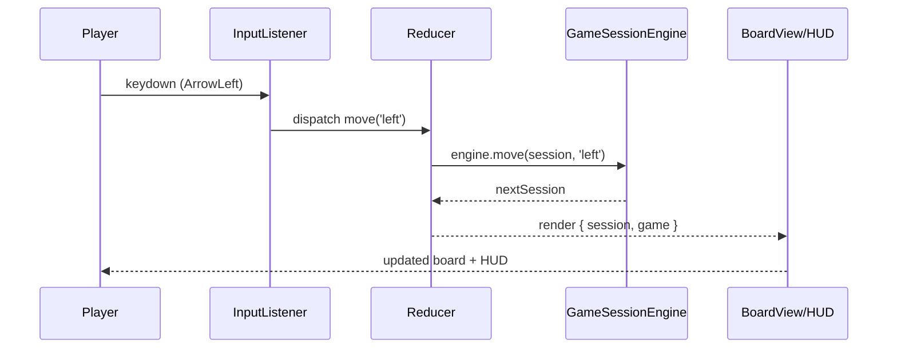
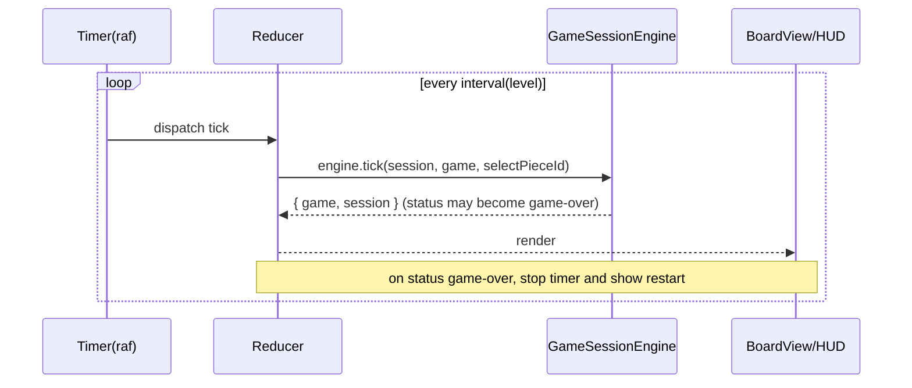

## Context

The browser app (`apps/pentix-web`) is currently a static foundation landing page (`src/App.tsx`) that imports the shared piece catalog and board size from `pentix-core` via the `#pentix/core` Vite alias (which points at `packages/pentix-core/src/index.ts`). The shared package already exposes everything needed to play a game locally:

- `createPentixGame` and `createPentixGameSession` to build an opening state,
- `gameSessionEngine` with pure `move`, `rotate`, `tick`, and `drop` operations,
- `Piece` and `getOccupiedOffsets` to compute the active piece's occupied cells,
- `DEFAULT_BOARD_SIZE` (12×22) and `BoardSnapshot` for rendering.

`PentixServer` exposes equivalent REST endpoints, but its state is in-process memory that requires the server to be running, and server-driven play is a separate later goal. The web app already contains empty placeholder directories (`src/engine`, `src/games/pentix`, `src/ui`) that outline the intended structure for this work.

Constraints: strict TypeScript, React 19 function components, Vite, ESLint, and no router. The repo's metadata lists Vitest/Playwright as the intended test stack, but the current test runner is Node's built-in `node --test` against shared/server code — the browser UI has no test harness yet.

## Goals / Non-Goals

**Goals:**

- A playable, self-contained game in the browser (no server required) driving the shared `pentix-core` engine.
- Render the shared board with occupied cells and the active piece overlay.
- Keyboard and on-screen controls for move, rotate, soft drop, hard drop, pause, and start/restart.
- A gravity loop (`tick`) whose cadence speeds up with level.
- A HUD showing score, level, cleared lines, and a next-piece preview.
- A start / pause / game-over / restart lifecycle driven by session `status`.

**Non-Goals:**

- Server-driven or multiplayer play, persistence/resume, and account integration.
- Touch/gesture input, sound, or comprehensive visual polish beyond readability.
- Any changes to `pentix-core`, `pentix-server`, or the existing REST contract.

## Decisions

1. **Client-local engine, not the REST API.** The UI calls the shared engine directly and never speaks to `PentixServer`. The engine is pure and stateless and is already wired into the web app through the `#pentix/core` alias, so a game works with only `npm run dev:web`. *Alternative considered:* drive `PentixServer` over HTTP — rejected because it requires a running server whose state is ephemeral and non-durable, which would lose the game on refresh and pull server deployment concerns into this UI change.

2. **Game state is a React reducer.** Component state holds `{ phase, game, session }` where `phase` is `'ready' | 'playing' | 'paused' | 'game-over'`. Every input action calls the pure engine and stores the returned `{ game, session }` (immutable values), so the UI has a single source of truth and future pause/resume or undo is trivial. *Alternative considered:* an imperative loop that mutates refs outside React — rejected for React 19 idiom cleanliness and testability.

3. **Gravity via a self-correcting timer.** A timer computes its interval from `session.statistics.level` (higher level → shorter interval, e.g. `base - (level - 1) * step`). Pausing clears the timer; resuming restarts it from the current level. `requestAnimationFrame` with an accumulator is preferred so background-tab throttling does not freeze the game silently, but the reducer stays independent of the clock implementation.

4. **One projection helper owns screen coordinates.** A single pure helper maps a `PentixGameSession` into a render grid: it colors occupied `board.rows` cells by `pieceKey` and overlays the active piece by translating `session.activePiece.origin` + `piece.occupiedOffsets` into `(row, column)` cells. This centralizes the one subtlety — the engine's offset `y` increases downward while `board.rows[row]` already matches — and makes it unit-testable.

5. **Input is pass-through to the engine.** `ArrowLeft`/`ArrowRight` → `move('left'|'right')`, `ArrowUp`/`z` → `rotate('clockwise')`, `ArrowDown` → soft drop (`tick`), `Space` → `drop`, `p` → pause/resume, `r` → restart. Keys are mapped to engine calls rather than reimplementing rotation semantics (note: clockwise is `-90` in the shared engine), so behavior stays consistent with the server.

6. **Pluggable piece selection for tests.** `createPentixGame` accepts a `selectPieceId`; the web app injects the default random selector in production but can inject a seeded/deterministic one for any future component tests.

## Risks / Trade-offs

- [Gravity timing can drift when a tab is backgrounded] → use a rAF accumulator and recalc the next tick from current level; acceptable for v1.
- [Active-piece overlay must match engine row/column semantics] → isolate the projection in one helper and cover it with unit tests.
- [Rotate direction is easy to get backwards] → pass through to `gameSessionEngine.rotate` and add an explicit keybinding note rather than re-deriving angles.
- [No persistence] → refresh resets the game; explicitly out of scope and documented in the HUD/start state.

## Migration Plan

The change is additive within `apps/pentix-web`. Deploy by merging the web app changes; `npm run dev:web` and `npm run build:web` continue to work unchanged (the `#pentix/core` alias is already configured). Rollback: revert the `apps/pentix-web` files and restore the foundation landing page; `pentix-core` and `pentix-server` are untouched, so rollback is isolated.

## Open Questions

- Keep the foundation landing summary as the pre-game "ready" screen, or remove it entirely? (Working assumption: retain a compact foundation summary as the ready state so the start screen is not blank.)

## Sequence Diagrams

