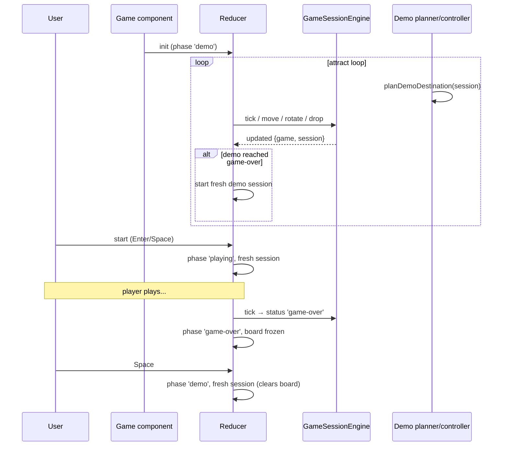

## Context

The browser client (`apps/pentix-web`) is a React app that drives a local `PentixGameSession` through the shared `gameSessionEngine` from `packages/pentix-core`. Its reducer (`apps/pentix-web/src/engine/gameReducer.ts`) owns four phases — `ready | playing | paused | game-over` — initializing in `ready`. A gravity loop (`useGameLoop.ts`) runs only while `phase === 'playing'`, and `useKeyboardControls.ts` maps keys to reducer actions via `keyMap.ts`. On game-over the session snapshots a failed spawn active piece, which `projection.ts` still draws over the frozen board beneath a blocking overlay.

The original Delphi client (`delphi/Tetris.pas`, `delphi/Demo/Pentix/Main.pas`) ran a demo mode when no real game was active: the `toDemoOnWait` option (default on) made `WaitGame` call `StartDemo`, which played a local game, and `CalcDemoDest` chose a target angle/column per piece; `GameOver` restarted the demo automatically, and any key after game-over discarded the player's frozen board and re-entered the demo.

## Goals / Non-Goals

**Goals:**

- Restore an attract/demo mode that auto-plays on first load and re-enters after game-over.
- Port the Delphi destination heuristic and steering behavior faithfully so the demo "imitates user actions."
- Preserve a player's final board after game over and make re-entering the demo a deliberate action (Space).
- Keep the demo purely local: no server calls, no persistence, no session-replay logging.

**Non-Goals:**

- No `DemoOnWait`/`DemoScoring` settings toggles (demo is always on; a preference can come later).
- No changes to server (`pentix-server`), storage, or `session-replay`.
- No changes to existing shared engine operations (`move`/`rotate`/`tick`/`drop`) or their semantics — the demo is a new consumer of them.

## Decisions

### 1. Add a `demo` phase instead of keeping `ready`

`GamePhase` becomes `demo | playing | paused | game-over`; `createInitialState` defaults to `demo`. This matches Delphi (construct → `tsWaitGame` → `StartDemo`) and removes a dead "Ready" overlay state. The demo is the attract state and behaves like playing (gravity + rendering), so it reuses the same rendering/HUD path rather than a separate view.

### 2. Implement the destination planner in `pentix-core` (`demo.ts`)

The Delphi `CalcDemoDest` is a pure function of board occupancy and the active piece. Porting it to `packages/pentix-core/src/demo.ts` (exported `planDemoDestination(session): { angle, column } | null`) keeps collision logic in one place and lets `tests/pentix-core.test.mjs` cover the heuristic without React. The planner reuses the placement/collision helpers currently private to `session-engine.ts`, so those helpers (`checkPlacement`/`canPlace`/`getOccupiedCells`/`getActivePiece`) are extracted into an internal `placement.ts` module imported by both `session-engine.ts` and `demo.ts`. Only `planDemoDestination` is added to the public `index.ts` surface.

*Alternative considered:* put the planner in `apps/pentix-web`. Rejected — it would duplicate collision logic (violating the "shared engine, no local re-implementation" rule) and be harder to unit-test.

### 3. Map the destination to a single reducer action in the web layer

`apps/pentix-web/src/engine/demo.ts` exposes `nextDemoAction(session): GameAction | undefined`, a pure port of the Delphi `TimerExpired` demo branch: return `rotate` if the angle differs, `move left/right` if the column differs, or `drop` once aligned. Returning an action (rather than mutating the session) keeps the demo flowing through the ordinary reducer/engine path and makes it testable like `keyMap.ts`.

### 4. Run the demo controller on the gravity cadence

Gravity already advances via `engine.tick`. The demo extends `useGameLoop` to run for `phase === 'playing' || phase === 'demo'`, and a new `useDemoController` hook applies one steering action per gravity interval while `phase === 'demo'`. This mirrors Delphi (`TimerExpired` moves down, then steers one step per tick) and avoids a busy frame loop dispatching redundant no-ops.

*Alternative considered:* steer every animation frame. Rejected — it would spam dispatches and diverge from the Delphi pacing.

### 5. Handle demo auto-restart deterministically in the reducer

When a `tick`/`drop` during `phase === 'demo'` produces `status: 'game-over'`, the reducer immediately returns a fresh demo session (`createSessionBundle` → `phase 'demo'`) rather than a `game-over` phase. This mirrors Delphi `GameOver` (`if tsDemo then StartGame(True)`) and keeps the restart logic unit-testable. The player-facing `game-over` phase is only produced when `phase === 'playing'`.

### 6. Preserve the final board on game-over

`projection.ts`/`BoardView` stop overlaying the active piece when `session.status === 'game-over'` (the failed spawn piece is cleared), leaving only the locked board. The game-over overlay becomes translucent/compact so the frozen board stays visible, and its hint documents "Space — demo" and "Enter — play again". `keyMap.ts` maps Space in `game-over` to a new `demo` action and keeps Enter/R for a fresh player game.

## Risks / Trade-offs

- [The demo is visibly suboptimal] → Mitigation: intentional — it mirrors Delphi, which emits one steering step per gravity tick; the planner's destination is reachable by construction.
- [Extracting collision helpers from `session-engine.ts` could regress engine behavior] → Mitigation: pure refactor; the existing `tests/pentix-core.test.mjs` suite must stay green, and helper signatures are preserved.
- [Replacing `ready` with `demo` changes initial-state expectations] → Mitigation: update `tests/pentix-web.test.mjs` (the `default settings` test currently asserts `phase === 'ready'`) and any UI copy that references "Ready".
- [Demo re-entering on Space could conflict with Space-as-hard-drop muscle memory] → Mitigation: Space only means demo in the `game-over` phase; during play it remains hard drop, matching the existing key map and Delphi's Space = drop.

## Migration Plan

1. Add core `demo.ts` + extract `placement.ts`; export `planDemoDestination`; rebuild `pentix-core` (`npm run build:core`); add core tests.
2. Add web `engine/demo.ts`, `useDemoController`, reducer `demo` phase/action + auto-restart, updated `keyMap.ts` and `Game`/`BoardView` presentation; add web tests.
3. Update the in-app hint copy and any README/settings text; run `npm run lint` and `npm test`.
4. Rollback strategy: revert the `demo` phase to `ready` defaults, delete the demo modules/exports, restore the blocking overlay and Space→start mapping (see proposal Impact).

## Open Questions

- Should the demo rotate in the player's configured direction or a fixed clockwise direction? (Recommended: reuse the configured direction; modulo-90 convergence is unaffected. Confirm during implementation.)
- Demo gravity speed: reuse the level-based intervals starting at the configured starting level (recommended) — no separate "demo speed" is needed for parity.