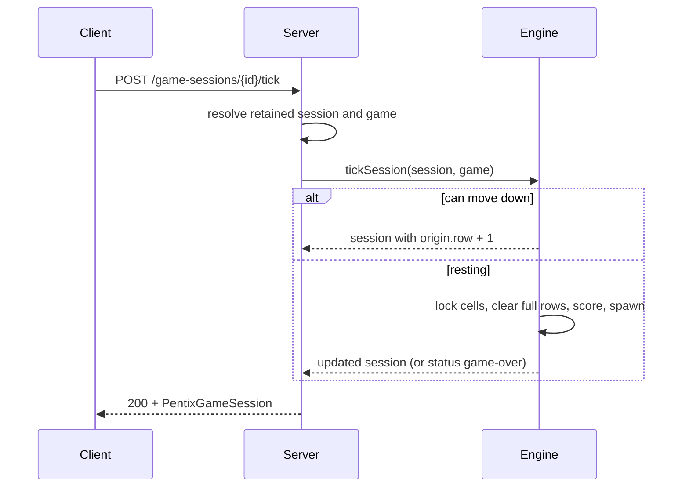

## Context

`pentix-core` can create games and sessions and advance a piece preview, but a session's board never changes after creation: there is no movement, rotation, locking, line clearing, scoring, or game-over. The Delphi source `delphi/Tetris.pas` defines the authoritative playfield behavior (collision precedence, rotation with near-wall kicks, spawn origin, line clearing), which this change ports onto the existing `Piece`/`Board`/`PentixGameSession` primitives.

## Goals / Non-Goals

**Goals:**

- Add pure, shared gameplay functions for move, rotate, tick, hard drop, locking, line clearing, scoring/leveling, spawning, and game-over.
- Preserve Delphi movement, rotation, collision, spawn-origin, and line-clearing semantics.
- Expose gameplay as `POST` endpoints that return the complete updated session snapshot.
- Track score, cleared lines, and level in the existing `statistics` object.

**Non-Goals:**

- A server-side timer or automatic gravity; ticks are client/server request driven.
- Durable persistence, history, or restart-safe resume.
- Multiplayer coordination beyond sharing a game's piece sequence.
- Browser rendering; this change only defines the server/domain contract.

## Decisions

### 1. Pure functions over immutable snapshots
The engine is a set of pure functions that take a `PentixGameSession` (and parent `PentixGame` when the sequence must extend) and return new frozen snapshots, mirroring `advancePentixGameSession`. The active piece stays separate from the board: the board holds only locked minos, and the active piece is described by `key`, `angle`, and `origin`. Occupied cells are computed by rotating the piece's catalog offsets with the existing `getOccupiedOffsets` and adding the origin.

Alternative: a mutable `GameEngine` class holding live state. Rejected because the session snapshot is the single source of truth the server persists, and pure functions keep tests deterministic.

### 2. Port Delphi collision and rotation semantics exactly
A placement is valid when every occupied cell is in bounds and unoccupied, matching `CheckBlockOfsAnglePos` (left/right/top/bottom walls and buried cells). Rotation uses Delphi's step (`clockwise = angle - 90`, `counterclockwise = angle + 90`, normalized by rotation mode) and applies near-wall kicks on wall collisions: right → `column = width - maxX - 1`, left → `column = -minX`, top → `row = -minY`, where the extremes are taken over the rotated offsets. Movement only mutates the origin when the target placement is valid.

### 3. Settling = lock, clear, score, spawn; a drop defers locking
A tick moves the active piece down one row, or settles it when blocked. Settling buries the active piece's cells into the board, removes full rows (shifting rows above down), updates score/level, then spawns the next piece from the game sequence at row `1`, column `floor(width / 2)`. If the spawn placement is blocked, the session's `status` becomes `'game-over'`.

A drop instead moves the piece to its lowest valid position without locking, mirroring the demo's `toMoveAfterDropDown` option: `FastDropDown` resets the tick timer rather than calling `EndWayBlock`. The piece therefore stays move/rotate-able until the following tick locks it.

### 4. Extend status, keep the active piece non-null
`GameSessionStatus` becomes `'active' | 'game-over'`. On game over the session keeps the failed spawn as its active piece and its post-settle board/statistics, so the snapshot stays well-formed without making `activePiece` nullable.

Alternative: clear the active piece on game over (as Delphi clears `FBlock`). Rejected because it would require a nullable active-piece field and a wider breaking change.

### 5. Port the Demo/Pentix scoring and level rules
`Demo/Pentix/Main.pas` defines the scoring: a lock scores `points × level`, a drop scores `points × (height − row) × level ÷ 10` (integer division), and each cleared line scores `lineIndex × (10 + (height − row)) × level`, with a `1000`-point bonus when clearing empties the field. Level advances by `1` every `30` locked pieces up to `9` (`BlocksForLevel = 30`, `MaxLevel = 9`). The shared `Piece.points` (its mino count, 1–5) is used as the per-piece points value; the demo's `TBlockDesc.Points` defaults to `0` and is not set by `SetDefaults`, so mino count keeps the formulas non-degenerate.

### 6. Request-driven gameplay endpoints
The server adds `POST /game-sessions/{id}/move` (`{ direction: "left" | "right" }`), `POST /game-sessions/{id}/rotate` (`{ direction: "clockwise" | "counterclockwise" }`), `POST /game-sessions/{id}/tick`, and `POST /game-sessions/{id}/drop`. All are state-changing `POST`s returning the updated snapshot, consistent with `next-piece`. The existing `next-piece` endpoint remains for bootstrap compatibility.

## Risks / Trade-offs

- [Piece points default to 0 in the demo] → Use the shared `Piece.points` (mino count) as the per-piece points value; document this as the chosen interpretation.
- [Drop when already resting] → Delphi locks immediately via `FastDropDown`; our model defers to the next tick; document the simplification.
- [No server timer means no automatic gravity] → Document that pacing is client-driven; add a server timer only when a real-time mode is designed.
- [`next-piece` overlaps spawn semantics] → Keep it for compatibility but route real play through tick/drop; reconcile or retire it in a later change.
- [Near-wall kick edge cases] → Port the exact Delphi three-case kick and add focused unit tests per wall.
- [Game-over leaves a non-null active piece] → Document that the active piece is the failed spawn; the non-null invariant avoids a wider contract change.

## Migration Plan

1. Add the engine module to `pentix-core`, extend `GameSessionStatus`, export the new functions, and cover movement/rotation/line-clear/scoring with core tests.
2. Add gameplay routes and validation to `PentixServer` and persist updated game/session snapshots through the lifecycle service.
3. Add server integration tests, update README/foundation docs, and run build, test, and lint.

Rollback follows the proposal: remove the engine and routes and restore the single-value status and prior boundary wording. There is no persisted data to migrate.

## Open Questions

No blocking questions remain. A server-side tick timer, the demo's `show next` scoring-halving option, and retiring the bootstrap `next-piece` endpoint require separate product decisions and are intentionally not settled here.

