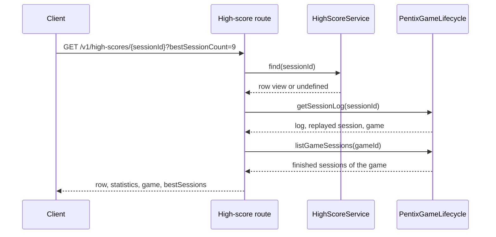

## Context

`HighScoreService` keeps the best `1000` finished sessions for each user type in
memory. A row already carries the session id, the user id, the user name, the
user type, the score, and the achievement date. The HTTP list view carries
`sessionId`, `name`, `score`, and `achievedAt`.

`PentixGameLifecycle.load` reads every stored `SessionActionLog`, finds its
`PentixGame`, and replays the log through the deterministic engine. The
lifecycle keeps the rebuilt `PentixGameSession` values, the source logs, and the
games in memory. A demo game creates one session for every registered engine, so
one game usually holds nine sessions that share a piece sequence.

The API uses zod schemas in `apps/pentix-server/src/api/schemas.ts` for both
validation and the OpenAPI document. Every path carries the `/v1` prefix from
`versionedPath`. The server has no session read route, and the browser client
has no high-score table yet.

## Goals / Non-Goals

**Goals:**

- One read-only request answers every value that an expanded high-score row
  needs. Those values are the row, the session statistics, the stored game, and
  the best sessions of that game.
- A client can start a human game on the same piece sequence from the response.
- A client can replay the best sessions on demo boards from the response,
  because each entry carries its engine id and its stored action log.
- The change stays additive and needs no data migration.

**Non-Goals:**

- The high-score table UI, the expanded row, and the demo boards. This change
  prepares the API only.
- A new write endpoint for a human replay. `POST /v1/game-sessions` already
  accepts a `gameId`.
- Paging, search, or filtering over the high-score table.
- A public read of an arbitrary session that is not a high-score row.
- A change to the high-score table size or its ranking rules.

## Decisions

### Decision: One detail route under the high-score resource

The route is `GET /v1/high-scores/{sessionId}`. A high-score row is the entry
point in the planned table, and the row identifies its session. One route keeps
the expand action to one request.

Alternatives considered:

- `GET /v1/games/{id}/sessions` needs a second request for the row values and
  needs the client to resolve the game id first.
- `GET /v1/game-sessions/{id}` names the session rather than the table, so the
  client would call it for a row that the table already returned. The same
  response would then serve callers outside the table, which this change does
  not need.

### Decision: The list entry gains `sessionId` only

`GET /v1/high-scores` adds `sessionId` to every entry. The field already exists
in `HighScoreEntry` and in the `high_scores` table, so the change opens one
stored value to the client and stores nothing new.

`gameId` stays out of the table row. The detail response carries it, and a
stored `game_id` column on `high_scores` would duplicate a value that the
session log already owns.

### Decision: The detail reads lifecycle memory

The lifecycle already holds the replayed session, the source `SessionActionLog`,
and the `PentixGame` for every stored session. The detail route reads those
maps through new read methods. It does not query the repositories and does not
replay a log again.

Alternatives considered:

- A repository query for one session and for the sessions of one game needs a
  new `GameSessionRepository` method and a second copy of the replay step.
- A read of the SQLite `pieces` JSON column would put storage-specific parsing
  in the request path.

The detail cost is one row lookup plus one scan over the in-memory sessions.
The best-session limit caps the response, and the scan never grows past the
number of sessions that one game holds.

### Decision: A finished demo run retains its sessions in the lifecycle

`DemoRunService` writes each game and session straight to the repositories, and
the lifecycle loads its maps only at startup. A detail read after a run would
therefore miss the run's sessions. The run now passes every finished session to
`PentixGameLifecycle.retainSession` after the run stores the session log and the
high-score row. The lifecycle then holds the session, its log, and its game, and
the detail route still reads memory only.

Alternatives considered:

- A repository fallback in the detail builder needs new session query methods
  and a replay step in the request path.
- A lazy reload of the lifecycle maps duplicates startup work and changes the
  working set during a request.

### Decision: Best sessions rank like the high-score table

`bestSessions` keeps finished sessions of the same game only. It orders them by
`score` descending, then achievement date ascending, then session id ascending,
which is the high-score table order. The date comes from the high-score row when
that row exists. Otherwise it comes from the UUIDv7 timestamp of the session id,
the same fallback that the backfill uses.

### Decision: The human replay uses the existing session route

The detail response carries the stored `PentixGame`. A client sends its `id` to
`POST /v1/game-sessions` with a human user, and the lifecycle opens a new session
on that game. The new session starts from the game's stored board and piece
sequence, so the human plays the same game again. A new route would duplicate
`createSession`.

### Decision: `bestSessionCount` bounds the response

The query parameter `bestSessionCount` is optional. Its default is `9`, which is
one session per built-in engine. Its accepted range is `1` to `32`, and another
value answers `400 Bad Request`. The cap keeps one request from returning every
stored session of a large game and gives the client one predictable payload.

### Decision: The detail packs the replay inputs

The detail carries a replay, not a live session. The compact shapes therefore
replace the full `BoardSnapshot` and the full log objects:

- `statistics` drops `pieceCounts`.
- `game.board` is one row-major `0`/`1` line.
- `game.pieceIds` is one base64 byte per id.
- `bestSessions[].actions` aligns with `game.pieceIds`, and an AI entry drops
  every `T`.

Alternatives considered:

- A per-piece object repeats a piece id that `game.pieceIds` already carries.
- A base64 board is shorter than a `0`/`1` line, but the line stays readable
  and one character maps to one cell.
- A hex piece sequence doubles the size of base64 and adds no clarity.
- Keeping `T` in an AI log repeats a tick that demo playback derives from the
  action cadence.

The piece catalog keeps every id below `255`, so one byte holds each id. The
response schema and `docs/foundation.md` state the decoding rules for a client.

### Decision: Only the detail response is compact

The game and session routes serve the live client. That client draws the board
and reads each cell, so those routes keep the full `BoardSnapshot` and the full
session statistics. The detail is the only response that carries a stored game
and stored logs, and it is the only one that needs the compact form. The
high-score list response already carries only scalars.

Further savings considered and rejected:

- A shared name or date map saves little and makes each entry depend on another
  field.
- A compact board on the session routes would shrink every gameplay response.
  The live client draws cells and would decode the board on every action.
- A compressed body belongs to the transport layer, not to this contract.

### Decision: A missing row or log answers `404`

The route answers `404 Not Found` when the high-score table has no row for the
session id. It answers `404` when the row exists but the lifecycle holds no log
for that session, because the response cannot carry a replay without it.
Malformed ids and out-of-range counts answer `400 Bad Request`.

## Request flow

## Risks / Trade-offs

- A large log set makes a large response. → The `bestSessionCount` cap of `32`
  bounds the count, and only finished sessions enter the list.
- Lifecycle memory is the authority for the detail read, so a second server
  process that writes the same SQLite file is not visible. → The server already
  treats its in-memory set as the working copy, and one process per data file is
  the current deployment model.
- A demo engine may leave the registry after a run. → The response still carries
  the stored `engineId` and `name`. The client can show the row, and it can
  replay only an engine that it can resolve.
- The achievement date can differ between a stored row and the UUIDv7 fallback.
  → The row value wins whenever the row exists, so a table row and its detail
  agree.
- A strict generated client may treat a new response field as a change. → The
  field is additive JSON, and existing clients ignore it.
- A client that reads a packed board or a base64 piece sequence needs a decoder.
  → The schemas, `README.md`, and `docs/foundation.md` state both formats.
- An AI action list has no `T` codes. → Each entry carries `type`, and demo
  playback adds the tick after each action and after the log ends.
- A stored log whose piece ids do not follow the game sequence cannot align with
  `game.pieceIds`. → The server writes every log from piece index `0`, and the
  contract test asserts the alignment.

## Migration Plan

1. Add the schemas, the service lookup, the lifecycle read methods, and the
   route in one release.
2. Add the contract tests and the OpenAPI route set check in the same release.
3. Deploy the server. No data migration runs, and an older data file works as
   it is.
4. Update `README.md`, `docs/foundation.md`, and the API reference.
5. Roll back by reverting the release. No stored row, log, or game changes, so
   the rollback loses no data.

## Open Questions

- None. This design fixes the default count, the ranking, the 404 behavior, and
  the human replay route above.
