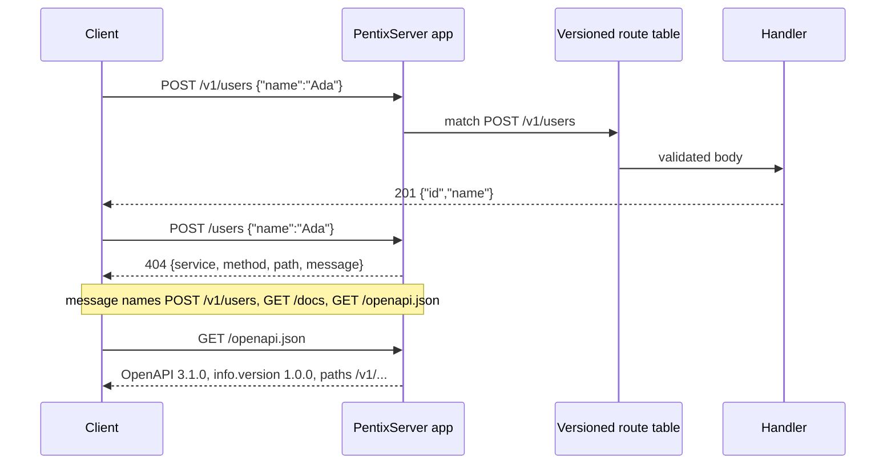

## Context

`apps/pentix-server/src/api/routes.ts` declares twelve operations with `createRoute`, and `createPentixApp` registers them through `app.openapiRoutes(buildPentixRoutes(...))`. Every path is a literal such as `/games` or `/game-sessions/{id}/move`. `apps/pentix-server/src/api/docs.ts` serves the generated document at `GET /openapi.json` with `info.version` `0.1.0`, and a Swagger UI at `GET /docs`. `apps/pentix-server/src/app.ts` holds a hand-written `NOT_FOUND_MESSAGE` that lists the twelve paths.

Constraints that shape this design:

- The document is generated from the route configs, and a contract test compares the documented `METHOD /path` pairs with `listPentixRouteKeys()`. The path string in each config is therefore the only place that can own the prefix.
- Hono 4.13 routes by exact path, and `OpenAPIHono` keeps its document registry per application instance. A prefix that is applied outside the route files would not appear in the document unless it is also written into the paths.
- Tests run through `node --test` over HTTP against `apps/pentix-server/dist` and assert exact status codes. Every test that calls an endpoint uses the path literal.
- The browser client does not call the server, so no client code needs a coordinated release.
- The repository already documents the API in `README.md`, `docs/foundation.md`, and several capability specs. All of them name the unprefixed paths.

## Goals / Non-Goals

**Goals:**

- One visible major version in the URL of every API endpoint.
- One constant that owns the version, so a future version needs no hunt through route strings.
- The OpenAPI document reports the version and lists the versioned paths exactly as the server serves them.
- The `404` fallback names the real versioned endpoints, without a second hand-written list that can drift.
- A published version stays stable. A breaking contract change goes to a new prefix.

**Non-Goals:**

- Multiple simultaneous versions in this change. `/v1` is the only version, and no `/v2` routes exist yet.
- Header-based or media-type content negotiation. The path carries the version, and no `X-Api-Version` request header is read.
- An alias, redirect, or deprecation window for the unprefixed paths. They stop answering.
- Per-version Swagger UI pages or a `/v1` index endpoint.
- Minor and patch versions in the URL. Additive changes that keep the contract stay inside `/v1`.
- Any change to payload shapes, status codes, error envelopes, gameplay rules, or storage.

## Decisions

### 1. A major version is a path segment: `/v1`

Every REST endpoint moves from `<path>` to `/v1<path>`. A client reads the version from the URL it already sends, and no header negotiation is needed.

Rejected alternatives:

- **`X-Api-Version: 1` request header.** It keeps paths stable, but the version becomes invisible in logs, browser URLs, and the Swagger UI. It also needs a `Vary` policy and a fallback rule for a missing header.
- **`Accept: application/vnd.pentix.v1+json`.** It is the most REST-pure option, but it needs content negotiation in every route, breaks the plain `application/json` contract that tests assert, and no current client sends the vendor type.
- **`/api/v1/...`.** The extra `api` segment adds no information and breaks the repo's flat path style for no gain.
- **A `?version=1` query parameter.** It mixes version selection into every operation's query space and disappears from the documented path.

### 2. One module owns the version, and route configs build their paths from it

`apps/pentix-server/src/api/version.ts` exports:

```ts
export const API_VERSION = '1'
export const API_BASE_PATH = `/v${API_VERSION}`
export const API_DOCUMENT_VERSION = `${API_VERSION}.0.0`
export function versionedPath(path: string): string
```

`routes.ts` calls `versionedPath('/games')` and similar for every config. `docs.ts` imports `API_DOCUMENT_VERSION` and `API_BASE_PATH`. `app.ts` renders the fallback message from `listPentixRouteKeys()` and the two documentation path constants.

Rejected alternatives:

- **Mount a sub-application at `/v1` with `app.route('/v1', apiApp)`.** The sub-app owns its own document registry, so the generated document would need a merge step or the parent route registration would need to repeat the paths anyway.
- **Rewrite `c.req.path` in middleware before routing.** Hono matches routes before the handler runs, and the document would still publish the unversioned paths.
- **Duplicate each config with a prefix string.** Twelve copies of `/v1` is the drift this change removes.

### 3. Documentation endpoints stay unversioned

`GET /docs` and `GET /openapi.json` keep their paths and describe the current version. The document's `info.version` becomes `1.0.0`, and every operation path carries `/v1`.

Rejected alternatives:

- **`/v1/docs` and `/v1/openapi.json`.** The console is a server-level tool, and a versioned console duplicates the Swagger UI wiring for every future version. The console can show the newest document without a second page.

### 4. Unprefixed and unknown-prefix paths answer the `404` fallback

`POST /users` and `POST /v2/users` both reach `app.notFound` and return the existing `{ service, method, path, message }` envelope with status `404`. The message names the `/v1` endpoints, `GET /docs`, and `GET /openapi.json`. No redirect, alias, or dual registration exists.

Rejected alternatives:

- **A `308` redirect from `/users` to `/v1/users`.** A redirect hides a forgotten version prefix, and clients then keep calling the old path.
- **`410 Gone` for unprefixed paths.** The unprefixed paths were never a published version, so `410` would claim a retirement that did not happen.
- **Serving both forms.** A dual surface doubles the route table, complicates the document contract test, and lets a client ignore versioning indefinitely.

### 5. A versioned path is a policy boundary

Within `/v1`, additive changes are allowed: a new optional request field, a new response field, or a new endpoint. A change that removes or renames a field, changes a type, or changes a status code for an existing request ships under a new major prefix. The old prefix keeps its handlers and its document entry, so a client upgrades on its own schedule.

### 6. Request flow



## Risks / Trade-offs

- **Every existing API client breaks at once** → Accepted and explicit. The change is marked BREAKING, the fallback message names the `/v1` paths, and no shipped client calls the server.
- **A forgotten prefix in one route string creates a mixed API** → All twelve configs go through `versionedPath`, and a test asserts that every key from `listPentixRouteKeys()` starts with `API_BASE_PATH`.
- **The `404` message drifts from the route table** → Build the endpoint list from `listPentixRouteKeys()` instead of a hand-written string. A test asserts the message names a versioned path, `/docs`, and `/openapi.json`.
- **The document and the routes disagree after the move** → The existing contract test compares the documented operations with the registered routes. It now fails on an unversioned path in either place.
- **A future `/v2` copies the handlers** → Handlers stay version-independent. A later version can register the same handlers under new paths or add new ones, and the version module already provides the prefix seam.
- **`info.version` was never asserted and can rot** → The document test asserts `1.0.0`, and `docs.ts` builds the value from `API_VERSION` instead of a literal.
- **Swagger UI keeps an old document in the browser** → The document is generated per request and carries no cache directive, so a reload reads the current paths.

## Migration Plan

1. Add `apps/pentix-server/src/api/version.ts` with the version constant, the base path, the document version, and `versionedPath`.
2. Wrap all twelve route paths in `routes.ts` with `versionedPath`, and keep registration order and handlers unchanged.
3. Update `docs.ts` to use `API_DOCUMENT_VERSION` and to name `API_BASE_PATH` in the description.
4. Update `app.ts` to build the fallback message from `listPentixRouteKeys()`, `API_REFERENCE_PATH`, and `API_DOCUMENT_PATH`.
5. Update every path in `tests/pentix-server.test.mjs` to `/v1/...`, then add the prefix, unknown-prefix, document-version, and fallback-message tests.
6. Run `npm run build`, `npm test`, and `npm run lint`.
7. Update `README.md`, `docs/foundation.md`, and `GLOSSARY.md`.
8. Start the server, open `/docs`, and execute `POST /v1/users` and `GET /v1/users` as the manual acceptance check.

Rollback restores the literal paths, the `0.1.0` document version, and the hand-written message. No stored data changes, so rollback needs no migration.

## Open Questions

- Should a future version keep the old prefix in the same process, or run both versions as separate deployments? Deferred until a real breaking change exists. This change only guarantees that `/v1` paths are the single current contract.
- Should the `404` fallback use `410 Gone` after a documented retirement window? Deferred. The server has no retired version yet.
