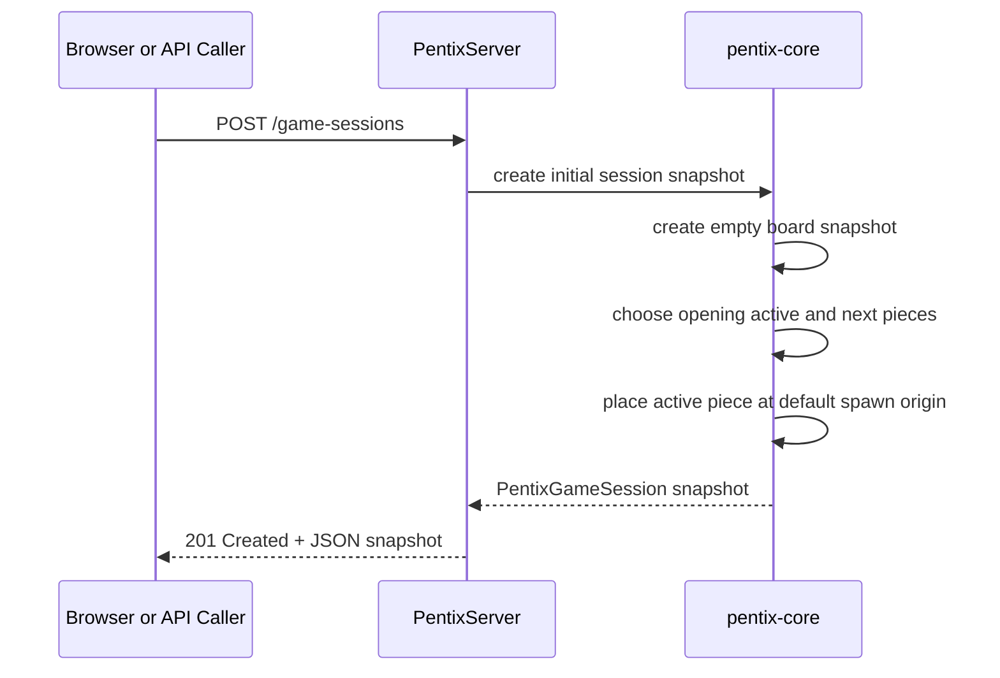

## Context

The current repository has the minimum building blocks for future gameplay work:

- `packages/pentix-core` exports shared `Board`, `BoardCell`, `Piece`, and catalog primitives.
- `apps/pentix-server` boots a Node.js HTTP server but only returns a generic "not implemented yet" response.
- the browser app can preview the shared catalog, but it has no contract for a live `PentixGameSession`.

The next useful slice is the first server-owned session snapshot. It needs to be small enough to fit the current bootstrap architecture, but concrete enough that later move, tick, scoring, and persistence changes can extend it instead of replacing it.

This change also has one architectural constraint: the new session-start payload has to cross a JSON boundary. Reusing the current `Board` and `Piece` classes directly would couple the API to runtime-only objects rather than a stable serialized contract.

## Goals / Non-Goals

**Goals:**

- Define a shared, JSON-serializable `PentixGameSession` snapshot contract in `pentix-core`.
- Add one server endpoint that starts a new single-player session and returns the initialized snapshot.
- Initialize each new session with an empty default board, zeroed opening statistics, an active piece, and a next-piece preview.
- Keep the implementation deterministic enough for automated tests without locking the project into a final randomizer design.

**Non-Goals:**

- Persist sessions between requests or support resume/reconnect flows.
- Implement movement, rotation input handling, gravity ticks, locking, line clears, or scoring progression.
- Introduce player accounts, multiplayer `PentixGame` orchestration, or history APIs.
- Finalize the long-term randomizer/bag algorithm beyond what is needed to produce the first active and next pieces.

## Decisions

### 1. Represent the API response as a shared serializable snapshot

Decision:
Add shared snapshot-style types in `pentix-core` for the session-start response instead of returning live `Board` or `Piece` class instances directly.

The session snapshot should include:

- an opaque session identifier,
- session status,
- board dimensions plus current board occupancy,
- opening statistics such as score, level, and cleared-line count,
- the active piece key/rotation/spawn origin,
- and the next piece preview.

Rationale:
The browser and server both need the same contract, but the contract has to survive JSON serialization. Snapshot types keep the API stable while allowing the existing `Board` and `Piece` classes to remain internal helpers for initialization logic.

Alternatives considered:

- Return the current `Board` and `Piece` class instances directly.
  Rejected because class instances are awkward across a JSON boundary and would leak implementation details.
- Keep the session DTO server-local and let the browser define its own shape later.
  Rejected because that would recreate the duplication boundary the shared package was added to prevent.

### 2. Start sessions with `POST /game-sessions`

Decision:
Expose the first supported gameplay endpoint as `POST /game-sessions`, returning `201 Created` with the initialized session snapshot as JSON.

Rationale:
This is the most natural RESTful collection shape for creating a new session. It also leaves room for future session-specific routes such as `/game-sessions/{id}` without committing to them in this change.

Alternatives considered:

- `POST /sessions/start`
  Rejected because it is more action-oriented than resource-oriented.
- `GET /game-sessions/new`
  Rejected because session creation is not a safe/idempotent read operation.

### 3. Use a deterministic default spawn layout with a small opening piece window

Decision:
Every new session should start with:

- the default shared board size,
- an empty board,
- score `0`,
- level `0`,
- cleared lines `0`,
- one active piece spawned at row `1` and the centered column `floor(width / 2)`,
- and one next-piece preview selected from the shared catalog.

Rationale:
This gives callers a meaningful first playable snapshot without dragging in move/tick logic or a long queue model. The explicit spawn formula is simple, testable, and compatible with the current catalog offsets.

Alternatives considered:

- Return only an empty board and defer the first active piece to a later endpoint.
  Rejected because callers would still not have a usable gameplay session.
- Return a longer preview queue or final bag/randomizer state.
  Deferred because the randomizer strategy is not yet part of the product contract.

### 4. Keep initialization logic in `pentix-core` and keep the server thin

Decision:
Implement session initialization as shared core logic that the server route calls, rather than building the initial snapshot inline inside the HTTP handler.

Rationale:
The opening session rules are gameplay-domain logic, not transport logic. Keeping them in `pentix-core` makes them reusable by the browser, easier to unit test, and less likely to drift once the client starts consuming the same rules.

Alternatives considered:

- Put all initialization logic in `apps/pentix-server`.
  Rejected because it would make the browser depend on duplicated knowledge about session shape and spawn defaults.
- Put session construction in the browser first and mirror it on the server later.
  Rejected because the server is intended to become the source of truth.

### 5. Do not store started sessions yet

Decision:
Generate and return a new session snapshot, but do not add persistence or even in-memory resume semantics in this increment.

Rationale:
This change is about defining the initial session contract, not about lifecycle management. Avoiding storage keeps the change narrow and prevents the API from accidentally implying durability or recoverability that does not yet exist.

Alternatives considered:

- Keep an in-memory session registry from the first increment.
  Rejected because it adds lifecycle semantics without any retrieval/update API to justify the complexity.

## Risks / Trade-offs

- `[Snapshot shape may evolve once movement starts]` The first session payload could miss fields later gameplay APIs want immediately. -> Mitigation: keep the snapshot centered on durable concepts like board state, active piece state, and basic statistics rather than transport-specific wrappers.
- `[Randomizer behavior is not final yet]` The first implementation may use a simple piece picker that later changes. -> Mitigation: only specify catalog membership plus active/next piece presence, not a final bag algorithm.
- `[Session IDs without storage can be misunderstood]` Callers may assume returned IDs are already resumable. -> Mitigation: document clearly that this increment creates fresh sessions only and does not yet support lookup or history.
- `[Spawn defaults could be contentious]` Later gameplay work may prefer a different spawn row or preview width. -> Mitigation: make the initial spawn rule explicit in the shared core and keep it easy to revise in a later focused change.

## Migration Plan

1. Add shared session snapshot types and initialization helpers to `packages/pentix-core`.
2. Add the `POST /game-sessions` route in `apps/pentix-server` and map its response to the shared snapshot.
3. Update server/core tests to verify the returned session shape and startup defaults.
4. Update docs and the bootstrap spec language so the server is described as narrowly functional instead of fully empty.

Rollback strategy:
Remove the shared session snapshot types and the server route, then restore the generic bootstrap-only server response and documentation.

## Open Questions

- Should the initial session snapshot expose a creation timestamp or seed, or should those wait until persistence/history work begins?
- Is one next-piece preview enough for the first browser integration, or should the project standardize on a longer preview queue before implementation starts?
- Should future gameplay commands target `/game-sessions/{id}` directly, or should they be nested under a broader `PentixGame` aggregate once multiplayer orchestration exists?
