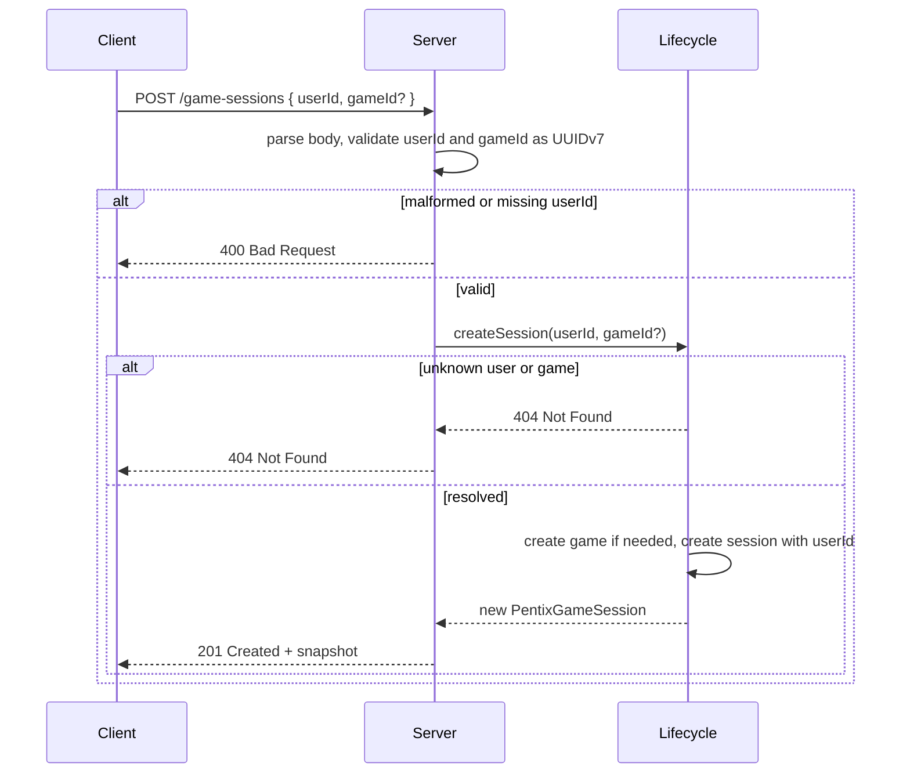

## Context

`pentix-core` models games and sessions, but no user concept exists: `PentixGameSession.userId` is always `null`, and `PentixServer` only exposes `POST /games`, `POST /game-sessions`, and `POST /game-sessions/{id}/next-piece`. The server's fallback response explicitly says player and history endpoints are not implemented.

This change adds a `User` entity, user management endpoints, and a required user on session creation so every session is attributed to a real user. It must stay strict TypeScript, JSON-serializable, and runnable under the existing Node test runner, and it must reuse the existing UUIDv7 generation and in-memory lifecycle patterns.

## Goals / Non-Goals

**Goals:**

- Model a JSON-serializable `User` with UUIDv7 identity and a required non-empty name.
- Support user creation (rejecting duplicate names), listing, and single-user lookup.
- Require a retained user on session creation so every session has an assigned `userId`.
- Retain users in process memory scoped to a server instance, consistent with games and sessions.

**Non-Goals:**

- User update/delete, authentication, passwords, or ownership enforcement.
- Durable persistence, history, or restart-safe resume.
- Session listing/lookup or multiplayer orchestration.
- Reassigning a session's user after session creation.

## Decisions

### 1. Add `User` to `pentix-core` with caller-supplied identity
`User` has `id` and `name`, created through a `createUser` factory that trims and validates both fields and returns a frozen snapshot. Identity is caller-supplied so tests stay deterministic, matching `PentixGame` and `PentixGameSession`. A user requires a non-empty name because a nameless user has no useful identity; games, by contrast, allow an empty name.

Alternative: model users server-side only. Rejected because the browser will also render user identity, and the shared package already owns all serializable domain contracts.

### 2. Make `userId` a required session field
`PentixGameSession.userId` becomes a required `string` holding a `User.id`. `createPentixGameSession` requires a `userId` option, validates it is non-empty, and stores it on the frozen snapshot.

Alternative: keep `userId: string | null` and add a separate assignment endpoint. Rejected because every session is created for a specific user, so a nullable field plus a follow-up request adds a state transition without adding information.

### 3. Require the user on session creation instead of a dedicated endpoint
User management uses the plural resources `POST /users`, `GET /users`, and `GET /users/{id}`, with `GET /users` returning `{ "users": [...] }` so the list payload can later gain pagination without a breaking shape change. `POST /game-sessions` requires a `userId` alongside the existing optional `gameId`, so one request both selects (or creates) its game and assigns its user.

Alternative: add a dedicated assignment endpoint after session creation. Rejected because it splits one logical creation step across two non-idempotent requests and lets a session exist without an owner.

### 4. Enforce unique user names on creation
A new user's `name` is trimmed and compared case-insensitively against every retained user's name. `POST /users` returns `409 Conflict` when a duplicate exists, so name-based lookup and display stay unambiguous.

Alternative: allow duplicate names and rely only on `id`. Rejected because a user's name is the primary human-facing identifier and duplicates would make lists and assignment confusing.

### 5. Retain users in the server-scoped lifecycle
The existing `PentixGameLifecycle` gains a `users` map plus `createUser`, `getUser`, and `listUsers` methods, keeping all state instance-scoped (no module globals). `createUser` rejects duplicates with `HttpError(409)`. Session creation resolves the supplied `userId` through the users map, raising `HttpError(404)` when it does not exist, and passes it into `createPentixGameSession`.

## Risks / Trade-offs

- [Users disappear on restart] → Document ephemeral retention alongside games and sessions; defer persistence to a later change.
- [Duplicate names are rejected only at creation] → Names are compared case-insensitively after trimming; rename (update) is out of scope for this increment.
- [`userId` references a `User` entity] → The field name already matches the `User` domain, so no rename is needed.
- [No ownership enforcement] → A caller can start a session for any known user; authentication is a separate, later concern.
- [Requiring a user breaks existing session-creation callers] → Mark the change breaking, update README and tests together, and require a valid `userId` in every documented example.
- [List payload shape may grow] → Use the wrapped `{ "users": [...] }` object so pagination or metadata can be added without breaking clients.

## Migration Plan

1. Add `User` to `pentix-core`, make the session factory require `userId`, export the new contracts, and cover them with core tests.
2. Extend the server lifecycle with the user map and user methods (including duplicate-name rejection), and require and resolve `userId` during session creation.
3. Add the three user routes, update `POST /game-sessions` validation, and update the fallback message.
4. Add server integration tests, update README and foundation docs, and run build, test, and lint.

Rollback follows the proposal: remove the user entity and routes, restore the optional `userId` and the previous endpoint list and boundary wording. There is no persisted data to migrate.

## Open Questions

No blocking questions remain. User update/delete, authentication and authorization, session reassignment, and durable user storage require separate product decisions and are intentionally not settled by this design.

