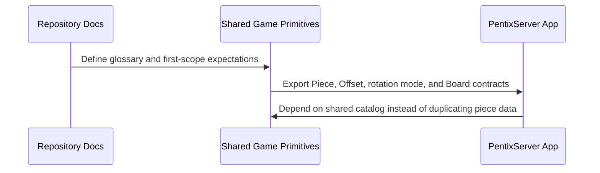

## Context

The current repository contains only the default React + Vite starter application at the root. The target product, however, requires:

- a `PentixServer` application,
- a browser-based Pentix application,
- and shared common code between them.

The first change should not attempt to implement players, PentixGames, history, scoring, or the browser UI. It should create the structural baseline that future changes can safely build on.

The legacy Delphi implementation in [Tetris.pas](/C:/ai/pentix/delphi/Tetris.pas) already defines the canonical piece set and rotation math:

- `TOfs` / `TOfsArray` describe mino offsets.
- `TBlockRotates` distinguishes `brNoRotate`, `br90`, and `brFullRotate`.
- `GetOffsetX` and `GetOffsetY` implement 0/90/180/270-degree rotation.
- `TBlockDesc.SetDefaults` defines the piece catalog from `bi1Line` through `bi5RMir`.

That Delphi file is the authoritative source for the initial port, with one important caveat: the legacy `bo5Corner` coordinates do not include an occupied `(0, 0)` mino even though the new domain request describes `(0, 0)` as the rotation-center mino. Leave it as in the legacy code.

## Goals / Non-Goals

**Goals:**

- Establish a repository structure that can host both the browser app and PentixServer without duplicating game-domain primitives.
- Define shared TypeScript primitives for pieces and boards using clear names such as `Offset` instead of Delphi-specific abbreviations.
- Preserve the legacy Delphi piece catalog and rotation behavior as the source of truth for the first port.
- Create an empty PentixServer application scaffold that can be started and extended in later changes.
- Replace starter documentation with Pentix-specific repository documentation.

**Non-Goals:**

- Implement player management endpoints.
- Implement PentixGame creation, game history persistence, or piece-sequence APIs.
- Implement browser gameplay, rendering, or UI layout.
- Implement scoring, tick progression, collision handling, or line clearing.
- Resolve every legacy-to-new-model mismatch if it would expand scope beyond the first foundation change.

## Decisions

### 1. Use a workspace layout with separate apps and a shared package

Decision:
Adopt a multi-package structure such as:

- `apps/pentix-web`
- `apps/pentix-server`
- `packages/pentix-core`

Rationale:
The goals explicitly require shared code between the browser and server. Moving to a workspace layout early keeps shared primitives out of application-specific folders and avoids a later migration after gameplay code already exists.

Alternatives considered:

- Keep the current Vite app at the repository root and add a sibling `server/` folder.
  Rejected because it delays the shared-code boundary and makes later migration noisier.
- Put shared code inside the future server app and import from there.
  Rejected because the browser app would then depend on a server-owned module.

### 2. Keep the first server application intentionally empty

Decision:
Create a runnable PentixServer scaffold with startup wiring and no gameplay/business endpoints yet.

Rationale:
The user asked for an empty server application as part of the first specification. This keeps the first implementation focused on repository structure and shared domain modeling instead of speculative API work.

Alternatives considered:

- Implement player CRUD endpoints now.
  Rejected because the data model and persistence approach are not specified yet.
- Delay server creation until the API is fully designed.
  Rejected because the repository goals already include a server application and shared-code planning depends on knowing where it will live.

### 3. Port the piece catalog as explicit data, not generated shapes

Decision:
Represent the legacy pieces as a constant catalog of descriptors, each with a stable identity, human-readable name, rotation mode, and ordered mino offsets.

Rationale:
The Delphi source is already data-driven. A direct, explicit port is easy to verify against the source file and reduces the risk of silently changing a shape through algorithmic generation.

Alternatives considered:

- Generate pentominoes/tetrominoes algorithmically from shape rules.
  Rejected because the project requires fidelity to the Delphi definitions, not merely shape equivalence.
- Store only rendered matrices.
  Rejected because the Delphi code is based on offsets around a rotation origin, and that representation is more suitable for shared logic.

### 4. Preserve Delphi rotation semantics in the shared model

Decision:
The shared piece model should preserve the same angle normalization and rotation math as Delphi:

- `0`: `(x, y)`
- `90`: `(y, -x)`
- `180`: `(-x, -y)`
- `270`: `(-y, x)`

The new model should also preserve the three rotation constraints analogous to `brNoRotate`, `br90`, and `brFullRotate`.

Rationale:
This is the simplest way to guarantee parity with the legacy piece behavior and avoids a premature redesign of the rotation system.

Alternatives considered:

- Replace the legacy rotation model with precomputed orientation matrices.
  Rejected because it obscures the parity check against Delphi.
- Normalize all pieces to a new center-based representation immediately.
  Deferred because the legacy `5Corner` definition makes that translation ambiguous without an explicit product decision.

### 5. Use clearer TypeScript naming while keeping Delphi parity

Decision:
Use new TypeScript/domain names such as `Offset`, `offsets`, `Piece`, `PieceCatalog`, `Board`, `BoardCell`, and `RotationMode` instead of Delphi names like `Ofs`.

Rationale:
The user explicitly requested this naming cleanup, and it makes the shared model easier to understand for future contributors.

Alternatives considered:

- Preserve Delphi identifiers exactly.
  Rejected because readability in the new codebase matters and the legacy file remains available as the source reference.

## Risks / Trade-offs

- `[Legacy parity vs. desired normalization]` The Delphi `5Corner` piece does not occupy `(0, 0)`, which conflicts with the requested “rotation-center mino” model. → Mitigation: treat Delphi coordinates as authoritative in the first port and record normalization as an explicit open question.
- `[Workspace migration churn]` Moving from a single starter app to a workspace changes scripts and folder layout before gameplay exists. → Mitigation: keep the first implementation narrow and document the structure clearly in the root docs.
- `[Premature server-framework choice]` Choosing a server framework now may constrain later API work. → Mitigation: keep the bootstrap minimal and avoid framework-specific behavior in the shared-domain specs.
- `[Spec drift from Delphi]` Manually transcribing 29 piece definitions is error-prone. → Mitigation: require exact offsets in the spec and verify against the legacy source during implementation.

## Migration Plan

1. Replace the starter README and related repository documentation with Pentix-specific docs.
2. Introduce workspace/app/package structure for web, server, and shared code.
3. Create the empty PentixServer bootstrap.
4. Add the shared piece/board primitives and the Delphi-derived piece catalog.
5. Add tests or fixture-based verification that the catalog matches the legacy definitions.

Rollback strategy:
Remove the new workspace folders and restore the starter README/package structure if the foundation change needs to be abandoned before later features depend on it.

## Open Questions

- Should the repository use `PentixServer` consistently in package/folder names, or should `TetrisServer` survive anywhere beyond the legacy Delphi reference?
- Should the implementation preserve the Delphi `5Corner` offsets exactly, or normalize that piece so an occupied mino always exists at `(0, 0)`?
- Should the empty PentixServer expose only process startup, or should it include a placeholder health endpoint in the first implementation?
