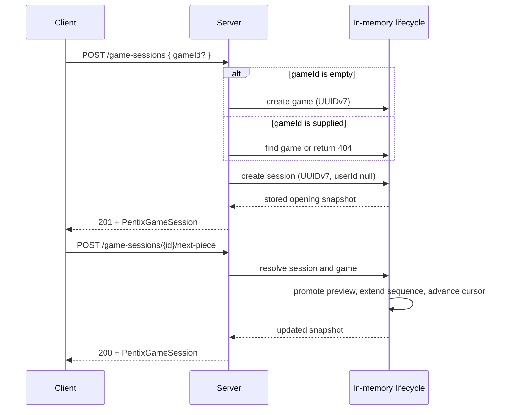

## Context

`pentix-core` currently creates a complete opening session snapshot, while `PentixServer` returns that snapshot without storing it. Piece definitions contain both numeric IDs and two string identities (`bi3Corner` and `3Corner`), and the only route is `POST /game-sessions`. The new next-piece operation requires retained session state and a clear relationship between a game and its player sessions.

The implementation must remain strict TypeScript, JSON serializable, and usable from the existing Node test runner. Host/port settings already determine the server's advertised URL; `http://localhost` is only a base for parsing a relative HTTP request target.

## Goals / Non-Goals

**Goals:**

- Model a game separately from each player's mutable session.
- Support game creation, session creation against a new or existing game, and deterministic next-piece advancement through a server-owned sequence.
- Retain enough in-memory state for those operations and isolate state between server instances.
- Simplify catalog identity without changing numeric IDs or Delphi geometry.
- Use real UUIDv7 identifiers for games and sessions.

**Non-Goals:**

- Durable storage, multi-process coordination, authentication, or user assignment.
- Game lookup/listing, session resume after restart, history, or multiplayer orchestration.
- Movement, gravity, locking, scoring, or a final randomizer/bag algorithm.
- Configuring the public base URL through the request-parsing constant.

## Decisions

### 1. Use a game-owned piece sequence and session-owned cursor

`PentixGame` contains `id`, `name`, a `BoardSnapshot`, and numeric `pieceIds`. Creation initializes the default empty board, an empty name unless one is supplied, and at least two valid piece IDs so a session can have active and preview pieces. The existing selectable-random approach supplies IDs and appends more on demand; this change does not define a bag algorithm.

`PentixGameSession` retains the current board, statistics, active piece, and preview fields, adds `id`, `userId: null`, `gameId`, and `nextPieceIndex`, and removes `sessionId`. `nextPieceIndex` identifies the preview entry and starts at `1`; the active piece starts at index `0`. Each session receives an independent board copy initialized from its game, so sessions do not share mutable cells.

A next-piece request promotes the preview to active at angle `0` and the default spawn origin, appends a game piece if another preview is needed, advances the cursor, refreshes the preview, and returns the complete updated session snapshot. Session and game updates are performed together in the server-owned lifecycle service.

Alternative: return only a piece and leave active/preview synchronization to clients. Rejected because it splits one state transition across requests and permits contradictory session snapshots.

### 2. Keep repositories in memory and scoped to a server instance

A lifecycle service owns game and session maps created with the server context, rather than module-global maps. Routes resolve IDs through this service. The maps provide the retention required by next-piece requests while making tests independent and avoiding claims of durability.

Alternative: keep the current stateless snapshots and derive the next piece from the cursor. Rejected because random on-demand selection cannot reproduce earlier active/preview state and supplied game IDs would not be resolvable.

### 3. Use plural REST resources and explicit state changes

The endpoints are `POST /games`, `POST /game-sessions`, and `POST /game-sessions/{id}/next-piece`. Session creation accepts an optional JSON `gameId`; no body, an omitted field, `null`, or an empty/whitespace-only string creates a game. A nonempty malformed UUID is a `400` request error, and a well-formed unknown game ID is `404`. Game creation and both session operations return `201`, `201`, and `200` respectively with JSON. Invalid JSON and invalid field types return `400`; an unknown session returns `404`.

`next-piece` is deliberately not `GET`: every successful call advances state and retries are not idempotent. No idempotency-key mechanism is added in this increment.

### 4. Generate UUIDv7 at the server boundary

Use the maintained `uuid` package's v7 generator in the server and inject ID/piece selectors into core factories for deterministic tests. API tests verify version and variant bits rather than only checking that IDs differ. JSON contracts represent IDs as strings; core factories continue accepting caller-supplied identities.

Alternative: retain `randomUUID()` or hand-roll UUIDv7. The former produces v4, and the latter adds unnecessary correctness risk for timestamp, random-bit, and monotonicity handling.

### 5. Keep numeric IDs, replace only legacy string keys

Rename `LegacyPieceKey` to `PieceKey`, whose values are `1Line` through `5RMir`. Each definition stores that value once as `key`; remove `name` and the `bi*` union. Update `PIECES_BY_KEY`, board cells, session piece references, the web preview, exports, and tests atomically. Numeric `id` remains the sequence reference because it is compact and already stable.

Alternative: use string keys in `pieceIds`. Rejected because the requested game model specifically references catalog IDs and numeric IDs avoid a second breaking change to game data.

### 6. Name the request parsing base, not the deployment URL

Introduce an internal `REQUEST_URL_BASE = 'http://localhost'` constant for `new URL(request.url ?? '/', REQUEST_URL_BASE)`. Keep `PENTIX_SERVER_HOST` and `PENTIX_SERVER_PORT` as the actual listen/public URL configuration.

## Risks / Trade-offs

- [In-memory state disappears on restart] → Document ephemeral lifetime and return not-found semantics after restart; defer persistence to a later change.
- [A shared game sequence couples session timing] → Keep cursors and boards session-owned, append pieces deterministically on demand, and test independent sessions against one game.
- [Duplicate next-piece retries advance twice] → Document non-idempotency; consider idempotency keys when clients and delivery guarantees are designed.
- [Key renaming breaks all string references] → Change core, web, fixtures, and specs together; add a uniqueness test for numeric IDs and keys.
- [An ever-growing piece array consumes memory] → Accept for this ephemeral increment; revisit sequence windows or seeds with persistence work.

## Migration Plan

1. Migrate catalog types and all key consumers while preserving numeric IDs and geometry.
2. Add game types/factories and revise session initialization around game-owned sequences.
3. Add the UUIDv7 dependency, server-scoped lifecycle service, request validation, and routes.
4. Update core/server tests and documentation, then run build, test, and lint.

Rollback follows the proposal: remove the new routes/state and restore the prior session and catalog contracts as one coordinated revert. There is no persisted data to migrate.

## Open Questions

No blocking questions remain. Durable ownership, multiplayer behavior, idempotency, sequence retention, and the final randomizer require separate product decisions and are intentionally not settled by this design.

