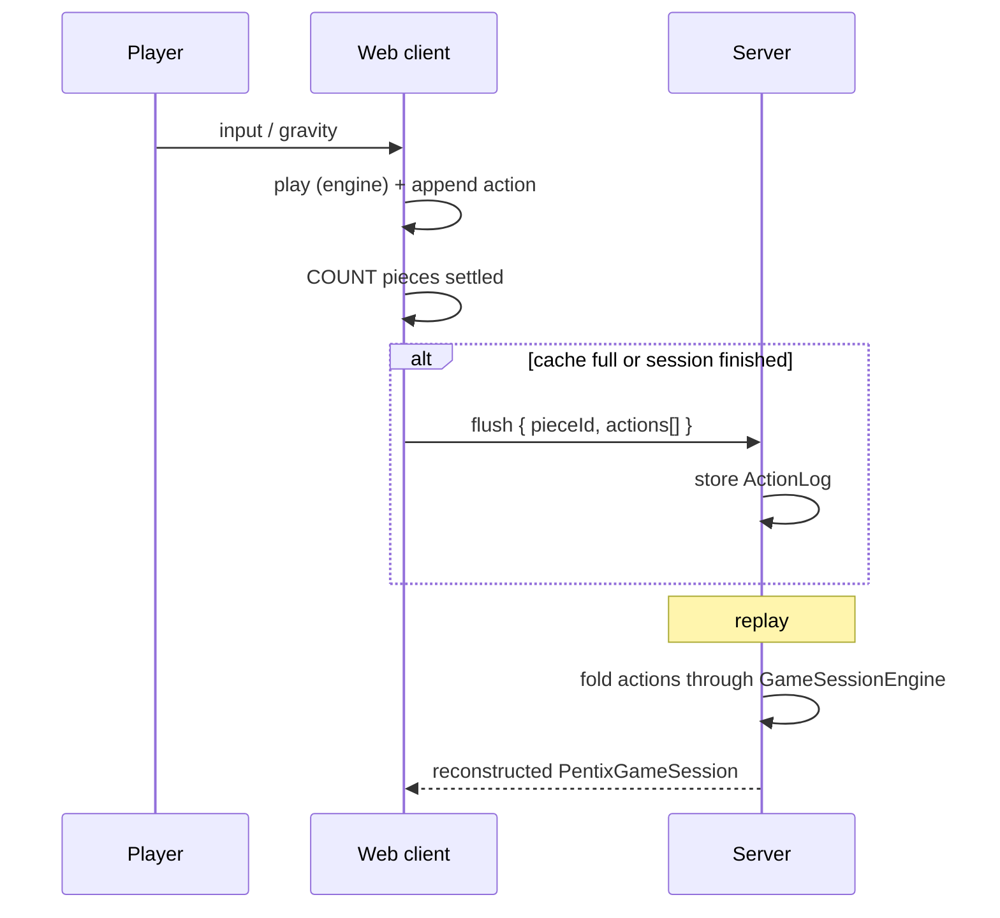

## Context

Today a `PentixGameSession` is a full frozen snapshot (`board`, `statistics`, `activePiece`, cursors) returned by every gameplay endpoint, and the engine mutates that snapshot per operation. The persistence direction (from `introduce-storage-repositories`) stores these snapshots. We now want to store only the piece and the ordered actions, and reconstruct state by replay, so a session can be recovered exactly without storing every intermediate board.

## Goals / Non-Goals

**Goals:**

- A minimal action alphabet that fully determines play (`T`, `L`, `R`, `C`, `A`, `H`).
- Store a session as piece ID + ordered actions, not full state.
- Deterministic replay through the existing pure `GameSessionEngine`.
- Client-side action caching with flush after `SOME_CACHE_PIECE_COUNT` pieces or on finish.
- Remove soft drop from the game process.

**Non-Goals:**

- Timestamped/weighted actions or per-action scores in the log.
- Server-side "resume mid-piece" beyond re-running the deterministic log.
- Changing drop/lock scoring semantics.

## Decisions

### Decision 1: A discriminated action alphabet without soft drop

Define `SessionAction = 'T' | 'L' | 'R' | 'C' | 'A' | 'H'` mapping to tick/left/right/clockwise/anticlockwise/hard-drop. Soft drop is excluded; the existing on-demand "down" key that triggered a descending `tick` is removed.

- *Why*: each action maps 1:1 to an existing engine operation, and the alphabet is exactly what must be replayed.
- *Alternative considered — log engine calls instead of a compact alphabet:* tautological and harder to store/validate.

### Decision 2: A session log is piece ID + ordered actions

The recorded representation of a session is `{ pieceId, actions: SessionAction[] }` (scoped per piece, so the log composes across the game's sequence). Runtime `PentixGameSession` snapshots remain the playback contract returned to clients.

- *Why*: the minimal durable representation the requirement asks for; the full snapshot stays a derived, replayable artifact.
- *Alternative considered — store only global actions with no piece markers:* replay cannot distinguish which piece a settled action sequence belonged to.

### Decision 3: Replay folds actions through the pure engine

Replay reconstructs a `PentixGameSession` by applying the recorded actions in order against the game's piece sequence, using the existing stateless `GameSessionEngine`. Determinism is guaranteed by the game sequence (Change A) and the pure engine.

- *Why*: reuses the single source of gameplay truth so replay matches live play.
- *Alternative considered — a separate replay interpreter:* duplicates mechanics and risks divergence.

### Decision 4: Client caches actions and flushes in bulk

The client accumulates each action (player inputs and gravity ticks) and flushes them to the server after `SOME_CACHE_PIECE_COUNT` pieces have settled or immediately when the session finishes.

- *Why*: amortizes network writes while bounding uncommitted data.
- *Alternative considered — flush every action:* simple but chatty and defeats the caching requirement.

## Risks / Trade-offs

- [Replay is only deterministic if the piece sequence is stable] → guaranteed by the game sequence retained from Change A.
- [Gravity `T` actions must be recorded faithfully] → the gravity loop appends exactly one `T` per elapsed step.
- [Crash loses the unflushed tail] → `SOME_CACHE_PIECE_COUNT` bounds the loss window; flush on finish minimizes it.
- [Removing soft drop changes muscle-memory controls] → explicit, out-of-scope behavior; documented in `browser-gameplay`.

## Migration Plan

1. Add `SessionAction` and the action-log types to `pentix-core`.
2. Record actions in the web client and remove soft-drop control.
3. Change the session repository to persist the log (piece ID + actions) with replay on read.
4. Add flush scheduling (`SOME_CACHE_PIECE_COUNT`) and on-finish flush.
5. Add replay-determinism and flush tests; update `browser-gameplay` and the new `session-replay` spec.

Rollback: the session repository can store full snapshots again if replay proves problematic; clients and endpoints are unchanged.

## Open Questions

- The concrete value for `SOME_CACHE_PIECE_COUNT` (e.g. 5 pieces) — propose 5 as a starting default.
- Whether the flush endpoint is a new `POST /game-sessions/{id}/actions` or piggybacks on existing gameplay routes — propose a dedicated endpoint for clarity.