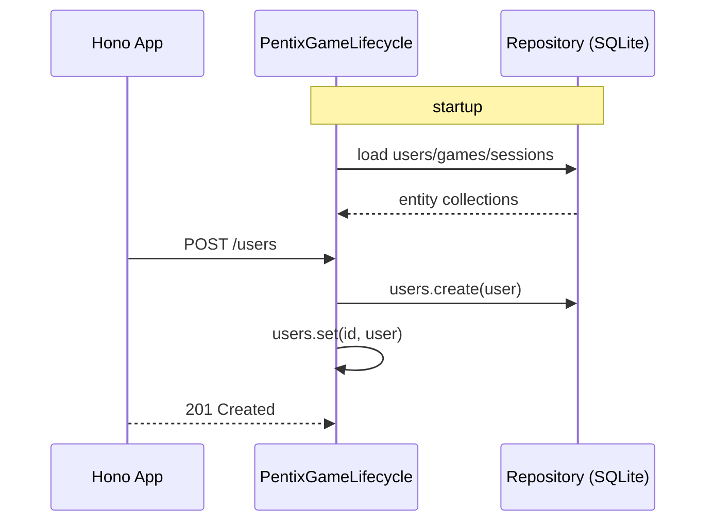

## Context

`PentixGameLifecycle` holds three in-memory `Map`s (users, games, sessions) and mutates them directly. Entities are frozen JSON-serializable snapshots. Restarting clears everything; there is no database and no third-party storage dependency. The eventual target storage engine is a relational DB (PostgreSQL), so the HTTP layer must never know which engine is in use.

## Goals / Non-Goals

**Goals:**

- Repository interfaces that abstract persistence from the HTTP/routing layer.
- Separate persistence per entity; a game's piece sequence as one field.
- A working SQLite implementation now, plus an in-memory implementation for tests.
- Startup reload of retained state; deterministic, unchanged REST behavior.

**Non-Goals:**

- PostgreSQL implementation (the interfaces make it a later drop-in).
- Durable history endpoints, multiplayer orchestration, or schema migrations.
- Replay/action-log session semantics (that is Change C).

## Decisions

### Decision 1: Repository interfaces per entity

Define `UserRepository`, `GameRepository`, and `GameSessionRepository` with narrow async methods (e.g. `create`, `findById`, `list`, `save`). The lifecycle depends on these interfaces, never on a concrete store.

- *Why*: swapping SQLite → PostgreSQL later is a new implementation, not a rewrite.
- *Alternative considered — one generic `KeyValueStore`:* loses entity-specific query shape and makes per-entity modeling awkward.

### Decision 2: Separate storage per entity, sequence as one field

Users, games, and sessions live in distinct collections/tables. `PentixGame.pieceIds` is persisted as a single ordered list field alongside the game row.

- *Why*: matches the "stored separately" requirement and keeps a game's sequence an atomic unit.
- *Alternative considered — separate piece-sequence table:* unnecessary for a single ordered list.

### Decision 3: SQLite via `node:sqlite` when available, else `better-sqlite3`

Prefer the Node built-in `node:sqlite` module (synchronous API, no native build) where the runtime supports it; fall back to `better-sqlite3`. The repository interface hides this choice.

- *Why*: avoids a native compilation step; a future PostgreSQL implementation conforms to the same interface.
- *Alternative considered — `pg` now:* premature; PostgreSQL wiring adds config and a running service with no benefit at this stage.

### Decision 4: Keep the working-set pattern, hydrate and persist through repositories

The lifecycle keeps its in-memory maps as the request-time working set, hydrates them from the repositories on startup, and persists each successful mutation through the matching repository.

- *Why*: preserves all existing lookup/validation logic and tests; persistence is layered on without touching routing.
- *Alternative considered — read-through/write-through with no maps:* forces serialization on every read with no benefit here.

## Risks / Trade-offs

- [Synchronous SQLite writes on each mutation add latency] → acceptable at this scale; the repository interface allows batching later.
- [Single SQLite connection assumes one process] → document as a constraint; multi-process sharing is out of scope.
- [Corrupt or missing DB file] → missing = empty store on first run; corrupt = fail fast at startup.
- [Native dependency fallback (`better-sqlite3`)] → prefer `node:sqlite` to avoid it; isolate the driver behind the interface.

## Migration Plan

1. Add repository interfaces and the in-memory implementation with no behavior change.
2. Add the SQLite implementation behind the same interfaces.
3. Wire load-on-startup and save-on-mutation into the lifecycle; default tests to the in-memory repository.
4. Configure `main.ts` to use SQLite (via `PENTIX_DATA_FILE` / DB path).
5. Add restart-survival and round-trip tests; update the `pentix-server-bootstrap` spec.

Rollback is configuration-only (select the in-memory repository); no data migration exists yet.

## Open Questions

- Confirm the runtime's `node:sqlite` availability versus falling back to `better-sqlite3` at implementation time.
- Whether the DB path should be a directory (multi-file) or a single file — proposed: a single SQLite file for now.