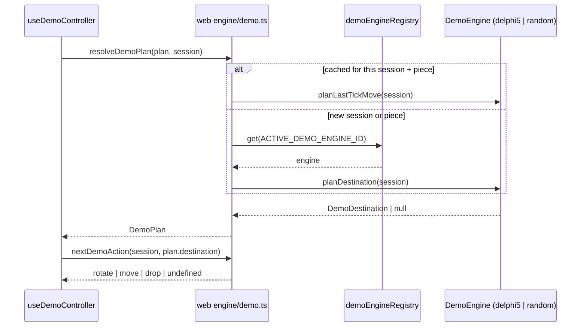

## Context

The attract demo in `apps/pentix-web` gets its destinations from two pure functions in `packages/pentix-core/src/demo.ts`: `planDemoDestination(session)` and `planDemoLastTickMove(session)`. The browser adapter `apps/pentix-web/src/engine/demo.ts` caches the destination per session/piece in `resolveDemoPlan` and turns it into a reducer action via `nextDemoAction`; `useDemoController` drives that once per gravity interval. Both the core planner and the web adapter import the Delphi heuristic directly, so the demo has exactly one strategy and no place to add another.

The heuristic is a faithful port of the Delphi client's `CalcDemoDest` and is covered by an extensive test suite in `tests/pentix-core.test.mjs`; `tests/pentix-web.test.mjs` covers the steering and plan cache. Any restructuring must keep that behaviour byte-for-byte equivalent.

## Goals / Non-Goals

**Goals:**

- Introduce a named, pluggable demo-engine contract in `pentix-core` so the demo's planning strategy can be swapped without touching the controller, the reducer, or the engine operations.
- Register the existing heuristic as `Delphi5` with no behavioural change.
- Provide a temporary `Random` engine that returns a random reachable destination, to exercise the pluggable path end to end.
- Provide one registry that owns engine lookup and is the only place a new engine must be added.
- Keep the demo's plan-once-per-piece caching semantics.

**Non-Goals:**

- No runtime engine picker in the UI (Settings, URL parameter, or persisted preference). Selection is a single code-level seam for now.
- No new planner heuristics beyond `Delphi5` and the throwaway `Random`.
- No changes to `gameSessionEngine`, `placement.ts`, the reducer's phase/action model, rendering, server, storage, or session replay.
- No change to `planDemoDestination` / `planDemoLastTickMove` behaviour or signatures.

## Decisions

### 1. The engine contract lives in `pentix-core`

`packages/pentix-core/src/demo-engine.ts` defines:

```ts
export interface DemoEngine {
  readonly id: DemoEngineId
  readonly name: string
  planDestination(session: PentixGameSession): DemoDestination | null
  planLastTickMove(session: PentixGameSession): DemoDestination | null
}
```

with `DemoEngineId = string`. Engines are pure planners: they read a session and return a destination, exactly like the existing functions. Keeping the contract in core means engines can be unit-tested without React and the shared engine keeps ownership of all state changes.

*Alternative considered:* define the contract in `apps/pentix-web`. Rejected — the planning heuristics already live in core and the web layer must not re-implement placement logic.

### 2. Both planning operations belong to the engine

The last-tick side-step is part of a strategy, not of the demo loop: `Delphi5` implements it, `Random` declines it. Making it an optional part of the controller would mix two strategies in one run and force the controller to know Delphi-specific rules.

*Alternative considered:* a destination-only contract with the last-tick check left in the controller. Rejected — a random destination paired with the Delphi side-step would produce incoherent play and would keep heuristic code in the client.

### 3. An explicit registry with fail-fast lookups

`demo-engine.ts` exposes a `DemoEngineRegistry` class and a module singleton:

- `register(engine)` — throws when the id is already registered, so a duplicate is caught at startup rather than silently shadowing a built-in.
- `get(id)` — throws an `Error` naming the unknown id, so a typo fails loudly instead of silently falling back.
- `list()` — returns the registered engines in registration order for diagnostics/tests.

The module also registers `delphi5DemoEngine` then `randomDemoEngine` and exports `DEFAULT_DEMO_ENGINE_ID = 'delphi5'` plus `getDemoEngine(id = DEFAULT_DEMO_ENGINE_ID)`.

*Alternative considered:* a frozen `Record<DemoEngineId, DemoEngine>` lookup. Rejected — it cannot reject duplicates and forces every future engine into one file; a registry also gives the web a single discovery point.

*Alternative considered:* engines self-registering via a side-effect import. Rejected — import-order-dependent behaviour is harder to reason about and test.

### 4. `Delphi5` is an adapter, not a rewrite

`packages/pentix-core/src/demo-delphi5.ts`:

```ts
export const delphi5DemoEngine: DemoEngine = Object.freeze({
  id: 'delphi5',
  name: 'Delphi 5',
  planDestination: planDemoDestination,
  planLastTickMove: planDemoLastTickMove,
})
```

The existing functions and their tests remain untouched, so `Delphi5` is provably the current behaviour. No re-export of the functions is removed.

### 5. `Random` enumerates reachable placements, then picks one

`packages/pentix-core/src/demo-random.ts` reuses the internal geometry helpers exported from `demo.ts` (`candidateAngles`, `findLandingRow`) to build every `{ angle, column }` pair whose shaft is open from the spawn row, then returns one uniformly at random via `Math.floor(Math.random() * candidates.length)`. `planLastTickMove` always returns `null`.

Picking a random angle/column blindly could return a column the piece cannot be dropped into (blocked shaft), making the demo steer against a wall and lock early; enumerating reachable pairs keeps the destination executable by construction, matching the Delphi planner's guarantee used by `resolveDemoPlan`.

The engine file carries a prominent TEMPORARY comment: it exists only to prove the registry seam and will be deleted.

*Alternative considered:* random destination plus random last-tick side-step. Rejected — "randomly plan the piece destination" is the requested scope, and no side-step keeps `Random` trivially removable.

### 6. One code-level seam selects the active engine

The registry default is `delphi5`. `apps/pentix-web/src/engine/demo.ts` declares a single temporary constant:

```ts
/** TEMPORARY: run the random engine while the registry seam is validated. */
export const ACTIVE_DEMO_ENGINE_ID: DemoEngineId = 'random'
const activeDemoEngine = getDemoEngine(ACTIVE_DEMO_ENGINE_ID)
```

`resolveDemoPlan(plan, session, engine = activeDemoEngine)` uses it, and `nextDemoAction` keeps its existing "destination is supplied" fast path. `useDemoController` passes the active engine explicitly. Reverting `Random` is therefore a one-line change plus deleting `demo-random.ts` and its registry line.

*Alternative considered:* put the temporary choice in the registry's `DEFAULT_DEMO_ENGINE_ID`. Rejected — the default should stay the durable choice; a temporary experiment should not redefine it.

### 7. Plan caching is unchanged

`resolveDemoPlan` still keys its cache on `session.id` + `session.nextPieceIndex`, and still re-targets on a last-tick move. That matters more with `Random`: without the cache a random choice would be re-rolled every tick and the piece would jitter.



## Risks / Trade-offs

- [The temporary `random` default makes the visible demo play badly] → Intentional and temporary; the engine id is a single commented constant, and `Delphi5` remains the registry default. The rollback plan in the proposal restores the old demo in one line.
- [A mutable module-level registry makes tests order-dependent] → Built-ins are registered once at import; `register` throws on duplicate ids, and new tests register uniquely named throwaway engines instead of re-registering built-ins.
- [Random destinations could be unreachable] → The engine only returns angle/column pairs with an open drop shaft, the same reachability guarantee the Delphi planner relies on; it returns `null` when nothing is reachable, which the controller already handles.
- [Changing `resolveDemoPlan`'s signature breaks existing callers/tests] → The engine parameter is optional and defaults to the active engine; web tests are updated to pass an explicit engine so their expectations do not depend on the temporary selection.
- [Refactoring the planner into adapters could regress demo behaviour] → `Delphi5` delegates to the untouched functions and the existing core planner tests must stay green; new tests only cover the registry and `Random`.
- [Exporting internal helpers from `demo.ts` widens the module surface] → They are exported for package-internal reuse only and are deliberately not added to the `pentix-core` barrel.

## Migration Plan

1. Add `demo-engine.ts` (contract, registry, default), `demo-delphi5.ts`, and `demo-random.ts`; export the internal geometry helpers needed by `Random` from `demo.ts`.
2. Export the new public API from `packages/pentix-core/src/index.ts` and rebuild core.
3. Add core tests for registry lookup/duplicates/unknown ids and for `Random` (reachable destination, deterministic under a stubbed `Math.random`, `null` when blocked, no side-step); confirm existing planner tests still pass.
4. Update `apps/pentix-web/src/engine/demo.ts` and `useDemoController.ts` to plan through the resolved engine; update the web demo tests to pass an engine explicitly.
5. Run `npm run lint`, `npm run build`, and `npm test`.
6. Rollback: set `ACTIVE_DEMO_ENGINE_ID` back to `'delphi5'` (or remove the constant and use the registry default), then delete the new engine modules, the registry, the barrel exports, and the engine parameter; `demo.ts` is unchanged, so the demo reverts without touching its heuristic.

## Open Questions

- Should the engine become user-selectable later (Settings or a URL parameter)? Recommended as a follow-up; this change only provides the registry seam.
- Should `Random` live in core or be deleted together with its export when it goes? Recommended: delete the module, its registry line, and its barrel export; the registry itself stays.
