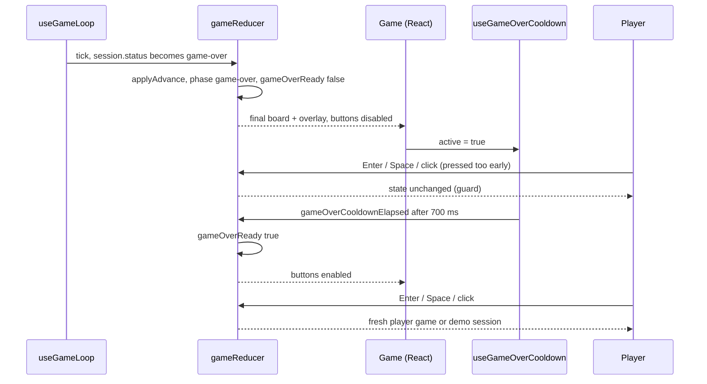

## Context

The web client (`apps/pentix-web`) keeps all gameplay state in a pure reducer (`src/engine/gameReducer.ts`) with four phases — `demo | playing | paused | game-over`. Every mutation funnels through `createGameReducer(deps)`: the overlay buttons in `Game.tsx`, the sidebar buttons in `Controls.tsx`/`Settings.tsx`, and the global `keydown` listener in `useKeyboardControls.ts`, which maps keys to actions with the pure `mapKeyToAction(key, phase)` in `src/engine/keyMap.ts`.

When a player game over happens, `applyAdvance` sets `phase: 'game-over'` on the same dispatch that returns the final board, so the overlay's "Play again" (`restart`) and "Demo" (`demo`) buttons plus the `Enter`/`Space` hotkeys are armed in the same frame the final piece locks. A player still pressing keys from muscle memory therefore starts a new game or the demo instantly, discarding the final board.

The attract demo is different: `applyAdvance` and the `drop` case restart a game-over demo session immediately (`startDemo`), never surfacing the overlay. `demo-mode` requires that loop to stay immediate, so the cooldown must not touch it.

Gravity and demo timers are already implemented as `window.setInterval`/`requestAnimationFrame` inside React hooks (`useGameLoop`, `useDemoController`); a one-shot `window.setTimeout` hook follows the same pattern.

## Goals / Non-Goals

**Goals:**

- Block accidental `start` / `restart` / `demo` requests for a short, fixed cooldown (700 ms, under the 1 s ceiling) after a player game over.
- Cover every entry point with one rule — overlay buttons, `Enter`/`Space`/`r` hotkeys, and the sidebar Restart button.
- Keep the final board and the overlay visible immediately; only the actions are delayed, and the buttons visibly show that they are not yet active.
- Keep the reducer pure and the new rule unit-testable without React.

**Non-Goals:**

- No change to demo auto-restart timing, demo steering, gravity scheduling, or the shared `pentix-core` engine.
- No change to `mapKeyToAction`'s phase→action mapping or to the pause/resume flow.
- No server, storage, persistence, or session-replay changes; no new dependency.

## Decisions

### 1. The cooldown is reducer state (`gameOverReady`), not component state

`GameState` gains `readonly gameOverReady: boolean`:

- `createInitialState` and `startSession` set it to `true`.
- `applyAdvance` sets `phase: 'game-over'` together with `gameOverReady: false` when a player session's status becomes `'game-over'`.
- A new action `{ type: 'gameOverCooldownElapsed' }` sets it back to `true`, only while `phase === 'game-over'`.

*Alternatives considered:* a `useState` flag in `Game.tsx` (rejected — the keyboard listener and the buttons would need parallel guards, and the rule would be untestable without React); storing an expiry timestamp from `Date.now()` in state (rejected — needs a clock dependency in `GameDependencies` and makes tests time-dependent). A boolean flipped by an explicit action keeps the reducer deterministic: the timer lives in React, the rule lives in the reducer.

### 2. Guard the transition actions in the reducer

`start`, `restart`, and `demo` return the current state unchanged when `state.phase === 'game-over' && !state.gameOverReady`. These three actions are the only ways the client leaves the game-over phase, so a single guard covers the overlay buttons, the `Enter`/`Space` hotkeys, the `r` key, and the sidebar Restart button — no per-input plumbing.

`keyMap.ts` stays untouched: it maps keys to intents per phase, and the cooldown is a stateful rule rather than a keybinding concern. This also keeps the existing `mapKeyToAction(' ', 'game-over')` contract and its tests valid.

*Alternatives considered:* gating inside `useKeyboardControls`/`keyMap` (rejected — leaves button clicks unguarded unless duplicated, and splits one rule across layers); disabling the `Controls` Restart button (rejected — the reducer guard already no-ops it and would otherwise require threading the flag through `Controls`).

### 3. The demo path bypasses the cooldown

The early `startDemo` returns in `applyAdvance` and the `drop` case stay exactly as they are, and the demo plays only while `phase === 'demo'`, so a demo game over never produces `gameOverReady: false` and never shows the overlay. `demo-mode`'s "restarts automatically on game over" requirement is therefore unaffected.

### 4. A one-shot React hook arms the timer

New `apps/pentix-web/src/games/pentix/useGameOverCooldown.ts`, mirroring the timer style of `useDemoController`:

```ts
useEffect(() => {
  if (!active) return
  const timer = window.setTimeout(
    () => dispatch({ type: 'gameOverCooldownElapsed' }),
    GAME_OVER_COOLDOWN_MS,
  )
  return () => window.clearTimeout(timer)
}, [active, dispatch])
```

`Game.tsx` calls it with `active = phase === 'game-over' && !gameOverReady`. Cleanup covers unmount, restart, and re-entry into game over, and the dispatched action is a no-op when the phase already moved on, so a late timer can never start anything.

### 5. Overlay renders immediately with disabled actions

`Game.tsx` keeps rendering the overlay on `phase === 'game-over'` (final board beneath it) but passes `disabled={!gameOverReady}` to both buttons; `App.css` adds `.overlay__button:disabled` (reduced opacity, `not-allowed`, no hover brightening). The tooltips stay, so the hotkeys remain discoverable while inert.

### 6. Game-over action flow



## Risks / Trade-offs

- [A player may read the dimmed buttons as broken] → Mitigation: the cooldown is only 700 ms and the buttons visibly enable; the `Game over` title renders immediately, so the state change is still obvious.
- [An intentional fast restart is also swallowed] → Mitigation: the ceiling is under a second and only the first presses are dropped; a deliberate press after the delay always works.
- [Background tabs throttle `setTimeout`, stretching the cooldown] → Mitigation: the timer only ever *enables* actions, and `gameOverCooldownElapsed` is a no-op outside game over; nothing auto-starts from a late timer.
- [A stale timer firing after a restart could re-enable actions] → Mitigation: the effect cleans up on `active` change, and the action requires `phase === 'game-over'`.
- [Existing tests construct game-over states by hand] → Mitigation: new tests explicitly set `gameOverReady`, and the unchanged `mapKeyToAction` assertions keep the hotkey contract covered.

## Migration Plan

1. Add `GAME_OVER_COOLDOWN_MS`, `gameOverReady` on `GameState`, the `gameOverCooldownElapsed` action, the guard on `start`/`restart`/`demo`, and the flag updates in `applyAdvance`/`startSession`/`createInitialState` (`gameReducer.ts`).
2. Add `useGameOverCooldown.ts` and wire it in `Game.tsx`; pass `disabled={!gameOverReady}` to the overlay buttons.
3. Add the `.overlay__button:disabled` styling in `App.css`.
4. Extend `tests/pentix-web.test.mjs` with the blocked-actions, elapsed-cooldown, and untouched-demo cases.
5. Run `npm run lint` and `npm test`; spot-check `npm run dev:web` by mashing keys at game over.
6. Rollback: revert steps 1–4 (remove the flag, action, guard, hook, `disabled` attribute, CSS rule, and tests). No data migration is involved.

## Open Questions

- Is `700` ms the right feel, or should it be closer to the 1 s ceiling? Recommendation: start at `700` ms — it stops accidental presses without feeling unresponsive.
- Should the overlay itself fade in after the cooldown instead of showing disabled buttons? Recommendation: keep it immediate and disable the buttons; hiding the result of the game over is worse for the player.
