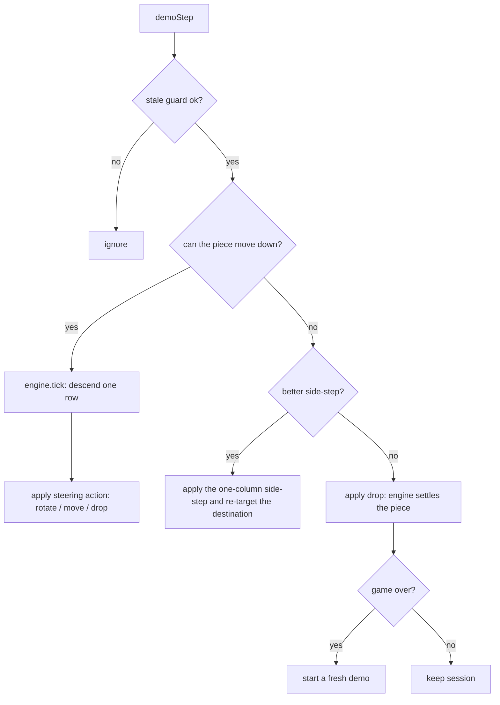
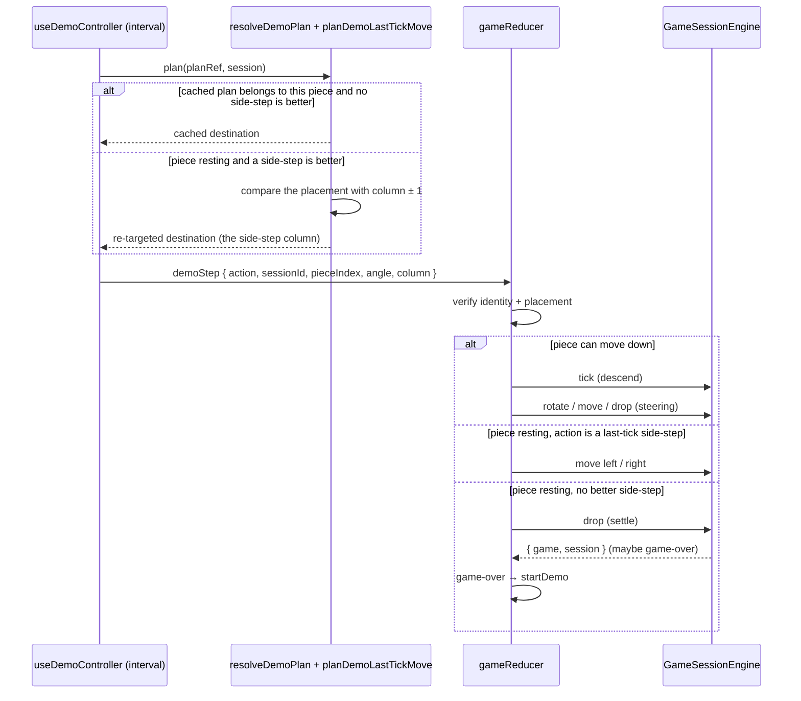

## Context

The attract demo lives in two places:

- `packages/pentix-core/src/demo.ts` — `planDemoDestination(session)` ports Delphi's `CalcDemoDest`: it scans every rotation angle × column, keeps placements reachable from the top, scores each as `row + round((holesBefore − holesAfter) × 1.5) + fullLines²`, and resolves equal scores by lower bottom, lower top, more orthogonal contacts, non-wall placements, then a random choice.
- `apps/pentix-web` — `engine/demo.ts` maps the destination to one `GameAction` per tick (`rotate` → `move` → `drop`), `resolveDemoPlan` caches the destination per spawned piece (so random ties cannot make a falling piece jitter), `useDemoController` dispatches that action every gravity interval, and `gameReducer.ts` applies it (`demoAction`, guarded by `session.id` + `nextPieceIndex`).

Gravity is a *second* timer: `useGameLoop` runs an animation-frame accumulator for `phase === 'playing' || phase === 'demo'` and dispatches `tick`. `tick` descends the piece and **settles** it (locks the minos, clears lines, spawns the next piece) when it cannot descend, and `drop` also settles when there is no space below.

Consequently the last tick of a demo piece is wasted: the piece locks at the exact placement it fell into. Delphi behaves the same way (`TimerExpired` calls `EndWayBlock` as soon as `SetBlockPos(FCol, FRow + 1)` fails), but the browser demo has one extra degree of freedom: a resting piece can shift one column left or right before it locks. That side-step can land a better placement (for example the pocket under a settled mino, which a straight drop can never reach) and it can also drop the piece into a deeper column. Two things are missing today: the destination planner scores only straight-drop placements, so it steers to the wrong column, and the last tick is spent locking instead of side-stepping. Because two independent timers race (the frame loop may settle the piece before the demo interval steers it), the side-step must also be made deterministic.

## Goals / Non-Goals

**Goals:**

- Extend the destination planner so each candidate settled placement is compared with the placements one column left and right, and steer the piece to the column the winning placement is reached from.
- When a demo piece can no longer fall, compare its resting placement with the placements one column left/right and take the better one, including side-steps that cannot fall any further.
- Prioritize side-steps that keep the piece falling by scoring them at their further landing.
- Make a demo step deterministic: one gravity step plus one steering step per gravity interval, with no second timer able to lock the piece first.
- Keep the score formula, the tie-break precedence, and the plan-once-per-piece cache behaviour otherwise unchanged; no new dependencies; demo stays local and unlogged.

**Non-Goals:**

- No rotation on the last tick (the demo only side-steps) and no multi-step search or pathfinding beyond one column.
- No change to `GameSessionEngine` behaviour (`move`/`rotate`/`tick`/`drop` keep their semantics), to player controls, to scoring, or to `pentix-server`/storage/`session-replay`.
- No change to the level cadence (`1000 − 100 × level` ms) or to the demo's level-follow behaviour.

## Decisions

### 1. Both planners compare a placement with its one-column side-steps

The demo has one extra move the classic client does not model: on its last tick, a resting piece can shift one column left or right before it locks. Both planners therefore treat a side-step as part of a placement:

- `planDemoDestination` keeps its Delphi scan (every reachable angle × column × row) and, for each candidate at a column's **resting row**, additionally scores the placements at `column − 1` and `column + 1` at the same row. The winning placement may be such a side-step; the destination returned is still the column the piece must be *dropped* in (the pre-side-step column), because that is what `actionTowardDestination` can steer to.
- `planDemoLastTickMove(session)` then compares the resting placement with those same two neighbours when the piece can no longer move down, and returns the side-step column when the neighbour is better.

Every candidate — including the side-step ones — is scored after being allowed to fall as far as it can: a side-step whose result can still move down is scored at its further landing, so it outranks one that merely parks the piece. That is the requested "if the piece can move down after moving left or right, prioritize this candidate", and it also means the user's motivating case works both ways: a side-step that drops the piece into a deeper column wins, and a side-step that parks it under an overhang (no descent left) still wins when its placement scores better.

*Alternatives considered:* only comparing side-steps at runtime, without teaching the planner (rejected — the demo would steer to the spawn-time destination and never be next to the pocket it should slide into, which is exactly the reported `1L`-to-the-left-corner behaviour); re-running the full planner on the last tick (rejected — it ignores reachability from the resting row and thrashes); a multi-step/BFS search (rejected — larger search and a different feature; the runtime check already repeats on each last tick).

### 2. Termination needs a strict, deterministic ordering

A side-step no longer has to enable descent, so progress cannot be argued from the falling row. Instead the last-tick planner takes a side-step only when the neighbour is **strictly better** on the shared ordering — score, then bottom, top, contacts, and the non-wall preference — and an *indistinguishable* neighbour is never taken (the shared tie-break helper returns "no preference" rather than a random coin flip). Because that ordering is antisymmetric, two adjacent positions cannot each be better than the other, so the piece cannot shuffle back and forth, and the number of last-tick moves per piece is bounded.

*Alternative considered:* reusing the planner's random tie-break (rejected — equal neighbours would be picked at random and the piece could oscillate forever instead of locking).

### 3. The destination is re-targeted, and the plan cache stays in the hook

A last-tick side-step moves the piece off its spawn-time destination, so keeping the cached destination would steer the piece straight back. `resolveDemoPlan(plan, session)` therefore re-targets: while the cached plan still belongs to the current session and piece, a resting piece asks `planDemoLastTickMove` and, when it returns a destination, replaces the cached destination with it. Once the piece has stepped, the new destination is stable (steering toward it is a no-op until the next rest), so the cache never flaps.

The plan remains owned by `useDemoController`'s ref — the reducer never plans, it only applies. This keeps one owner for the plan and keeps `resolveDemoPlan`/`nextDemoAction` unit-testable without React.

*Alternatives considered:* move the plan into `GameState` (rejected — it exists only to stop two timers from disagreeing, and decision 4 removes the second timer); invalidate the cache on every placement change (rejected — random ties would flap mid-flight, the problem the current cache was introduced to solve).

### 4. One demo step per gravity interval: gravity and steering in the same reducer action

The gravity loop stops running for the demo (`useGameLoop(phase === 'playing', ...)`); `useDemoController` dispatches a single `demoStep` action per level interval:

```ts
case 'demoStep': {
  // stale guard: session.id, nextPieceIndex, active angle + column must match
  const result = canDemoPieceMoveDown(state.session)
    ? applyAdvance(state, deps, gameSessionEngine.tick(state.session, state.game, deps.selectPieceId))
    : state
  return gameReducer(result, action.action) // rotate | move | drop
}
```

- When the piece can fall, the step is exactly Delphi's `TimerExpired`: descend one row, then steer one step (the hook's action is `rotate`, `move`, or `drop` once aligned).
- When the piece is resting, no gravity is applied, and the hook's action is either the last-tick step (`rotate`/`move`) or `drop`, which settles the piece through the engine (game-over still restarts the demo through `applyAdvance`).

This keeps the observable cadence identical to today (one gravity step plus one steering step per interval) while removing the race: nothing else can settle a demo piece.

*Alternatives considered:* keep both timers and check the last tick in the reducer (rejected — the reducer would need the hook's plan, or would re-plan and disagree with it); move the demo entirely into `tick` and delete `useDemoController` (rejected — bigger diff, and the level-follow requirement is already expressed through the hook's interval).

### 5. Stale guard extended with the placement

`useDemoController` reads the session from a ref that can be one render behind. The `demoStep` payload therefore carries the placement the step was planned for (`angle`, `column`) in addition to `sessionId` and `pieceIndex`; the reducer ignores the action when the active piece no longer matches, so a step planned for a placement that already moved can never be applied to a different one.

### 6. Shared scoring and ordering helpers, and where the new exports live

`planDemoDestination` and `planDemoLastTickMove` must score and rank placements identically, so the per-candidate work (`holesAfter`, `fullLines`, `priority`, `bottom`, `top`, `touchesWall`, `contacts`) lives in one `scorePlacement` helper, `scoreSettledPlacement` adds the "fall as far as possible first" step, and the tie-break chain is a single `placementTieBreak` helper that returns `null` for indistinguishable placements. `preferCandidate` uses it plus the planner's random final tie-break (and prefers the placement that needs no side-step); `isBetterPlacement` uses it without randomness for the last-tick decision. `pentix-core` exports exactly two additions — `planDemoLastTickMove` and `canDemoPieceMoveDown` — keeping demo collision/scoring logic in the core, as the original demo design decided.





## Risks / Trade-offs

- [The demo looks more "clever" than the Delphi original] → Accepted: side-step positions are scored with the same heuristic, and a side-step is only planned/taken when it beats the alternative on that heuristic.
- [A last-tick side-step can be planned from a stale render] → Mitigation: the `demoStep` payload carries `angle`/`column`, so a stale step is ignored rather than applied to the wrong placement (the next interval re-plans).
- [The demo's gravity now depends on `setInterval` instead of the animation-frame accumulator] → Mitigation: the interval is the same `getTickInterval(level)` the demo controller already uses, level changes still re-arm it immediately, and the demo already tolerates interval drift because it steers on that timer.
- [Side-step scoring is an approximation of a two-phase plan] → Mitigation: the planner models one side-step per candidate and the runtime repeats the check on every last tick; both use the same scoring, so the runtime never contradicts the plan.
- [Extra planner work per candidate] → Mitigation: at most two extra placements per resting candidate and two per rest (`width × height × 5 cells × 4 neighbours` each), negligible against the existing scan.

## Migration Plan

1. Refactor `packages/pentix-core/src/demo.ts` scoring into shared helpers; add `canDemoPieceMoveDown` and `planDemoLastTickMove`; export both from `index.ts`; rebuild `pentix-core` (`npm run build:core`).
2. Make `resolveDemoPlan` re-target on a last-tick destination; keep `nextDemoAction`/`actionTowardDestination` unchanged.
3. Replace the `demoAction` case in `gameReducer.ts` with `demoStep` (gravity + steering, placement-aware guard) and dispatch it from `useDemoController`; restrict `useGameLoop` to `phase === 'playing'`.
4. Update/add core and web tests; run `npm run lint`, `npm run build:web`, `npm test`.
5. Rollback: restore the steering-only `demoAction`, restore `useGameLoop(loopActive, ...)`, and delete the new core exports and tests (the public `planDemoDestination` contract never changes).

## Open Questions

- Should the planner model a second side-step (shift, fall, shift again) instead of one per candidate? Recommended: no for now — the runtime repeats the check on every last tick, so the demo still gets there; modelling it in the spawn planner would multiply the candidate set.
- Should a side-step that only ties the current placement ever be taken (for a tidier stack)? Recommended: no — strict improvement is what keeps the last-tick loop finite and jitter-free.
