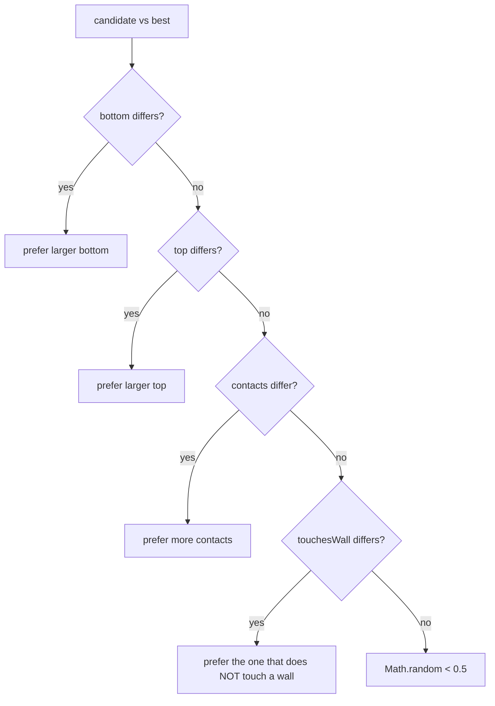

## Context

`planDemoDestination` (`packages/pentix-core/src/demo.ts`) ports the Delphi `CalcDemoDest` heuristic: it scans every reachable rotation angle × column, drops to the lowest reachable row, and scores each placement as `row + round((holesBefore − holesAfter) × 1.5) + fullLines²`. Ties were previously settled by scan order, which let the demo settle pieces away from the stack or the walls, leaving avoidable gaps.

## Goals / Non-Goals

**Goals:**

- Among equal-scoring placements, prefer the one with the most **contacts** — orthogonal touches with settled minos or the board walls (side walls, floor, ceiling).
- When contacts tie, prefer the placement that does **not** touch a side wall.
- Choose randomly between placements that are still indistinguishable.
- Plan the destination once per spawned piece and reuse it while steering, so a random tie never makes a falling piece jitter.
- Keep the planner's public API (`planDemoDestination(session): DemoDestination | null`) and scoring formula unchanged.

**Non-Goals:**

- No change to the score formula or to the bottom/top depth tie-breaks.
- No change to steering, demo phase handling, rendering, or engine operations; no server/storage/replay changes.

## Decisions

### 1. A single "contacts" score

For each occupied cell of the settled piece, add 1 for every orthogonal neighbor (up/down/left/right) that is either an already-settled mino (occupied in the pre-placement board) or outside the board bounds (a side wall, the floor, or the ceiling). The total is the candidate's `contacts`. One term is used throughout — **wall** — for the board boundary.

*Alternatives considered:* separate mino/edge counters (rejected — one total is simpler and is what the requirement asks for); 8-direction adjacency (rejected — orthogonal is the standard contact measure); counting only settled minos (rejected — the requirement includes the board boundary).

### 2. Compute contacts from the pre-placement board

`countContacts(baseGrid, width, height, cells)` reads the pre-placement occupancy (`baseGrid`), never the merged grid, so the piece is not counted as touching itself. It returns a single number stored on each `DemoChoice`.

*Alternative considered:* count on the merged grid and subtract self-adjacencies (rejected — error-prone).

### 3. Tie-break order

`preferCandidate` is a lexicographic comparison of two equal-score candidates: lower bottom, then lower top, then more contacts, then non-wall over wall-touching, then a random coin flip.

### 4. Random tie-break

When two candidates are indistinguishable on every criterion, `preferCandidate` returns a coin flip (`Math.random() < 0.5`). `planDemoDestination` is therefore intentionally non-deterministic for tied placements; tests pin `Math.random` where a specific outcome is asserted.

### 5. Plan once per spawned piece

Because ties are resolved randomly, re-running the planner on every steering tick could pick a different tied destination and make the piece oscillate left/right. The demo therefore plans once per spawned piece: `resolveDemoPlan(plan, session)` (`apps/pentix-web/src/engine/demo.ts`) returns the cached destination while `session.id` and `session.nextPieceIndex` are unchanged, and re-plans only when a new piece spawns or the session changes. `useDemoController` keeps the plan in a ref and passes it to `nextDemoAction(session, destination)`, which skips planning when a destination is supplied.

## Risks / Trade-offs

- [Random ties make the planner non-deterministic] → Mitigation: randomness only affects placements that are equal on every criterion; tests stub `Math.random` where needed.
- [The contact heuristic is approximate] → Mitigation: contacts only break ties among equal-score placements and are covered by dedicated tests.
- [Terminology: "wall" includes the floor and ceiling] → Mitigation: documented in the `countContacts` comment and the spec.
- [Extra per-candidate work] → Mitigation: negligible (`width × height × 4 angles × ≤5 cells × 4 neighbors`).

## Migration Plan

1. Merge contacts into one `contacts` field, prefer non-wall placements, and use a random final tie-break in `packages/pentix-core/src/demo.ts`.
2. Add `resolveDemoPlan` and use it in `useDemoController` so the destination is planned once per spawned piece.
3. Update the `planDemoDestination` tests (`tests/pentix-core.test.mjs`) and the demo steering tests (`tests/pentix-web.test.mjs`) for random ties and the once-per-piece cache.
4. Run `npm run lint`, `npm run build:web`, and `npm test`.
5. Rollback: restore the separate contact counters and deterministic tie-break.

## Open Questions

- Should diagonals count? Recommended no — orthogonal only.
