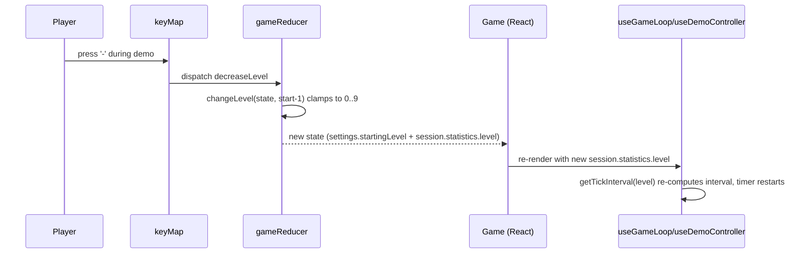

## Context

The browser gameplay client (`apps/pentix-web`) owns level control in `gameReducer.ts` and gravity timing in `gameLoop.ts`. Today `DEFAULT_SETTINGS.startingLevel` is `1`, only an `increaseLevel` action exists (`-` is unmapped), and that action only mutates `settings.startingLevel` — so while the demo is running (or any active session), changing the level has no visible effect until the next session starts. `getTickInterval` uses `800 − 70 × (level − 1)` with a 120 ms floor, which at level 9 yields 240 ms — noticeably slower than the classic client. The Delphi reference (`delphi/Demo/Pentix/Main.pas`) sets `Tetris.Speed := 1000 − 100 × FLevel` (level 9 → 100 ms, level 0 → 1000 ms), with `MaxLevel = 9`.

The client reads the live level as `session.statistics.level` (`Game.tsx`), and both `useGameLoop` and `useDemoController` derive their interval from that value via `getTickInterval`, re-running whenever `level` changes.

## Goals / Non-Goals

**Goals:**

- `+`/`-` (and `=`/`_`) step the configured level up/down, clamped to `0–9`.
- During the demo, the level change takes effect immediately on the running demo session (speed changes at once) and persists as the next session's starting level.
- Default starting level is `9`.
- The gravity interval matches the Delphi schedule `1000 − 100 × level` ms for levels `0–9`.

**Non-Goals:**

- No change to the shared engine's level progression ("+1 every 30 locked pieces, max 9") in `pentix-core`.
- No change to `setStartingLevel` (digit keys and the level grid) behavior beyond the new default — only `increaseLevel`/`decreaseLevel` apply to a running demo.
- No server, storage, persistence, or session-replay changes; the demo stays purely local.

## Decisions

### 1. One `changeLevel` helper guards both level actions

Add a private `changeLevel(state, nextLevel)` that clamps once with the existing `clampLevel` and returns a new state. `increaseLevel` calls it with `startingLevel + 1`; the new `decreaseLevel` with `startingLevel − 1`.

```ts
function changeLevel(state, level) {
  const startingLevel = clampLevel(level)
  const settings = { ...state.settings, startingLevel }
  if (state.phase === 'demo') {
    return { ...state, settings, session: applyStartingLevel(state.session, startingLevel) }
  }
  return { ...state, settings }
}
```

*Alternatives considered:* updating only `settings.startingLevel` (rejected — the demo speed never changes live, which is the reported bug); adding a separate `setLiveLevel` action (rejected — two keys for one concept). Reusing `applyStartingLevel` keeps the frozen-session update in one place and semantics identical to session creation.

### 2. Live-level updates are scoped to the demo phase

Only `phase === 'demo'` rewrites `session.statistics.level`. During `playing`, the engine owns level progression and manual keys keep their current meaning (adjust the next game's starting level). This matches the requirement "increase/decrease for the current demo too".

*Alternative considered:* always rewrite the live session level (rejected — would fight the engine's 30-piece level progression mid-game).

### 3. `getTickInterval` ports the Delphi schedule

Replace the constants with `1000 − 100 × level`, clamped so level 9 (the UI max) yields 100 ms:

```ts
const BASE_INTERVAL_MS = 1000
const LEVEL_STEP_MS = 100
const MIN_INTERVAL_MS = 100

export function getTickInterval(level: number): number {
  const normalized = Number.isFinite(level) ? Math.trunc(level) : 0
  return Math.max(MIN_INTERVAL_MS, BASE_INTERVAL_MS - normalized * LEVEL_STEP_MS)
}
```

This drops the old `normalizedLevel = max(1, trunc(level))` so level 0 correctly resolves to 1000 ms (Delphi's level 0 → 1000 ms) instead of being treated as level 1. Delphi's `Speed < 3 → 3` floor and its `Level > MaxLevel → 50` branch are unreachable for levels `0–9` (the UI clamps to 9), so a 100 ms floor is the faithful bound.

*Alternatives considered:* keeping `800 − 70 × (level − 1)` (rejected — slower than Delphi at high levels, the reported symptom); a lookup table (rejected — the linear formula is simpler and matches Delphi).

### 4. Map `-`/`_` to `decreaseLevel`

`keyMap.ts` already maps `+`/`=` to `increaseLevel`; add `case '-': case '_': return { type: 'decreaseLevel' }` in the same switch. This reuses the pure, testable `mapKeyToAction` surface and keeps keyboard and on-screen "▲ level" consistent (both dispatch the level actions).

### 5. Level-change flow during the demo



## Risks / Trade-offs

- [Manual level changes during a demo are overwritten on session restart] → Mitigation: the restart uses `settings.startingLevel`, which the same action updates, so the chosen level persists.
- [A live-level change mid-piece restarts both loop timers] → Mitigation: `useGameLoop`/`useDemoController` depend on `level` and simply re-arm with the new interval; no piece state is lost.
- [Changing the interval table invalidates the existing `>= 120` floor assertion] → Mitigation: update `tests/pentix-web.test.mjs` to assert `getTickInterval(20) === 100` and add the level 0/5/9 table.
- [Defensive `level > 9` clamps to 100 ms rather than Delphi's 50 ms] → Mitigation: unreachable in practice (level is capped at 9 everywhere); documenting this keeps the bound simple.

## Migration Plan

1. Update `DEFAULT_SETTINGS.startingLevel` to `9`; add `decreaseLevel` to the `GameAction` union and the reducer; add `changeLevel` and rewrite `increaseLevel`.
2. Add `-`/`_` mapping in `keyMap.ts`.
3. Rewrite `getTickInterval` constants and normalization in `gameLoop.ts`.
4. Update `tests/pentix-web.test.mjs` for the default (9), `decreaseLevel`, live-demo level changes, the `-` key, and the new interval table.
5. Run `npm run lint` and `npm test`; spot-check `npm run dev:web`.
6. Rollback: revert `DEFAULT_SETTINGS`, remove `decreaseLevel`/`-`, restore settings-only `increaseLevel`, and restore the old interval constants/normalization.

## Open Questions

- Should the digit keys (`0–9`) and the level grid also rewrite a running demo's live level, for full symmetry with `+`/`-`? Recommended: out of scope for now; `-`/`+` cover the reported interaction.