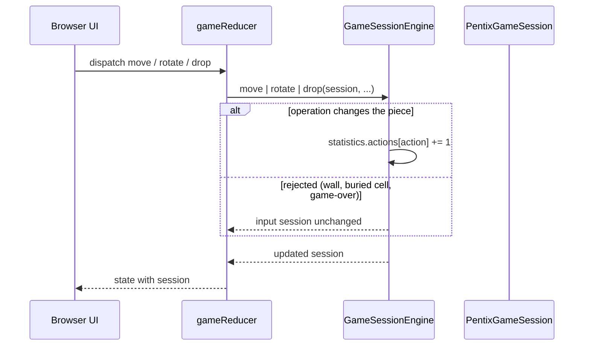
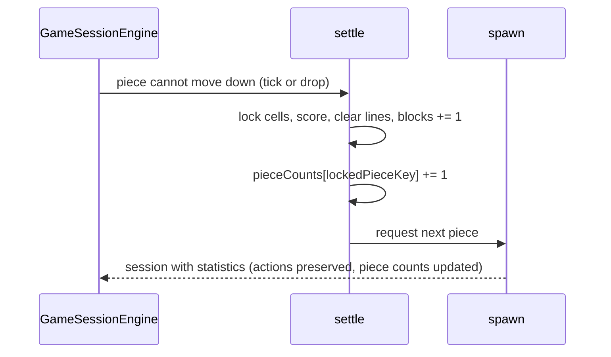

## Context

`apps/pentix-web/src/engine/gameReducer.ts` owns a `CollectedStats` value (`moveLeft`, `moveRight`, `rotate`, `drop`, `pieceCounts`) inside the browser `GameState`. It is incremented by the reducer's `move`/`rotate`/`drop` cases only when `phase === 'playing'`, and per-piece counts are attributed in `applyAdvance` by comparing `session.statistics.blocks` before and after an engine call. Consequences:

- The attract demo plays through the same reducer actions but is excluded, so a demo session can never show what it did.
- The counters describe UI input events, not gameplay actions, and are lost whenever the client rebuilds state from a session snapshot.
- Per-piece attribution depends on a fragile `blocks` delta check and on reading the pre-settle active piece.

The engine already owns every operation that changes a session (`GameSessionEngine.move/rotate/tick/drop`, `settle`, `spawn`) and already owns `GameSessionStatistics` (`score`, `level`, `clearedLines`, `blocks`). `PIECE_CATALOG` (29 keys) is already imported by `session.ts`. `replayPentixGameSession` folds `L`/`R`/`C`/`A`/`T`/`H` codes through the same engine, so any counter the engine keeps is reproduced by a replay automatically.

## Goals / Non-Goals

**Goals:**

- Record per-session statistics in `pentix-core`: aggregate `moves`, `rotates`, `drops` action counters and a per-piece lock count for all 29 catalog pieces.
- Make every session — player or demo — accumulate statistics as a property of the snapshot rather than of the UI phase.
- Remove the client-side statistics state, helpers, and `blocks`-delta attribution.
- Display the engine statistics in the existing secondary panel with action labels (Moves/Rotates/Drops) instead of key labels.

**Non-Goals:**

- Persisting or aggregating statistics server-side, high scores, or leaderboards.
- Changing the `session-replay` storage format (piece ID + action codes stays the same).
- Recording per-piece action breakdowns, timings, or soft-drop counts (there is no soft drop).
- Changing the HUD's scoring line (Score/Level/Lines/Pieces) or its styles.

## Decisions

1. **Extend `GameSessionStatistics` instead of adding top-level session fields.** The new shape is:

   ```ts
   export interface GameSessionActionCounts {
     readonly moves: number
     readonly rotates: number
     readonly drops: number
   }

   export interface GameSessionStatistics {
     readonly score: number
     readonly level: number
     readonly clearedLines: number
     readonly blocks: number
     readonly actions: GameSessionActionCounts
     readonly pieceCounts: Readonly<Record<PieceKey, number>>
   }
   ```

   One statistics object keeps the snapshot self-describing, lets `Hud` and `SecondaryStats` share the same prop type, and makes `applyStartingLevel`'s existing statistics spread preserve the counters for free. *Alternative considered:* top-level `session.actions`/`session.pieceCounts` — leaves the `gameplay-mechanics` scenarios that say "statistics unchanged" literally true, but splits statistics across the snapshot and forces the panel to take three props; rejected for cohesion. The affected scenarios are reworded to "scoring statistics" in this change's delta spec.

2. **Count effective operations only.** `move`, `rotate`, and `drop` record a count only on the path that changes the session; rejected operations return the input session and therefore change nothing. This keeps the engine pure (a no-op cannot mutate statistics) and prevents the attract demo from inflating counters with repeated blocked steering attempts. *Alternative considered:* count every invocation to mirror the old "key pressed" semantics — rejected because it would make a rejected rotation count and would require returning a modified session for a no-op.

3. **One aggregate `moves` counter, not `moveLeft`/`moveRight`.** The request is to collect actions rather than keys: a move in either direction is one action. The panel's existing combined left+right display therefore needs no summation in the UI. *Alternative considered:* keep directional counters — rejected as key-level detail the engine has no reason to store.

4. **Gravity ticks are not actions.** `tick` is automatic and stays uncounted; only calls that represent a user or demo decision (`move`, `rotate`, `drop`) count. This also matches the previous exclusion of gravity from key counts.

5. **Record `drops` on both drop paths.** `drop` either moves the piece to its lowest position and scores fall distance, or settles it immediately when there is no space below. Both are one hard-drop action, so the counter increments in both branches — including when the drop settles the piece and spawns the next.

6. **Per-piece counts increment inside `settle`.** `settle` already knows the locked piece (`getActivePiece(session).key`) and the resulting statistics, so it increments `pieceCounts[piece.key]` there. This removes the client-side `blocks`-delta heuristic entirely. `createPentixGameSession` initializes the map from `PIECE_CATALOG` with zeros for all 29 keys so consumers never have to guess whether a missing key means zero.

7. **A session owns its counters, so the demo records them and resets by construction.** The reducer's phase guard and `startSession`'s statistics reset disappear; `startDemo`/`startGame` already build a fresh session, which starts at zero. When a demo game ends, the existing `applyAdvance` demo branch swaps in a new demo session, so the demo's counters reset with its board.

8. **Replay equality is preserved by construction.** `replayPentixGameSession` issues the same `move`/`rotate`/`drop`/`tick` calls, so a replayed session reproduces identical `actions` and `pieceCounts`. `game`/`session` reconstruction does not need new data. A test pins this.

9. **The panel reads the session.** `SecondaryStats` takes `statistics: GameSessionStatistics` and renders `actions.moves` as "Moves", `actions.rotates`, `actions.drops`, and `PIECE_CATALOG.map(piece => statistics.pieceCounts[piece.key])`. `Game.tsx` passes `session.statistics`; `GameState` loses `collectedStats`.

### Recording flow



### Settle flow



## Risks / Trade-offs

- [The snapshot contract grows required TypeScript fields, breaking literals in tests and any external constructor] → Update the 8 hand-built statistics fixtures in `tests/pentix-core.test.mjs`, the `deepEqual` assertions in `tests/pentix-server.test.mjs`, and the web tests; the JSON change is additive, so version-tolerant REST consumers are unaffected.
- [Dropping statistics when a demo game ends hides the finished demo's numbers] → Accepted: the attract loop replaces the board immediately, exactly as before; the counters are visible during play and belong to the live session.
- [An aggregate `moves` count loses left/right detail forever] → Accepted per the requested action model; directional detail remains available in the `session-replay` action log if ever needed.
- [Counter increments could drift from actual play if a new engine path changes a piece without recording] → Keep recording inside the three existing engine methods and cover each with tests; `settle` is the only piece-lock path.
- [A rejected move no longer shows in the counts, unlike the old key counters] → Intentional semantics change (actions, not key presses); documented in the spec scenarios so it is not mistaken for a bug.

## Migration Plan

1. Extend `pentix-core`: statistics types and factory defaults, recording helpers in `session-engine.ts`, barrel exports.
2. Update core/server tests and fixtures to the new statistics shape, and add coverage for counters, settle counts, and replay equality.
3. Remove `CollectedStats`/`collectedStats` from the web reducer and re-point `SecondaryStats`/`Game.tsx` at `session.statistics`; update web tests.
4. Run `npm test`, `npm run lint`, and `npm run build`.

No data migration is required: the server stores only session action logs (piece IDs and action codes) and rebuilds sessions through the engine on load. Rollback is a straight revert of the `pentix-core` statistics extension and the web reducer/panel changes; persisted logs remain valid either way.
