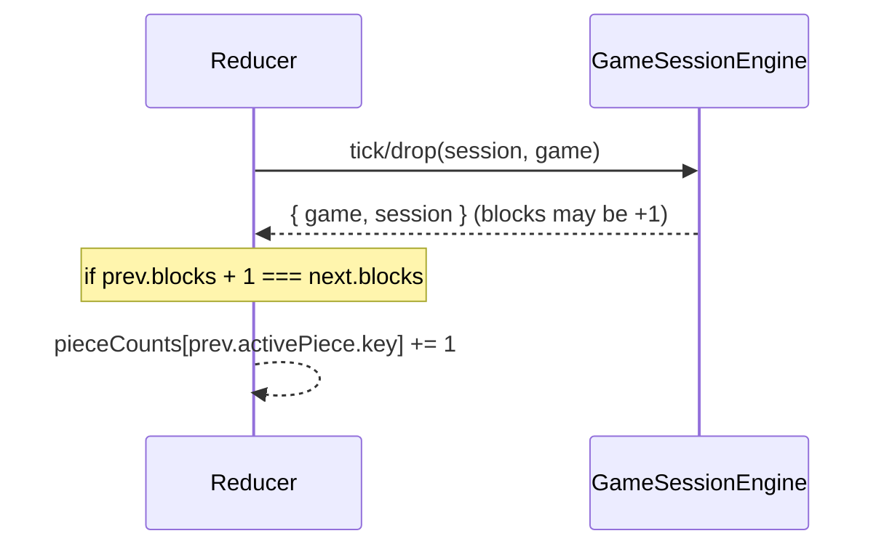

## Context

The browser HUD lives in `apps/pentix-web/src/games/pentix/Hud.tsx` and renders Score, Level, and Lines as vertically stacked blocks, followed by an optional next-piece preview. The game-over overlay is rendered inline in `apps/pentix-web/src/games/pentix/Game.tsx` and currently shows only a title and restart/demo buttons.

Two existing primitives make this change possible without touching the shared engine:

- `packages/pentix-core/src/catalog.ts` exports `PIECE_CATALOG`, a `29`-entry catalog (ids `0`–`28`, keys `1Line`…`5RMir`) with each piece's `id`, `key`, `colorName`, and offsets.
- `packages/pentix-core/src/session-engine.ts` already maintains `GameSessionStatistics.blocks`, incrementing once per locked piece inside `settle`. The per-settle delta is always exactly `+1`.

The web reducer (`apps/pentix-web/src/engine/gameReducer.ts`) is the single source of truth for gameplay state (`{ phase, settings, gravityEpoch, game, session }`) and dispatches `move`, `rotate`, `tick`, and `drop` actions. The `session-replay` capability already defines the single-character action alphabet `T`/`L`/`R`/`C`/`A`/`H`, and `keyMap.ts` translates physical keys into those reducer actions. No per-piece or per-action counters are collected anywhere today.

## Goals / Non-Goals

**Goals:**

- Show Score, Level, Lines, and Pieces on a single HUD line (Pieces = `statistics.blocks`).
- Collect, per player game: action counts (left/right/rotate/drop), aggregate rotate count, aggregate drop count, and a per-piece lock count for each of the 29 catalog pieces.
- On game-over, show a "Last game statistics" recap that includes the summary stats, the action/rotate/drop counts, and a collapsible, compact 29-piece panel.

**Non-Goals:**

- Changing `pentix-core`, `pentix-server`, or the `GameSessionStatistics` snapshot contract.
- Persistence, high scores, or server-side aggregation (see future statistics below).
- Recording these counters into the `session-replay` action log.

## Decisions

1. **Collect everything client-side in the reducer, not the shared engine.** The requested statistics are presentation concerns for the browser player, and the engine already supplies the raw facts (`statistics.blocks`, the active piece key, the catalog). *Alternative considered:* extend `GameSessionStatistics` in `pentix-core` — rejected because per-piece and per-action counters would change the shared snapshot contract and ripple into `pentix-server` and every API response, far beyond this UI feature.

2. **Attribute each locked piece from the `blocks` delta and the pre-settle active piece.** When `engine.tick`/`engine.drop` cause a settle, `result.session.statistics.blocks` becomes `prev.blocks + 1` and `result.session.activePiece.key` is the *next* spawned piece — so the locked piece is `state.session.activePiece.key`. The reducer increments that key's counter only when the delta is exactly `+1`. *Edge cases:* a hard drop that merely moves (no settle) does not increment; game-over still settles first, so the final piece is counted.

3. **Action counts use the `session-replay` alphabet, shown as pressed keys.** Track `moveLeft`, `moveRight`, `rotate`, and `drop` counters; display them identified by their keys (left/right/rotate/drop). Aggregate `rotateCount` equals `rotate`, and `dropCount` equals `drop`. Gravity ticks (`T`) are excluded from key-press counts because they are automatic, not key presses. *Alternative considered:* count successful state changes only — rejected because the ask is explicitly "shown as key pressed", i.e. input events.

4. **Single-line MainStatistics panel with the next piece leftmost.** Replace the stacked blocks with one `.hud__stats` flex row of compact `.hud__stat` label/value pairs inside a "MainStatistics" panel. When enabled, the next-piece preview is the leftmost item in the same row and renders inside a fixed 5×3 frame (the largest catalog bounding box), so the panel height never changes between pieces — fixing the dynamic-expansion bug.

5. **Collapsible secondary statistics panel in the sidebar.** A "Statistics" `CollapsiblePanel` (open by default, small font) renders in the right column directly below the MainStatistics panel, so the extra counters are live during play and persist through game-over. It contains a combined key count (left+right), rotates, drops, and a per-piece grid of all 29 pieces, each drawn with 5×5px minos and its count beside it, arranged in three rows of ten with the gap widened by 5px. The game-over overlay keeps only the title and the "Play again"/"Demo" buttons, which expose their `Enter`/`Space` hotkeys as popup tooltips (native `title` tooltips) instead of inline text.

6. **Counts reset per player game and ignore the demo.** Counters accumulate only while `phase === 'playing'` and reset on `start`/`restart`. The attract demo (`demoAction` → recursive reducer) is excluded so "last game" reflects the human player's run.

## Data shape

```ts
interface CollectedStats {
  readonly moveLeft: number
  readonly moveRight: number
  readonly rotate: number
  readonly drop: number
  readonly pieceCounts: Partial<Record<PieceKey, number>>
}
```

`rotateCount` is surfaced as `rotate`, and `dropCount` as `drop`.

## Attribution flow



## Risks / Trade-offs

- [Per-piece attribution could drift if the engine ever increments `blocks` by more than one] → attribute only on an exact `+1` delta; add a unit test that pins the settle behavior.
- [Demo actions could pollute the recap] → scope all counters to the `playing` phase and reset on `start`/`restart`.
- [29 items at small size may crowd narrow screens] → compact grid with small labels/values that wraps; verify at the `@media (max-width: 900px)` breakpoint.
- [A blocked rotation still counts as a key press] → acceptable and intentional under "shown as key pressed" semantics; documented here so it is not mistaken for a bug.

## Proposed Additional Statistics (future work)

| Statistic | Derivable today? | Notes |
| --- | --- | --- |
| Average score per piece | Yes | `score / blocks` computed in the UI. |
| Lines per minute | Yes | `clearedLines / elapsedTime`, needs a wall-clock timer read. |
| Play duration | Yes | Track elapsed time between `start` and `game-over`. |
| High score (best) | No | Needs persistence/local storage. |
| Tetris count (4-line clears) | No | `settle` would need to count `clearedRows.length === 4`. |
| Soft-drop count | No | `tick` does not distinguish gravity from manual soft drop. |

## Migration Plan

The change is additive within `apps/pentix-web`. Deploy by merging the web-app files; `npm run dev:web` and `npm run build:web` continue to work unchanged. Rollback: revert `gameReducer.ts`, `Hud.tsx`, `Game.tsx`, and `App.css` to restore the previous HUD and game-over overlay; `pentix-core` and `pentix-server` are untouched.

## Open Questions

- Should the 29-piece panel also surface in the live HUD (not only on game-over)? (Working assumption: game-over only for now.)
- Is "Pieces" the preferred label over "Blocks"? (Working assumption: "Pieces".)
- Should the tick (`T`) count be shown in the recap even though it is not a key press? (Working assumption: no.)