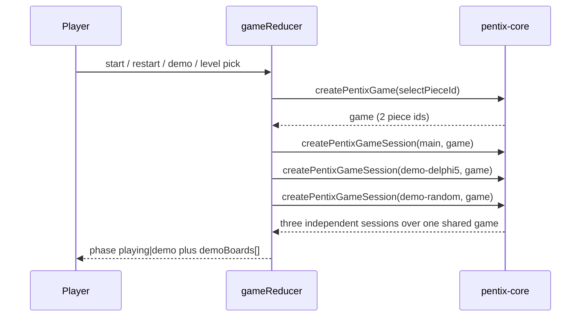
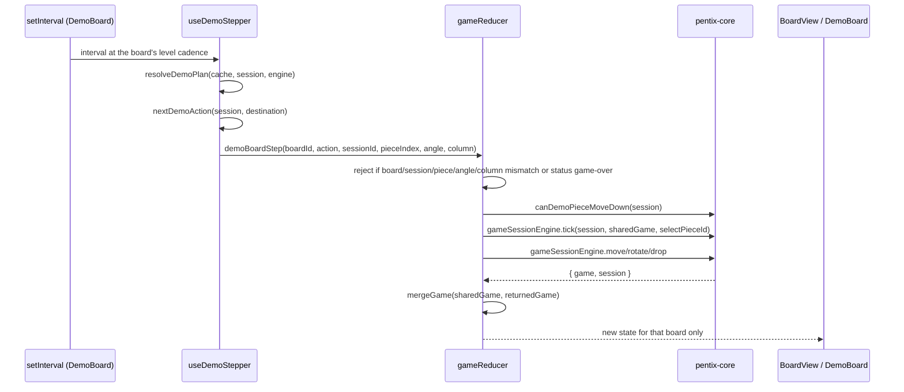

## Context

`apps/pentix-web` renders exactly one session. `Game.tsx` owns a single `useReducer` over `gameReducer.ts`, whose state is `{ phase, gameOverReady, settings, gravityEpoch, game, session }`. Every player action (`tick`, `move`, `rotate`, `drop`, `pause`, …) and the attract demo's `demoStep` mutate that one `game`/`session` pair through the shared `gameSessionEngine`. `useGameLoop` drives player gravity with `requestAnimationFrame`, `useDemoController` drives the attract demo with `setInterval` (one combined gravity+steering step per `getTickInterval(level)`), and `useDemoRestart` fires `demoRestart` after `GAME_OVER_COOLDOWN_MS`.

`pentix-core` already ships everything the parallel boards need: `createPentixGameSession({ id, userId, game })`, the `demoEngineRegistry` with the `delphi5` and `random` engines (each with `id` and human-readable `name`), `getDemoEngine(id)`, `resolveDemoPlan`/`nextDemoAction` in `src/engine/demo.ts` (already parameterised by `DemoEngine`), and `canDemoPieceMoveDown`.

Two facts shape the work:

- **The piece sequence lives on `PentixGame`.** `PentixGame.pieceIds` is a lazily extended array, and `advancePentixGameSession`/`gameSessionEngine.*` return `{ game, session }` where `game` may carry one extra piece id. So "the same game in all three sessions" means "one shared `PentixGame` whose piece list every session reads from", not "one shared session".
- **Layout is single-column on purpose.** `browser-gameplay` currently pins "one centered column whose width equals the board width" and "the space to the right of the board is empty", and `App.css` implements it with `.game { justify-items: center }` and `.game__column { width: min-content }`.

`apps/pentix-web` has no DOM test harness: `tests/pentix-web.test.mjs` exercises the reducer, projection, key map, tick interval, and demo helpers with `node:test`, so the reducer must stay framework-free and carry all board-set behavior. Layout is verified visually (`npm run dev:web` + screenshots) plus `npm run lint`, `npm run build:web`, `npm test`.

## Goals / Non-Goals

**Goals:**

- Render two small demo boards beside the main board, bottom-right, at a reduced mino size.
- Start those boards in parallel with a new main session, from the same `PentixGame`.
- Keep each board's session independent (board, statistics, level, piece index) while sharing the piece sequence.
- Auto-play board two with `delphi5` and board three with `random`, through the shared session engine.
- Keep the small boards running after the main board is over/paused, and hold their final board when their own session ends.
- Reserve the rail for a future 4 × 3 grid of twelve boards.

**Non-Goals:**

- No change to `pentix-core`, the demo-engine contract, the registry, or the REST server.
- No new statistics, scoring, or level rules; small boards reuse `GameSessionStatistics` as is.
- No player input, keyboard bindings, settings, or overlays on the small boards.
- No persistence, no routing, no new dependencies, no CSS framework or per-component stylesheet.
- No generic "N boards" configuration UI; the engine assignment is a code-level table.

## Decisions

1. **The board set lives in the one existing reducer.** `GameState` gains `demoBoards: readonly DemoBoardState[]`, where `DemoBoardState` is `{ id, engineId, session }`; `game` and `session` keep meaning "the main board's game/session". *Alternatives considered:* a `useReducer` per `DemoBoard` component — rejected because each board would generate its own `PentixGame`, so the three sessions could not share a piece sequence, and the logic would leave the node-testable reducer; a React context per board — rejected as the same split-brain problem with more machinery. Keeping `session`/`game` at the top level also keeps the existing reducer tests almost untouched (they all read `state.session`).

2. **A board set is built by one factory, `createBoardSet(deps, level)`.** It creates **one** `PentixGame`, then the main session and one session per entry of the engine table from that same game, applies the starting level to each, and returns `{ game, session, demoBoards }`. Engine table: `DEMO_BOARD_ENGINES = ['delphi5', 'random'] as const`, so the board ids are `demo-delphi5` and `demo-random`, and the display names come from `getDemoEngine(id).name` rather than being hardcoded. Adding a board later is one table entry; twelve boards will need unique slot ids, which this shape already allows.

3. **The piece list is merged, longest wins.** Every session operation already returns the game it used or extended, so the reducer keeps whichever of `state.game` and the returned game has more `pieceIds` (`mergeGame(shared, next)`). Because every board is fed the shared game, the two lists are always prefix-compatible and the sequence stays identical for all boards at every index. *Alternatives considered:* a fixed pre-generated piece array — rejected because it would need a new core concept and an unbounded pre-generation; per-board copies — rejected because the sequences would diverge as soon as two boards extend at different times.

4. **Two demo-step actions instead of one generic action.** The main board keeps `{ type: 'demoStep', action, sessionId, pieceIndex, angle, column }` (guarded by `phase === 'demo'`, reused by the whole reducer so a demo drop bumps `gravityEpoch`), and the small boards get `{ type: 'demoBoardStep', boardId, action, sessionId, pieceIndex, angle, column }`. Both funnel into one internal `runDemoStep(boardSession, game, step, selectPieceId)` helper that applies the gravity descent when `canDemoPieceMoveDown`, then the steering action. *Alternatives considered:* adding `boardId` to `demoStep` — rejected because the guard conditions differ (phase vs `status === 'active'`) and it would rewrite every existing demo-step test for no behavioural gain.



5. **Session resets follow user intent, not the attract demo's timer.** `createBoardSet` runs from `createInitialState` (initial page load), `start`, `restart`, `demo`, and the `setStartingLevel` path that starts a game from `game-over`. `demoRestart` — the `700` ms automatic restart of the finished attract demo — creates only a new main demo session, and it creates it from the existing board set's game, because the demo boards keep playing and their sessions reference that game id (a new game would make them stale). *Alternatives considered:* resetting on every session start, including `demoRestart` — rejected because a completed attract demo would wipe both small boards every few seconds, defeating the comparison; never resetting on `demo` — rejected because the player explicitly asked for a new session and stale finished boards would stay on screen.

6. **One hook instance and one plan cache per board.** `useDemoController.ts` gains a shared `useDemoStepper({ boardId, engine, level, session, dispatch, active })` that holds the `DemoPlan` cache in a `useRef` and dispatches one step per interval. `useDemoController` stays as a thin wrapper for the main board (the active demo engine, `demoStep`), and `DemoBoard` calls the stepper with its own engine and `demoBoardStep`. Because each `DemoBoard` is its own component instance, every board gets an independent timer, cache, and stale-step payload; no shared mutable state is introduced. *Alternatives considered:* stepping all boards from one interval in `Game.tsx` — rejected because each board's cadence follows its own level and each needs its own cache.

   While the demo boards are being evaluated, `engine/demo.ts` carries a temporary `DEMO_ENGINE_OVERRIDE = 'random'`, so the main board's attract demo runs the same engine as the third demo board; setting it to `null` restores the registry default (`delphi5`) without touching anything else.

7. **Rendering reuses `BoardView` with a compact flag.** `BoardView` gains an optional `compact` prop that adds `board--mini`; that class rebinds `--cell-size` to `var(--demo-cell-size)`, which both the inline `grid-template-*` and the `.cell` rules already read, so the grid stays data-driven from `session.board.width`/`height` and no cell size is passed through props. `DemoBoard` renders its own header (engine name plus `Score`/`Lines`/`Pieces` from `statistics`) and a game-over marker, and deliberately does not mount `Hud`, `SecondaryStats`, `Controls`, `Settings`, or any overlay.

8. **The rail is a top-left 4 × 3 grid, level with the statistics.** `.game__layout` becomes a two-track grid (`min-content` for the main column, `auto` for the rail) with `align-items: start`, so the rail's first row starts level with the statistics line; the rail itself is `display: grid; grid-template-columns: repeat(4, var(--demo-slot-width)); align-content: start; justify-content: start`, with `--demo-slot-width` derived from `--demo-cell-size`, the board padding, and the card chrome, which reserves all twelve slots from the top-left corner while only two are filled. `--demo-cell-size` is `9px` at desktop, `7px` at a `1000px` viewport (the four reserved slots no longer fit beside the board below that width), and `6px` at the existing `900px` breakpoint; the rail gap is `0.6rem`, slightly wider than the card padding, so neighbouring boards stay visually separate. Below `760px` the layout collapses to one column and the rail stacks under the main column, two slots per row below `480px`. *Alternatives considered:* `flex-wrap` on the rail — rejected because it cannot reserve future slots without phantom elements; measuring the board with a `ResizeObserver` — rejected as unnecessary while every board is a default 12-column board, and the slot width stays a single CSS variable to revisit when board sizes differ; bottom-anchoring the rail — rejected after review because the boards drifted far below the statistics and left the top-right area empty.

9. **Small boards are independent of main-board control flow.** Their steppers are gated only by `session.status === 'active'`, so `paused`, `game-over`, `demo`, and `demo-over` on the main board do not affect them, and the pieces popup (which pauses the player game and the main demo) leaves them running. The reducer still refuses a step whose payload no longer matches the board's session, so a late interval after a reset is a no-op.

10. **A demo level change retunes the rail.** `changeLevel` already applied a chosen level to the live main demo session; it now also maps `applyStartingLevel` over `demoBoards` in the `demo` and `demo-over` phases, so the level buttons, `+`/`-`, and the digit keys change every board's cadence together (the finished main demo keeps the level it played at, while the still-running rail follows immediately). The player-game path is untouched, because a player's level raise belongs to that session; and `demoRestart` keeps applying the configured level to the new main demo session, which by then matches the rail. *Alternatives considered:* retuning the rail only on the next `demoRestart` — rejected because the boards would visibly lag the main demo and the level buttons would look inert for them; retuning during a player game — rejected because the player raising their own difficulty should not change the comparison boards mid-run.



## Risks / Trade-offs

- [Three independent timers plus the player's `requestAnimationFrame` loop] → Each demo timer runs at the board's own level cadence and plans once per spawned piece, so the added work is one session operation per board per interval; background tabs already throttle `setInterval`, and the reducer ignores stale steps.
- [Merging games assumes every board received the shared game] → `createBoardSet` is the only place sessions are created and always passes the board set's game; a reducer test asserts one `gameId` and identical pieces at equal indices, so a future per-board selector fails loudly instead of silently diverging.
- [A session operation may return a shorter piece list than the shared game when a step is applied from an older snapshot] → `mergeGame` keeps the longer list, and every engine operation accepts the shared game, so a board can only add pieces, never drop them.
- [Small boards resetting when the player picks `Demo` after game over may look like lost progress] → The boards are demos with no player investment; the reset keeps the intended rule "a new main session starts a new board set", and the attract demo's own auto-restart (the frequent case) does not reset them.
- [The reserved rail width is derived from the default 12-column board] → The slot width is a single CSS variable and `BoardView` still uses the session's stored dimensions; when boards of other sizes join the rail, the slot width becomes the maximum board width.
- [Twelve boards will eventually be expensive and visually dense] → The state is already a list and the rail is already a 4 × 3 grid, so adding boards is a table change; a later change can add a shared scheduler or caps.
- [Reduced minos (`9px`, `7px`, `6px`) make the active-piece glow and the 4px cell radius dominate] → `.board--mini` tightens the gap, padding, and radius, and the visual check covers every breakpoint.

## Migration Plan

1. Land the reducer board set (`demoBoards`, `createBoardSet`, `mergeGame`, `demoBoardStep`) with its tests.
2. Add the shared `useDemoStepper`, the `DemoBoard` component, and the `BoardView` compact variant.
3. Restructure `Game.tsx` into `.game__layout` (main column + rail) and add the `App.css` rail and small-board styles.
4. Update `README.md`'s browser-client capability list to include the two demo boards.
5. Verify with `npm run dev:web` at desktop, `900px`, and mobile widths (two boards bottom-right, space reserved for twelve, main board unchanged), then `npm run lint`, `npm run build:web`, and `npm test`.

**Rollback:** revert `apps/pentix-web/src/engine/gameReducer.ts`, `apps/pentix-web/src/games/pentix/Game.tsx`, `BoardView.tsx`, `useDemoController.ts`, `App.css`, the `README.md` capability list, delete `DemoBoard.tsx` and `useDemoBoard.ts`, and revert `tests/pentix-web.test.mjs`. Nothing is persisted and no other package changed, so the rollback restores the single-board screen exactly.

## Open Questions

- Should the small boards also pause while the browser tab is hidden? (Working assumption: no — they are already throttled by the browser and resume where they were.)
- Should a finished small board restart itself after the game-over delay? (Resolved: no — it holds its final board until a new main session starts, matching the requested lifecycle.)
- Should the engine name render above each small board or below it? (Working assumption: above, in the same compact header as the statistics.)

```

```
