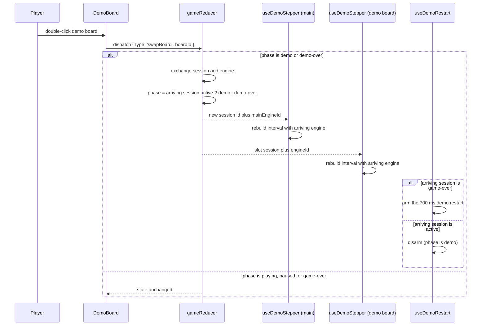

## Context

The browser client (`apps/pentix-web`) keeps one `PentixGame` and three sessions in a single reducer state (`apps/pentix-web/src/engine/gameReducer.ts`): the main board's session plus two demo boards whose ids are derived from their engine ids (`demo-delphi5`, `demo-random`). The attract demo's engine is still a module-level constant with a temporary override comment (`DEMO_ENGINE_OVERRIDE = 'random'` in `apps/pentix-web/src/engine/demo.ts`), and `useDemoController` reads that constant directly, so the reducer cannot know or change which engine drives the main board. The demo already restarts itself after `GAME_OVER_COOLDOWN_MS` (`700` ms): `applyAdvance` moves a finished demo into the `demo-over` phase, `useDemoRestart` waits the delay, and the `demoRestart` action starts one fresh main session. The statistics panel (`Hud.tsx`) shows only score, lines, and pieces; nothing identifies the main board's occupant.

Constraints: strict TypeScript, no new dependencies, the client stays local and unpersisted (no `PentixServer` calls, no session-replay actions for demo boards), and the reducer stays a pure, headless-testable function because `tests/pentix-web.test.mjs` exercises it with `node:test` and no DOM.

## Goals / Non-Goals

**Goals:**

- Make `random` the main board's attract-demo engine by default, selected from the registry by id and stored in game state instead of a temporary constant.
- Show `Player01` on the main board during a player game and the demo engine's display name while the demo runs, including during the demo's post-game-over delay.
- Let the player double-click a small demo board to move that session and its engine to the main board, sending the main board's previous session and engine into the freed rail slot.
- Keep the existing demo restart after the game-over delay working through every new path, including a swapped main board.
- Preserve every board-set invariant: one shared `PentixGame`, per-board stepping, stale-step rejection, rail-wide level retuning, and untouched sessions on a player action.

**Non-Goals:**

- Real user identity, login, or names from `PentixServer`; `Player01` is a placeholder until users are wired in.
- Persisting swapped sessions, recording replay actions, or any HTTP/API change.
- More than two demo boards, drag-and-drop or keyboard-driven swapping, swap animations, or reordering the rail.
- Swapping during a player game, which would strand the player's own session in a demo slot.

## Decisions

### Decision 1: The main board's engine id lives in `GameState`

Add `readonly mainEngineId: DemoEngineId` to `GameState`, initialized from a new exported constant `MAIN_DEMO_ENGINE_ID: DemoEngineId = 'random'`. `createBoardSet` returns the main engine id along with the game and sessions, `startSession` re-applies it on every fresh board set, and `restartDemoSession` keeps the current one. `demo.ts` loses `DEMO_ENGINE_OVERRIDE`, `ACTIVE_DEMO_ENGINE_ID`, and `activeDemoEngine`; `resolveDemoPlan` takes `engine` as a required argument and `nextDemoAction` takes `destination` as a required argument, so no caller can silently fall back to a module-level engine.

- Why state: the swap must move engines between boards, `demoRestart` must reuse the main board's current engine, and tests must assert the engine without importing a mutable module constant.
- Alternative rejected: keeping a module constant and swapping it imperatively — the reducer would become impure and its tests order-dependent.
- Alternative rejected: passing the engine only through React props — the reducer still needs it for `demoRestart` and for the demo step guards.

### Decision 2: Demo boards are addressed by rail slot, not by engine

`demoBoardId(index)` returns `demo-slot-<n+1>` (`demo-slot-1`, `demo-slot-2`), and `DEMO_BOARD_ENGINES` becomes the initial assignment used only when a board set is created (`delphi5` for slot 1, `random` for slot 2). `DemoBoardState.engineId` stays mutable per slot, so an engine travels with the session it planned.

- Why: engine-derived ids collide after a swap (two slots could claim `demo-random`), which would break React keys, `demoBoardStep` addressing, and the "one board at a time" rule.
- Alternative rejected: swapping only sessions and keeping engine ids — the slot would then play an engine its id denies, and a second swap would address the wrong board.

### Decision 3: The swap is one reducer action

Add `{ type: 'swapBoard'; boardId: string }`. The reducer applies it only when `phase` is `demo` or `demo-over` and the board id exists; it exchanges `session`/`mainEngineId` with the addressed board's `session`/`engineId`, leaves `game`, `settings`, `demoBoards` order, and every other board untouched, and derives the new phase from the arriving session's status (`active` → `demo`, `game-over` → `demo-over`). Mounting the delay timer is left to the existing `useDemoRestart` hook, which arms when the phase becomes `demo-over` and is cancelled when the swap moves the board back to `demo`.

- Why the reducer: swapping in the component would duplicate the same state transitions outside the tested pure function, and the phase guards already live there.
- Alternative rejected: an `onDoubleClick` handler that builds a new state object in local component state — the game state must stay a single source of truth.

### Decision 4: The UI reflects, the reducer decides

`DemoBoard` receives `canSwap: boolean` (true for `demo`/`demo-over`) and dispatches `swapBoard` from `onDoubleClick`. When `canSwap` is true it also renders a `demo-board--swap` modifier class and a `title` hint (`Double-click to move to the main board`); during a player game the card renders as before, and the reducer ignores any stray action.

### Decision 5: The main board names its occupant from state

`PLAYER_NAME = 'Player01'` is exported from `gameReducer.ts` next to `MAIN_DEMO_ENGINE_ID`, and a pure helper `mainBoardName(state)` returns `getDemoEngine(state.mainEngineId).name` for `demo`/`demo-over` and `PLAYER_NAME` otherwise. `Game.tsx` passes that string to `Hud`, which renders it as one `hud__player` line above the statistics row (the statistics line keeps the next-piece preview leftmost and gains no new items). The demo boards need no change: their header already reads the display name of the engine assigned to the slot, which follows a swap automatically.

### Decision 6: The demo stepper is rebuilt per engine

`useDemoController(active, level, session, engineId, dispatch)` resolves the engine from the id and passes it to the existing `useDemoStepper`. The stepper's interval effect already depends on `engine`, so a swap tears down the old timer and rebuilds it with the arriving engine. The plan cache is keyed by `sessionId` + `nextPieceIndex`, so a swapped-in session never reuses the previous board's plan, and a `demoStep` queued before the swap is rejected by `isCurrentPlacement`.

### Swap flow

## Risks / Trade-offs

- **[Two boards can show the same engine name after a swap]** → Accepted: slot ids, React keys, and step addressing all stay unique, and the rail still labels each card with the engine it currently plays. The duplicate label reads as two runs of the same engine, which is accurate.
- **[A double-click races the demo restart timer]** → Both directions are guarded: if the swap lands first the phase leaves `demo-over`, so the queued `demoRestart` is rejected; if the restart lands first the swap applies to the fresh `demo` phase and still exchanges the clicked session.
- **[Removing `activeDemoEngine` breaks existing imports]** → The three consumers (`demo.ts` defaults, `useDemoController.ts`, and tests) are updated in the same change, and `npm run build:web` fails fast on any missed import.
- **[A stale plan or step could steer the swapped-in session]** → Plans are keyed by `sessionId` + `nextPieceIndex`, and `demoStep`/`demoBoardStep` still require an exact session/placement match; the timer is also rebuilt on the engine change.
- **[`Player01` implies a real identity that does not exist yet]** → Documented as a placeholder constant; the session `userId` is untouched, so wiring real users later only replaces the display source.

## Migration Plan

1. Land the reducer and engine changes with the tests (`gameReducer.ts`, `demo.ts`, `useDemoController.ts`, `tests/pentix-web.test.mjs`) so the swap and engine rules are verified headlessly.
2. Land the UI changes (`DemoBoard.tsx`, `Game.tsx`, `Hud.tsx`, `App.css`) and verify by hand in `npm run dev:web`: the name line, a double-click swap, both boards continuing to play, and the demo restarting after the `700` ms delay.
3. No data migration: browser state is rebuilt on page load, and no session is persisted or sent to `PentixServer`.
4. Rollback: restore engine-derived board ids and the fixed engine assignment, delete `mainEngineId`, `mainBoardName`, `PLAYER_NAME`, and the `swapBoard` action, remove the double-click handler and the name line, and reinstate the temporary engine override in `demo.ts`. The demo restart and its delay predate this change and stay untouched.

## Open Questions

- Should the main board's swapped engine survive a page reload? No: the initial board set always starts at `random`, matching the current unpersisted client.
- Should `Player01` eventually come from the active `User`? Yes, but it needs user selection/authentication, which is out of scope here.

## Follow-up Decisions (from manual testing)

### Decision 7: A demo step that cannot be steered locks instead of waiting

Manual testing showed the attract demo freezing mid-game: the plan names a destination the piece can no longer reach (the target column or angle is blocked once the piece has descended past the obstruction), so `move`/`rotate` return the unchanged session and the piece never aligns and never locks. `runDemoStep` now treats an unchanged steering result on a resting piece as an unreachable destination and locks the piece through `gameSessionEngine.tick`, which keeps the same engine in charge of settling, line clears, scoring, and game-over detection. The steering switch was extracted to `applyDemoAction` so the descent + steer + fallback sequence stays readable.

- Why in the reducer: both the main demo and every rail board run through the same step function, so one fix covers them and the rule is testable without React.
- Alternative rejected: teaching each planner about reachability — the planners choose a destination, not a path, and every engine would need the same fix.

### Decision 8: The gameplay area overhangs the header by 4px per side

`.game__layout` keeps the board column first and now spans `calc(100% + 8px)` with `margin-inline: -4px`, so its left edge is 4px left of the `.hero` header (the shell's content box) and its right edge 4px right of it, with the rail filling the remaining width. `.game` no longer centers its child, so the board sits at that left edge. `.shell` gains `overflow-x: clip` so the overhang cannot create a horizontal scrollbar on viewports where the shell already fills the screen; the stacking breakpoint keeps its single-column rail with the same boundaries.

- Why the shell and not a viewport-relative calc: the header is the reference, and it is exactly the shell's content box, so percentages keep the rule true at every width without measuring text.
- Alternative rejected: aligning to the wordmark glyphs — the wordmark is centered text inside the header, so its glyph edges are not a stable layout box at different fonts and widths.

### Decision 9: The demo minos are sized by the four-per-row wall

The rail reserves four slots per row and three rows, so the demo mino is bounded by width, not height: four slots of `12` minos each, the `31` px of fixed chrome per slot (`11` px of `1` px cell gaps, `4` px board padding, `4` px card padding, `2` px of borders) and the three `0.6rem + 0.25rem` horizontal gaps must fit the rail column. Measured from the shipped layout, the rail is `735.31` px at the `1100` px shell, which allows `11.88` px minos, so `11` px is the desktop maximum; each narrower breakpoint (`1089`, `1041`, `993`, `945`, `800`) is the exact viewport where the next larger size would overflow. The extra `0.25rem` (`4` px at the default root) lives in `--demo-rail-gap`, applied as `column-gap` only, so rows keep their `0.6rem` spacing and the slot-width formula is untouched.

- Why steps instead of a fluid size: integer minos keep the `1 px` grid gaps and cell borders crisp, and the breakpoints are easy to verify with measured geometry.
- Alternative rejected: sizing the minos from the rail with container-query units — the rail's inline size is resolved from content that depends on the mino size, and the feedback makes intrinsic sizing unreliable.

### Decision 10: The demo wall's fit is verified by measurement

Each breakpoint was checked in headless Edge: `4 × slot + 3 × gap ≤ rail width` holds at `1440`, `1280`, `1100`, `1089`, `1041`, `994`, `993`, `946`, `945`, `901`, `900`, `801`, `800`, `760`, `480`, and `360` px, with no horizontal page scroll anywhere and a `0.85rem` column gap (`13.6` px at the default root) against the `0.6rem` row gap. Below `480` px the rail uses two slots per row, which the same check models with two slots and one gap.

