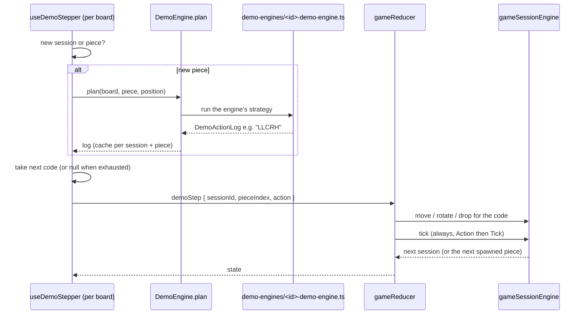

## Context

The demo seam already exists: `packages/pentix-core/src/demo-engine.ts` defines a `DemoEngine` interface with two operations (`planDestination`, `planLastTickMove`), a `DemoEngineRegistry`, a `getDemoEngine(id)` helper, and a module singleton registering `delphi5DemoEngine` and `randomDemoEngine` from `demo-delphi5.ts` and `demo-random.ts`. `apps/pentix-web/src/engine/demo.ts` caches a destination per session/piece, calls `planLastTickMove` on later ticks, and turns the destination into one reducer action at a time (rotate, then move, then drop). `gameReducer.ts` applies a gravity descent followed by that steering action, with a fallback that locks a resting piece whose destination became unreachable, and builds the rail from a hard-coded `DEMO_BOARD_ENGINES = ['delphi5', 'random']`.

The repository already owns a compact, replayable action vocabulary in `session-log.ts`: `T` (tick), `L` (left), `R` (right), `C` (clockwise), `A` (anticlockwise), `H` (hard drop), with `replayPentixGameSession` folding those codes through `gameSessionEngine`. That makes a per-piece action string the natural engine output — but the demo engine seam is still built around a scored destination instead.

The next step is a crowd of engines written by AIs. A two-method, destination-returning contract is the wrong shape for that: the strategy can only answer "where", the driver owns "how", the last tick needs a second call with special semantics, and an AI author must understand the client's steering loop to produce anything playable. What an engine should return is the piece's action program.

Constraints: strict TypeScript with `erasableSyntaxOnly`, NodeNext ESM with `.js` import specifiers, no new dependencies, `tests/pentix-core.test.mjs` and `tests/pentix-web.test.mjs` drive the behaviour with `node:test`, and the browser client stays local and unpersisted.

## Goals / Non-Goals

**Goals:**

- Make one demo engine equal one module with a uniform, documented shape: `id`, `name`, `description`, and one `plan(board, piece, position)` function returning a replayable action log.
- Define one action alphabet shared with the session replay vocabulary, and forbid `T` so tick timing belongs to the driver.
- Fix the driving rule: Action, Tick, Action, Tick, … from the piece's spawn, then ticks alone until it locks.
- Reject malformed engines at registration time with errors that name the offending engine or member.
- Expose engine metadata (`id`, `name`, `description`) to the UI without exposing planners.
- Drive the rail from the registry so registering an engine adds a board with no browser-client change.
- Ship `docs/demo-engine-task.md` as the one brief every AI receives, including the alphabet and the Action-Tick rule.
- Rewrite `delphi5` and `random` to emit logs while keeping their destination choices.

**Non-Goals:**

- No new heuristics in this change: the two built-ins keep `planDemoDestination` and the random reachable-pair pick.
- No last-tick side-step: the contract has one call per piece and no mid-piece re-planning.
- No per-tick engine calls, no engine access to the reducer, and no ticks inside a log.
- No runtime engine picker (Settings, URL parameter, or persisted preference); the main board keeps `random`.
- No changes to `gameSessionEngine`, `placement.ts`, `demo.ts` scoring, the reducer's phase model, the server, storage, or the session-replay format.
- No sandboxing or timing limits around third-party engine code; engines are reviewed and tested like any other repository code.

## Decisions

### 1. One file, four exports, one `plan(board, piece, position)` returning an action log

An engine module is `packages/pentix-core/src/demo-engines/<engine-id>-demo-engine.ts` and exports:

```ts
export const id = 'delphi5' // supplied by the repository
export const name = 'Delphi 5' // supplied by the repository
export const description = '...' // supplied by the repository
export function plan(
  board: DemoBoard, // rows of 0 (free) / 1 (occupied)
  piece: DemoPiece, // reachable orientations, current first
  position: DemoPosition, // the rotation point on the board
): DemoActionLog
```

`DemoActionLog` is a string over `DemoAction = 'L' | 'R' | 'C' | 'A' | 'H'`, for example `"LLCRH"`. The engine sees only the visible board, the active piece's reachable orientations, and that rotation point — no session, statistics, or next piece. `id`, `name`, and `description` are written by the repository, so the AI task asks only for `plan`. `DemoEngine` is exactly the module shape, so the registry stores the module namespace object itself. An empty string means "no actions for this piece"; the piece simply falls.

- Why a log: it is the same representation the session replay already uses, it is trivially testable (compare strings), it can be replayed and diffed, and it removes the client's steering rules from the strategy contract.
- Why a string rather than an array: it is the repository's existing action-log format, it is compact in state and test output, and every character is one reducer action.
- Alternative rejected: keeping `planDestination`/`planLastTickMove` and deriving a log in the driver — that keeps the steering heuristics in the client and the second engine call in the contract.
- Alternative rejected: returning an array of `DemoAction` values — it buys type safety the module boundary already validates with `isDemoAction`, and it stops matching the session log.

### 2. `T` is excluded; the driver applies Action then Tick

The demo driver applies one log character per gravity interval and then one `gameSessionEngine.tick` in the same step. From the piece's spawn the order is `Action, Tick, Action, Tick, …`; once the log is exhausted, the driver applies ticks only until the piece locks. An engine that emitted `T` would be planning time, which it does not own.

| Engine log | Demo applies |
| --- | --- |
| `"LRH"` | `L`, tick, `R`, tick, `H`, tick |
| `""` | tick, tick, … until the piece locks |
| `"LL"` (piece lands early) | `L`, tick, `L`, tick (locks or falls), then ticks |

- Why: gravity is the driver's clock and the piece's fall speed depends on the level, the board, and the piece; an engine cannot know how many ticks a move takes.
- Why Action before Tick: the piece should get the chance to move on the tick it spawns, and the last action must land before the tick that settles the piece.
- Why ticks continue after the log: a log only plans commands; the piece still has to fall and lock.
- Alternative rejected: interleaving explicit `T` in the log — it duplicates the session-replay format, makes every engine responsible for timing, and breaks when the level changes mid-piece.

### 3. The stepper replays one log per piece and drops what the piece outlives

`apps/pentix-web/src/engine/demo.ts` replaces the cached destination with a cached queue: `{ sessionId, pieceIndex, actions, index }`. On a new session or piece it builds the minimal input with `createDemoEngineInput(session)`, calls `engine.plan(board, piece, position)`, and resets the cursor; otherwise it takes `actions[index]` and advances. A step dispatches `{ type: 'demoStep' | 'demoBoardStep', sessionId, pieceIndex, action }`, where `action` is the next character or `null` once the log is exhausted. The reducer applies the action, then a tick; a step whose session id or piece index no longer matches is ignored.

- Why cache the log: replaying a planned program is deterministic and cheap, and the demo must not re-plan mid-piece.
- Why `null` steps: the log ends long before the piece locks, and the driver still owes one tick per interval.
- Why drop leftovers: a blocked action or an early landing can end the piece before the log does; the next piece index invalidates the queue, so stale commands never leak into the next piece.
- Alternative rejected: putting the queue in reducer state — the reducer would own engine output, and a swap/restart would have to clear it; a ref in the existing stepper keeps the reducer pure and per-board.

### 4. Commands run through the shared engine; blocked commands are no-ops

The reducer maps each code to `gameSessionEngine.move`/`rotate`/`drop` and then calls `gameSessionEngine.tick`. An action the board blocks leaves the session unchanged, and the paired tick still happens, so every interval makes progress and a resting piece locks instead of waiting for an unreachable command. This replaces `runDemoStep`'s "blocked on a resting piece ⇒ lock" fallback, which becomes unnecessary.

- Why: the shared engine stays the only mutator, and the Action-Tick pairing guarantees liveness for any log, including a wrong one.
- Alternative rejected: rejecting the whole step when an action fails — it would stall a policy whose plan drifted, the exact deadlock the old fallback patched.

### 5. One shared destination-to-actions converter

`packages/pentix-core/src/demo-actions.ts` owns the vocabulary and the conversion:

```ts
export type DemoAction = Exclude<SessionAction, 'T'>
export const DEMO_ACTION_CODES = Object.freeze({
  left: SESSION_ACTIONS.left, // 'L' — the same codes as the session log
  right: SESSION_ACTIONS.right,
  clockwise: SESSION_ACTIONS.clockwise,
  anticlockwise: SESSION_ACTIONS.anticlockwise,
  hardDrop: SESSION_ACTIONS.hardDrop,
} satisfies Record<string, DemoAction>)
export function isDemoAction(code: string): code is DemoAction
export function demoLandingRow(
  board: DemoBoard,
  cells: DemoPieceOrientation,
  column: number,
): number | null
export function actionsToward(
  orientation: number,
  position: DemoPosition,
  column: number,
): DemoActionLog
export function createDemoEngineInput(
  session: PentixGameSession,
): DemoEngineInput
```

The alphabet is not declared twice: `DemoAction` is `SessionAction` without `T`, and every code is read from `SESSION_ACTIONS`.

`createDemoEngineInput` lists the piece's reachable orientations by replaying the game's own `clockwise` rotation (which normalizes `-90` per rotation mode) and extracts the board and rotation point; `demoLandingRow` drops an orientation in a column; `actionsToward` emits `C` steps (one per orientation index), then `L`/`R`, then `H`.

- Why: both built-ins need identical conversion, the driver needs one place to extract the minimal input, and the rotation/move arithmetic lives in one tested place instead of in every engine.
- Why `H`: the classic demo hard-drops once aligned, and the drop keeps the demo at the same pace without relying on ticks to travel the remaining rows.
- Alternative rejected: letting engines compute rotations themselves — every engine would re-implement rotation-mode normalization (including `none`/`half`) and drift.

### 6. The last-tick side-step is removed from the demo contract

The base `demo-mode` spec has two requirements about last-tick side-steps and the `demo-engines` contract has a last-tick operation. Both go away: an engine plans once per piece, and the driver no longer re-plans when the piece rests. `planDemoDestination` keeps scoring side-step placements, so the chosen destination still accounts for them; `planDemoLastTickMove` remains a pure exported classic helper (and stays covered by the core planner tests) but is not called by the demo and is not offered in the toolkit.

- Why: a per-tick side-step cannot be expressed by a one-shot log, and the user-facing contract explicitly keeps one function per engine.
- Why keep `planDemoLastTickMove`: it is part of the faithful Delphi port, it is still tested, and deleting it would widen the removal beyond the demo contract.
- Alternative rejected: letting the log encode "wait until resting, then step" — a log has no timing, and the driver would have to parse intent from actions.
- Consequence: a demo piece no longer shifts one column at the last tick; its destination is where the log steers it.

### 7. The toolkit is the only helper surface engine modules may import

`packages/pentix-core/src/demo-engine-toolkit.ts` re-exports the pure helpers an engine or its wrapper needs: `DEMO_ACTION_CODES`, `actionsToward`, `createDemoEngineInput`, `demoLandingRow`, `demoCanPlace`, `demoPieceCells`, `createDemoEngineInput`, `isDemoAction`, `planDemoDestinationForOrientations`, plus the `DemoAction`, `DemoActionLog`, `DemoBoard`, `DemoEngineInput`, `DemoPiece`, `DemoPieceCell`, `DemoPieceOrientation`, `DemoPosition`, `DemoDestination`, `DemoOrientationDestination`, and `BoardSnapshot` types.

- Why: engine modules must not reach into unrelated internals, and a documented list is what the AI brief can promise. The built-ins need the orientation list, the landing check, and the classic planner; the toolkit makes that dependency explicit.
- Why internal (not in the `pentix-core` barrel): the toolkit serves engine modules inside the package; publishing it would freeze helper signatures the rest of the API never needed.
- Alternative rejected: letting each engine import `demo.ts` and `placement.ts` directly — the brief would have to enumerate file paths that are free to move.

### 8. The contract, the registry, and the catalog are three layers

`packages/pentix-core/src/demo-engine.ts` keeps the types, `DEFAULT_DEMO_ENGINE_ID`, the id pattern, and `DemoEngineRegistry` (registration, lookup, listing, summaries). `packages/pentix-core/src/demo-engines/index.ts` is the catalog: it imports `delphi5-demo-engine.ts` and `random-demo-engine.ts`, exports `delphi5DemoEngine`/`randomDemoEngine`, builds the ordered module list, creates `demoEngineRegistry`, and exports `getDemoEngine`. Engine modules import only types from `../demo-engine.js` (and helpers from the toolkit), so the contract never imports an implementation and the runtime module graph stays acyclic.

Registration rejects a non-kebab-case `id`, an empty `name`, an empty `description`, a `plan` that is not a function, and a duplicate id; unknown ids raise `Unknown demo engine '<id>'.` `summaries()` returns frozen `{ id, name, description }` objects in registration order.

- Why split: the contract must not depend on whichever engines happen to exist, and the catalog is the one file a maintainer edits to admit an engine.
- Why validation: an AI contribution that violates the shape should fail at startup with the offending member named, not produce `undefined` inside the demo loop.
- Alternative rejected: registering built-ins at the bottom of `demo-engine.ts` — it couples the contract to every implementation.
- Alternative rejected: a folder-scanning plugin loader — the core compiles to ESM for the browser bundle and has no filesystem access.

### 9. The rail is derived from the registry, capped at the design capacity

`apps/pentix-web/src/engine/gameReducer.ts` replaces `DEMO_BOARD_ENGINES` with `MAX_DEMO_BOARDS = 12` and a helper that maps `demoEngineRegistry.list().slice(0, MAX_DEMO_BOARDS)` to `demo-slot-<n>` boards. Slot ids stay positional, the main engine stays `random`, and a swap still moves `session` + `engineId` together.

- Why derived: adding an engine to the catalog must add a rail board without touching the client.
- Why 12: the rail CSS reserves a four-column, three-row wall; engines beyond that capacity keep working through the registry but do not get a board until the rail is re-measured.
- Alternative rejected: no cap — the grid would grow past the measured three-row layout.
- Alternative rejected: excluding the main engine from the rail — the rail is a comparison wall and showing the main engine's board there is the current behaviour.

### 10. Descriptions surface as a tooltip, not a picker

`DemoBoard.tsx` renders the engine name as before and adds `title={engine.description}` on the name element. The main board keeps its existing name line (`mainBoardName`), which reads the engine's `name`.

- Why: the description must be reachable from the UI without adding a new panel, and a tooltip is the smallest surface while engine selection remains a state decision.
- Alternative rejected: a Settings dropdown of engines — selection is a separate behavioural change and belongs in its own increment.

### 11. The AI brief lives in `docs/demo-engine-task.md` and is engine-agnostic

The brief is a standalone assignment for an AI with no repository access: just the game rules, the three parameters (`board` as rows of `0`/`1`, `piece` as cells around the rotation point, `position` as the rotation point), the `string` result with the `L`/`R`/`C`/`A`/`H` alphabet, the ban on `T`, the Action-Tick rule, the rotation and wall-kick rules, and what the function may and may not do. It never mentions a repository path, imports, the toolkit, or engine metadata: `id`, `name`, and `description` are added by the wrapper, so only the strategy idea changes between requests.

- Why a repository doc: the brief is versioned with the contract it targets, so a contract change updates the brief in the same commit.
- Why the Action-Tick rule in the brief: an AI that returns `T` or assumes a different cadence produces a log the driver cannot replay as intended.
- Alternative rejected: a prompt embedded in an external chat template — it drifts from the contract silently.

### 12. Engine-to-board flow



## Risks / Trade-offs

- [Removing the last-tick side-step changes demo placements] → The destination planner still scores side-step placements, so the chosen column is the same one the old driver steered to; the piece now lands in that column instead of shifting at the last tick. The removed requirements state the change explicitly.
- [Action before Tick changes fall timing versus the old tick-then-steer driver] → The order is now uniform and documented; the demo's gravity interval is unchanged, and the log is replayed one code per interval, so a piece still descends one row per interval.
- [A blocked action consumes a log character and the plan drifts] → The paired tick always advances the piece, so the demo never stalls; a log that drifts still locks, scores, and reaches game over, and the next piece gets a fresh plan.
- [A log longer than the piece's fall leaves unused actions] → Leftovers are dropped when the piece index changes, and the next plan starts clean; engines are told to put the meaningful actions first.
- [An AI returns invalid characters or `T`] → The stepper maps only `isDemoAction` codes and treats anything else as "no action" while still ticking; the brief forbids `T`, and built-in logs are asserted against the alphabet in core tests.
- [`import * as engine from './engine.js'` weakens the compile-time guarantee that a module exports exactly four names] → The registry validates `id`, `name`, `description`, and `plan` at registration, and a core test asserts each built-in module's shape and non-empty description.
- [Descriptions exposed only as a tooltip are undiscoverable on touch devices] → Acceptable for this increment; a picker or info panel is a separate UI change once engine selection exists.
- [Cap of 12 silently hides engines] → The catalog keeps them resolvable and summarized; the rail wall is a measured design constraint documented in the demo-boards spec.

## Migration Plan

1. Rewrite `packages/pentix-core/src/demo-engine.ts`: add the minimal demo input types (`DemoBoard`, `DemoPiece`, `DemoPosition`) and the `DemoEngine` contract with `plan(board, piece, position)`, add the id pattern and registration checks, add `summaries()`.
2. Add `packages/pentix-core/src/demo-actions.ts` (`DEMO_ACTION_CODES`, `DemoAction`, `DemoActionLog`, `demoLandingRow`, `demoCanPlace`, `demoPieceCells`, `actionsToward`, `createDemoEngineInput`).
3. Add `packages/pentix-core/src/demo-engine-toolkit.ts` with the documented re-exports.
4. Add `packages/pentix-core/src/demo-engines/delphi5-demo-engine.ts` (plans with `planDemoDestinationForOrientations` from the minimal input and converts the destination with `actionsToward`, empty when the heuristic finds nothing) and `random-demo-engine.ts` (a random reachable rotation and column, then `actionsToward`), add `demo-engines/index.ts` with the ordered catalog, the singleton registry, and `getDemoEngine`; delete `demo-delphi5.ts` and `demo-random.ts`.
5. Update `packages/pentix-core/src/index.ts` to export the contract, the action alphabet, the registry, the catalog, and every built-in engine.
6. Update `apps/pentix-web/src/engine/demo.ts` to cache and replay a per-piece log; update `gameReducer.ts` to apply one code plus one tick per step, drop `runDemoStep`'s unreachable-destination fallback, and derive the rail from the registry with `MAX_DEMO_BOARDS`; update `DemoBoard.tsx` to expose the description.
7. Update `tests/pentix-core.test.mjs` and `tests/pentix-web.test.mjs` to the log contract, the Action-Tick cadence, and the registry-derived rail; add admission and readiness tests.
8. Write `docs/demo-engine-task.md` (alphabet, ban on `T`, Action-Tick rule, signature, helpers, acceptance checks), update `docs/foundation.md` and `README.md`.
9. Run `npm run lint`, `npm run build`, and `npm test`; spot-check `npm run dev:web` for the rail count, names, tooltips, and action-log replay.
10. Rollback: restore the two-operation contract and the destination cache, restore the tick-then-steer driver and its fallback, move the engine modules back, restore `DEMO_BOARD_ENGINES`, delete `demo-actions.ts`, `demo-engines/`, `demo-engine-toolkit.ts`, and `docs/demo-engine-task.md`, and restore the removed `demo-mode` requirements.

## Open Questions

- Is losing the last-tick side-step acceptable for the Delphi demo? Recommended: yes for this change — the destination still accounts for side-step placements, and a future engine could emit its own final lateral move before `H` if parity matters.
- Should the rail be capped at 12, or should the CSS be re-measured for a larger wall once more engines exist? Recommended: keep 12 and revisit when the catalog approaches it.
- Should engine selection become user-facing (Settings or a URL parameter)? Recommended as a follow-up; the registry and its summaries are the seam it needs.
- Should an authored engine's log be validated against the alphabet at plan time and rejected loudly? Recommended: skip unknown characters and keep ticking (resilience), while tests reject a built-in that emits an invalid code.
