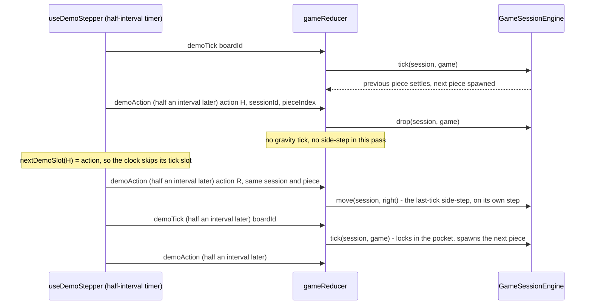
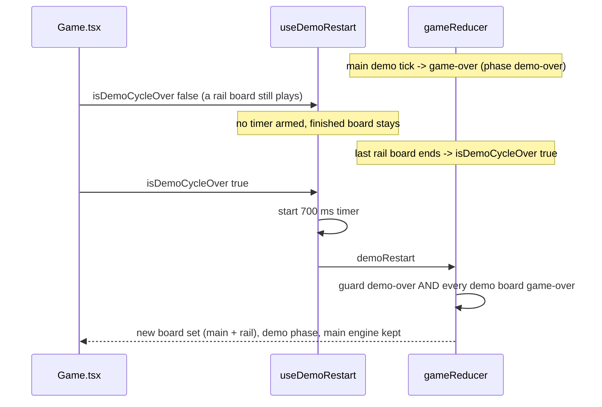

## Context

The browser client owns the attract loop. `apps/pentix-web/src/engine/gameReducer.ts` holds one `PentixGame`, the main board's session, the demo-engine id the main board plays, and one `DemoBoardState` per rail slot. Two hooks drive auto-play: `useDemoController` (main board, `phase === 'demo'`) and `useDemoBoard` (one rail slot, while its session is `active`), and both funnel into `useDemoStepper`. That hook runs one `window.setInterval(getTickInterval(level))` per board and dispatches one `demoStep` carrying `{ boardId, action, lastTickAction, sessionId, pieceIndex }`; the reducer applies the action, then the post-drop last-tick side-step, then exactly one `gameSessionEngine.tick` — all in one reducer pass, so the interval's action and gravity tick are indistinguishable in time.

`useDemoRestart` arms a `700` ms timer while `phase === 'demo-over'` and dispatches `demoRestart`, which calls `restartDemoSession`: a fresh main session only, with the rail deliberately untouched.

Three facts shape this design:

1. **The zero-length tick is a scheduling artefact, not an engine bug.** `gameSessionEngine.drop` moves the piece to its lowest reachable row and settles only when it cannot move down at all, and the step's tick immediately settles the resting piece. Because that tick runs in the same callback as the action, the piece's last tick lasts `0` ms: drop, side-step, lock, and a new piece appear in one frame, and the demo (and any drop in a demo session) reads as teleporting. The player's own `drop` action already avoids this by bumping `gravityEpoch` so the gravity clock restarts; the demo has no equivalent.
2. **The whole demo clock is one interval long.** `getTickInterval(level)` returns `1000 - 100 * level`, floored at `100`, so every level is a whole multiple of `100` ms and half of it is a whole number of milliseconds — a half-interval clock needs no rounding.
3. **The rail is independent.** Each rail board has its own session, level, and timer, so the main board's demo can finish long before the rail's boards do. `demo-over` currently lasts `700` ms regardless, which is why a new main demo starts while the rail is mid-game.

Constraints: strict TypeScript, no new dependencies, the client stays local and unpersisted (no `PentixServer` calls, no session-replay actions for demo sessions), and the reducer stays a pure, headless-testable function because `tests/pentix-web.test.mjs` exercises it with `node:test` and no DOM. `pentix-core` — the engine, the demo-engine contract, the registry, and the log grammar — must not change.

## Goals / Non-Goals

**Goals:**

- Give every demo interval a visible rhythm: one gravity tick at the interval boundary, one steering action at its midpoint, and the rest of the interval after the action, so no action and tick ever share an instant.
- Make the tick after a hard drop last a full interval instead of zero, keep the drop's side-step out of the drop's own instant, and make a freshly spawned piece wait half an interval before it is steered.
- Keep one clock per board and one authoritative reducer, with the same stale-step protection as today.
- Restart the main panel's attract demo only when the entire board set is over, or when the player asks for it with Space.
- Keep the rail alive across cycles by restarting the whole board set at once.
- Keep the docs (authoring brief, foundation notes, README) describing the cadence the client actually runs.

**Non-Goals:**

- No change to `GameSessionEngine` semantics, scoring, leveling, locking, or game-over detection.
- No change to the `DemoActionLog` grammar, the demo-engine contract, the registry, or any engine module.
- No change to the player game's gravity loop or to its `drop` epoch handling.
- No per-board offsets that would desynchronise the rail from the main board, and no animation smoothing or interpolation.
- No change to the HTTP API, storage, or the session-replay format.


## Decisions

### D1 — Split the demo step into a gravity step and a steering step

`GameAction` loses `demoStep` and gains two board-addressed actions:

```ts
| { type: 'demoTick'; boardId: string }
| {
    type: 'demoAction'
    boardId: string
    action: DemoAction | null
    sessionId: string
    pieceIndex: number
  }
```

`demoTick` applies exactly one `gameSessionEngine.tick`. `demoAction` applies exactly one log code and **no** tick; it keeps the existing `isCurrentDemoStep` guard, so a step planned for a session or piece that no longer matches is dropped. One code per step is what keeps a hard drop and its one-column side-step in separate instants: the side-step is simply the log's next code. `demoTick` carries only `boardId` because gravity is not planned: it applies to whatever piece is current, and its guards are the board's existence, the phase, and the session's `active` status.

- Alternatives: two timers (rejected — two clocks drift and can reorder the action after the tick it belongs before); one action with a `phase: 'tick' | 'action'` discriminator (rejected — the two halves have different payloads and different guards, so the union is honest); delaying the tick inside the hook (`setTimeout(interval / 2)` after dispatching a combined step, rejected — it hides half the behaviour in an untestable closure and leaves the reducer's step atomic); keeping `lastTickAction` (rejected — it welds the side-step to the drop's instant, which reads as the piece teleporting sideways the moment it lands).

### D2 — One alternating clock per board, half an interval long, restarted by a hard drop

`useDemoStepper` builds one `window.setInterval(interval / 2)` and holds the next slot in a local `DemoSlot` (`'action' | 'tick'`), dispatching `demoAction` and `demoTick` accordingly and clearing the interval on cleanup. Starting with the action means a piece that exists when the board mounts is steered after half an interval and descends a full interval after mount, and — because a locking tick is always followed by an action — every spawned piece gets half an interval of visibility before its first steering step and a full interval before its first descent.

The one exception is the hard drop, and it mirrors the player game: the player's `drop` bumps `gravityEpoch` so the dropped piece gets a full tick before it locks, and the demo now restarts its own alternation the same way. `nextDemoSlot(action)` is a pure helper that answers which slot comes next, and it returns `'action'` after `H` instead of `'tick'`. A drop therefore lands in the middle of an interval, the log's side-step follows half an interval later as its own action, and the tick that locks the piece and spawns the next one comes a full interval after the drop. Nothing is applied in the drop's own instant, and the piece rests visibly on the floor before its successor appears.

The interval stays `getTickInterval(level)`, so the gravity cadence is unchanged; only the action moved from the tick's instant to its midpoint. `getTickInterval` yields multiples of `100` ms, so `interval / 2` is always a whole millisecond (level 0 → 500 ms, level 9 → 100 ms).



- Alternatives: `requestAnimationFrame` with an accumulator, like `useGameLoop` (rejected — the phase would then depend on frame timing and would need its own epoch handling; a plain interval already gives an exact alternation); a single full-interval timer plus an inner `setTimeout` (rejected — same clock, two scheduling sources, and no benefit); keeping the fixed alternation and letting the drop lock at the next tick boundary (rejected — the dropped piece would lock half an interval later, which the user sees as the demo moving faster than the player game).

### D3 — The restart gate is a reducer guard plus a hook

A new exported selector answers "is the attract cycle over?":

```ts
export function isDemoCycleOver(state: GameState): boolean {
  return (
    state.phase === 'demo-over' &&
    state.demoBoards.every((board) => board.session.status === 'game-over')
  )
}
```

`Game.tsx` passes it to `useDemoRestart`, which arms its `700` ms timer only while it is true, and `demoRestart` keeps an identical guard in the reducer. The hook decides *when* to wait, the reducer decides *whether* the restart is still valid, so a stale timer (the player pressed Space, a swap brought an `active` session back to the main board, or a level pick restarted a cycle) cannot start an extra cycle.

- Alternatives: gate in the hook only (rejected — a stale timer would start a second board set); gate in the reducer only and keep the timer running from the main board's game over (rejected — the delay would then be measured from the wrong end, and the finished board could restart the instant the rail ends, with no visible final frame).

### D4 — A restart starts a whole new board set

`restartDemoSession` goes away. `demoRestart` now delegates to the same `startSession(state, deps, 'demo')` path the `demo` action uses, which builds one new `PentixGame`, a seeded main session, and one seeded session per registry engine, keeps `state.mainEngineId`, and bumps `gravityEpoch`. That is only reachable when the gate holds, i.e. when every rail session is already `game-over`, so nothing is thrown away: the dead rail boards are revived instead of staying frozen for the rest of the page's life.

Settings (starting level, rotation direction, next-piece preview) live outside the board set and survive, as they do today.

- Alternatives: keep the main-only restart (rejected — after the gate, the rail would stay dead forever, and the rail is the point of the rail); revive each dead rail session individually (rejected — it needs per-board seeding and engine bookkeeping for exactly the same result as a fresh board set).

### D5 — Space starts the next demo from the finished demo, Enter starts a game

`mapKeyToAction(' ', 'demo-over')` returns `{ type: 'demo' }` instead of `{ type: 'start' }`; `Enter` keeps `{ type: 'start' }` in every startable phase, and Space in the `demo` phase still starts a player game. Space therefore means "give me the demo" wherever a demo is what the client is showing, and it is also the only way to skip the new gate.

The demo badge follows the phase, because the two phases now behave differently: `Demo — press Space to play` while the demo runs, `Demo over — press Space for the next demo` while it waits.

- Alternatives: keep Space = start and add a different key for the next demo (rejected — the player asked for Space, and Space already restarts the demo from the `game-over` phase, so the meaning is consistent); leave the badge text unchanged (rejected — it would promise a player game that Space no longer starts).



### D6 — The docs describe the rhythm the client runs

`docs/demo-engine-task.md` replaces its "Action, Tick, Action, Tick" cadence with the tick-then-action rhythm: one tick every interval, one action halfway through it, a hard drop restarting the rhythm so its side-step is the next action and the locking tick comes a full interval after the drop. The brief keeps telling authors what they need — the log grammar, that `T` never appears, that each action costs one interval, and that leftovers are discarded when the piece locks. `docs/foundation.md` and `README.md` say the same in one sentence each.

- Alternatives: leave the brief alone (rejected — it documents an observable behaviour that would no longer match, and the `repository-documentation` spec pins it).


## Risks / Trade-offs

- [A spawned piece waits half an interval before it is steered] → Intended and specified: it is exactly the visible spawn the bug report asked for. At the default level 9 that is `50` ms after the locking tick; at level 0 it is `500` ms, still one full tick from spawn to first descent.
- [The hard drop's piece now rests for a full interval before it locks] → Intended, and it is what the player game does: `drop` bumps `gravityEpoch`, so a player's dropped piece also waits a full tick. The side-step costs one interval of its own, so a demo piece takes one interval longer per drop; that is the price of the piece not teleporting sideways as it lands, and the plan is replayed either way.
- [The main panel can sit on a finished demo while one rail board plays] → Intended by the request. Space skips it, the badge says so, and the rail boards run at the same level as the main demo, so the spread is bounded by one game.
- [A level change rebuilds the timer, restarting the alternation on the action half] → The rebuild follows a deliberate user action; the reducer drops steps whose session or piece no longer matches, so a rebuild cannot move the wrong piece.
- [Two dispatches per interval per board could double the renders] → The old step rendered once after applying both, so the count is unchanged in practice: two interval callbacks still produce the same state transitions, and no other board is touched.
- [Stale timers after a swap or a manual restart] → `clearInterval` on cleanup plus the reducer's phase/board/session/piece guards, with a test that a step planned before a restart is ignored.
- [Removing `restartDemoSession` drops the "rail keeps playing" guarantee] → Superseded on purpose: a restart can only happen when the rail has nothing left to keep.
- [Half intervals could become sub-frame] → Impossible while `getTickInterval` floors at `100` ms; a future speed-up below twice the frame budget must revisit the clock, and the design notes it here.
- [Tests that asserted the atomic step] → The web test helper is split into a tick helper and a steering-step helper, and the demo tests replay the two dispatches in the order the hook sends them.

## Migration Plan

1. Reducer: add `demoTick`/`demoAction`, delete `demoStep` and `restartDemoSession`, add `isDemoCycleOver`, rewrite `demoRestart`, and keep every existing phase/board/session/piece guard.
2. Driver: one log code per steering step, `nextDemoSlot` restarting the alternation after a hard drop, and `useDemoStepper` alternating on a half-interval timer.
3. Hooks and screen: `useDemoRestart` takes the gate, and `Game.tsx` passes it and renders the phase-specific badge.
4. Key map: Space in `demo-over` maps to `demo`.
5. Tests: replace the step helpers, and cover the tick/action split, the drop's own side-step step, the full-interval lock after a drop, the spawn pause, the gate, the fresh board set, and the Space mapping.
6. Docs: `docs/demo-engine-task.md`, `docs/foundation.md`, `README.md`.
7. Verification: `npm run lint`, `npm test` (which builds core and server first), and `npm run build:web`.

Rollback is the proposal's plan: restore the combined step and the full-interval clock, the `demo-over`-only restart guard with the main-only restart, Space in `demo-over` mapping to `start`, and the previous doc text. No engine module, core export, HTTP route, or stored record is involved, so a revert needs no data migration.

## Open Questions

- Should the `700` ms delay be skipped once the main board has been finished longer than that? Decided no: it is the same visible-final-frame rule a player game uses, and it is measured from the last board's end, so the newest final board always gets it.
- Should a manual Space restart also reset the rail when the rail is still playing? Decided yes: Space is "start a new demo show", and keeping some boards mid-game while others restart is the drift this change removes.
- Should a player game get the same half-tick action cadence? Decided no: player actions are input-driven, and the player's own hard drop already restarts the gravity epoch to get a full tick before the lock.
