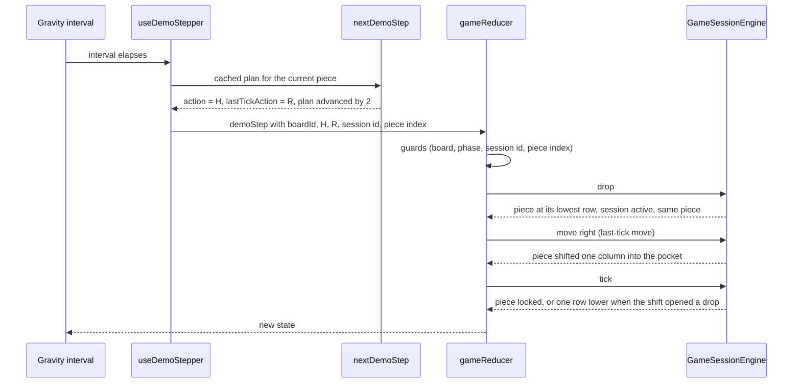

## Context

The attract demo is driven by demo engines in `packages/pentix-core/src/demo-engines/`, each exporting `id`, `name`, `description`, and `plan(board, piece, position)` where `board` is the visible `0`/`1` grid, `piece` the active piece's reachable orientations as cells around the rotation point, and `position` that rotation point. The log is a plain string over `L`, `R`, `C`, `A`, `H`; the browser replays it one code per gravity interval through `gameSessionEngine` and then applies exactly one tick.

Three facts shape this design:

1. **The log cannot side-step today.** `gameSessionEngine.drop` moves the piece to its lowest reachable row (it settles immediately only when the piece cannot move down at all), and the interval's tick then settles the resting piece. So a code after `H` would always be consumed by the next interval — after the piece has locked and the next piece has spawned. Every built-in log (`actionsToward`) ends with `H`, so the last-tick side-step never happens. Verified against the current build: on a `12x22` board with one settled mino at `(20, 11)` and the single-cell piece, the planner steers to column `10` and returns `"RRRRH"`, so the piece locks at `(21, 10)` beside the pocket instead of inside it. `planDemoLastTickMove` still exists in `demo.ts` but the browser no longer calls it: the archived `add-ai-demo-engines` change removed the second engine call on purpose.
2. **The classic planner already knows the side-step.** `planDemoDestinationForOrientations` scores the placements one column left and right of every resting placement (`shifted` candidates) and returns the column to drop in, but the direction from that column to the winning settled column is thrown away.
3. **The planner is allocation-heavy.** `delphi5` converts the `0`/`1` board into a `BoardSnapshot` (two objects per cell, 264 cells on the default board) and `scorePlacement` clones the whole boolean grid for every candidate, then rescans the whole board for holes and full lines. Candidate count is `orientations × columns × rows`, so a spawn clones the grid dozens of times.

## Goals / Non-Goals

**Goals:**

- Restore the classic last-tick side-step without a second engine call, without per-tick re-planning, and without breaking the flat-string log contract.
- Let any engine express the side-step with the toolkit in one call, and make `delphi5` actually take the side-step its planner already chooses.
- Make `docs/demo-engine-task.md` self-sufficient: every block of the catalog, the post-drop last tick with a worked pocket example, the scoring rules that state the goal, and TypeScript-only answers.
- Cut the demo planner's per-candidate allocations and whole-board rescans, collapse the duplicated demo-step wiring, and make `dist` builds deterministic.

**Non-Goals:**

- No rotation on the last tick, no multi-column side-step, and no path search beyond one column.
- No mid-piece re-planning, no second engine call, and no change to the "plan once per spawned piece" cache.
- No change to `GameSessionEngine` semantics, player controls, scoring, leveling, the HTTP API, storage, or the session-replay format.
- No change to the `random` engine's strategy, and no new runtime dependency.
- No benchmark harness: the optimizations are justified by structure (removed allocations and rescans) and guarded by the existing planner tests.

## Decisions

### D1 — The last-tick move is the single code after `H`

`DemoActionLog` stays a string; a log SHALL carry at most one code after its `H`, and that code SHALL be `L` or `R`.

- Alternatives: a second engine operation (the shape removed by `add-ai-demo-engines`, and it re-introduces mid-piece planning); returning `{ log, lastTickMove }` (a new return type for every engine and the brief); a marker such as `~R` (a new code in the alphabet, which the session vocabulary does not have).
- Rationale: the driver already locates `H`; the brief can explain the rule in three sentences; engines that do not want a side-step keep ending with `H`.

### D2 — The driver consumes the drop and its follow-up code in one step

`apps/pentix-web/src/engine/demo.ts` gains a pure helper:

```ts
nextDemoStep(plan: DemoPlan): {
  action: DemoAction | null
  lastTickAction: DemoLastTickMove | null
  plan: DemoPlan
}
```

`H` with a following `L`/`R` consumes both codes; any other code consumes one. `useDemoStepper` dispatches the pair in one `demoStep`.

The reducer's step then runs: action -> (last-tick move only when the action was `H`, the drop left the session `active`, and `nextPieceIndex` is unchanged) -> exactly one tick.

- Alternatives: dispatch two steps (the second step's tick would lock the piece in between, and the spec would need two intervals); let the hook apply the side-step itself (moves session mutation out of the reducer).
- Rationale: one dispatch keeps the reducer the only place that mutates the session, keeps exactly one tick per interval, and gives the settled-drop case a single, testable guard.

### D3 — The classic destination reports the last-tick move

`DemoOrientationDestination` (and `DemoDestination`) gain `lastTickMove: DemoLastTickMove | null`, derived from the winning candidate: `null` when it is not `shifted`, otherwise `column > landingColumn ? 'R' : 'L'` (a shift is always exactly one column). `actionsToward(orientation, position, column, lastTickMove = null)` appends the code after `H`, so an authored engine can express the same plan in one call.

- Alternative: have `delphi5` recompute the direction from the board (duplicates the planner's tie-break knowledge).
- Rationale: the planner already knows which placement won; it must not throw the information away.

### D4 — One board-addressed demo step instead of two

The `GameAction` union replaces `demoStep` and `demoBoardStep` with one:

```ts
{ type: 'demoStep'; boardId: string; action: DemoAction | null
  lastTickAction: DemoLastTickMove | null; sessionId: string; pieceIndex: number }
```

The reducer resolves the target session from `boardId` (`MAIN_BOARD_ID` or a rail slot), applies the same guards, and writes the result back to the same place: the main target still goes through `applyAdvance`, so a demo game over moves the phase to `demo-over`, while a rail target merges the shared `PentixGame` and replaces only that slot's session. `useDemoStepper` stops branching on the board kind.

- Alternative: keep two actions with a shared `applyDemoStep` (works, but the guard/merge code stays duplicated and the new field would be added twice).
- Rationale: one guard, one merge, one place to add the next demo behaviour; the step still names its board, so the stale-step and finished-board rules are unchanged.

### D5 — The classic heuristic runs on the `0`/`1` board

`planDemoDestinationForOrientations(board: DemoBoard, orientations)` replaces its `BoardSnapshot` parameter; `delphi5` passes the board it received. `planDemoDestination(session)` converts the session snapshot once. Placement probes use a new `demoCanPlaceAt(board, cells, row, column)` from `demo-actions.ts`, and `demoLandingRow` probes through it without allocating a cell array.

- Alternative: keep `BoardSnapshot` and add an adapter at the edge (the double conversion is exactly the cost being removed).
- Rationale: one board representation on the demo path, one geometry implementation, and no per-cell objects per spawn.

### D6 — Score a candidate in a reused scratch grid

One `boolean[][]` is built per plan call. For each candidate: write the piece cells, count holes only in the columns the piece touched (against per-column hole counts computed once), count full lines only among the touched rows (plus the base grid's full rows, which the engine's board never has because lines are cleared on settle), count contacts from the piece cells, then clear the piece cells again. The result is identical to the current whole-grid scan, at a fraction of the work.

- Alternative: keep the clone and accept it (simplest, but the clone is the dominant cost of a spawn).
- Rationale: the score only changes where the piece lands, so a local computation is exact.

### D7 — Memoize `Piece.occupiedOffsets`

`Piece` is immutable (`withAngle` returns a new instance), so the rotated offsets are cached on first access and the getter returns a frozen array typed `readonly Offset[]`. `getOccupiedCells`, `rotatedExtremes`, and the demo planners only read it.

### D8 — Deterministic builds

`package.json` gains a `clean:dist` step (Node's `node:fs.rmSync`, no new dependency) that runs before `build:core` and `build:server`. Today `packages/pentix-core/dist` still contains `demo-delphi5.js`, `demo-random.js`, `demo-engines/delphi5.js`, `demo-engines/random.js`, and `demo-engines/left-wall.js`, none of which has a source module.

### D9 — A demo session starts with one seeded mino

`gameReducer.ts` gains `withSeededDemoMino(session)`: it replaces the cell at `(height - 2, random column)` with an occupied cell carrying a piece key. `createBoardSet` seeds the main session only for a demo phase and seeds every rail board; `restartDemoSession` seeds its fresh session too.

- The seed is an ordinary settled cell, so it survives the `lockAndClear` rebuild (which drops cells without a piece key) and plays by the normal rules; it is not a locked piece, so `blocks`, `score`, `clearedLines`, and the level stay untouched.
- It has no timer: it stays where it is until its row is completed and cleared, which is what "let it be for a while" means operationally.
- Alternatives: seed inside `createPentixGameSession` (the core has no notion of a demo); seed on every spawn (keeps overwriting the board); seed a fixed column (the request asks for a random one).
- Effect: the first `delphi5` plan on a fresh demo already demonstrates the pocket side-step (`CCLLHR` on the default board with the seed in column 6).

### D10 — The main board's demo engine is state, not a board-set constant

`createBoardSet` now takes the engine id and a "seed the main session" flag. `startSession` passes `state.mainEngineId`, so `start`, `restart`, and `demo` all keep the engine the player swapped in; only `createInitialState` uses `MAIN_DEMO_ENGINE_ID`.

- The rail keeps following registration order, so a board set created after a swap can show the main board's engine on a rail slot as well; that is accepted and specified rather than special-cased.
- Alternatives: keep resetting on every board set (the reported bug); hold the selection outside the reducer (a second source of truth next to `mainEngineId`).
- Rationale: the engine already lives in the game state and travels with a swap; the bug was only that `startSession` rebuilt the state from a constant.

### Demo step with a last-tick move



## Risks / Trade-offs

- [A second action in one interval weakens "one action per interval"] -> The exception is narrow and specified: it applies only immediately after `H`, only to `L`/`R`, and the interval still ends with exactly one tick.
- [A stale last-tick move could move the wrong piece] -> The reducer applies it only when the drop kept the same `nextPieceIndex` and the session `active`; a settling drop discards it.
- [Demo outcomes shift once side-steps execute] -> Expected and intended: pieces reach pockets they previously missed. The classic score formula and tie-break precedence are unchanged, and a test pins the pocket scenario per column.
- [Changing the destination type and the board type ripples through tests] -> The public barrel keeps the same names; core tests build their boards through `demoInput`/`createDemoEngineInput`, so only the direct `planDemoDestinationForOrientations` call sites and the engine log assertions need updating.
- [In-place scoring must not leak cells between candidates] -> Set and clear the piece cells in one small function with no early return in between; per-candidate assertions compare placements against the existing scorer's expectations.
- [Memoized `occupiedOffsets` hands out a shared array] -> The array is frozen and typed `readonly Offset[]`, and every consumer maps or reduces over it.
- [Cleaning `dist` while a dev process watches it] -> Only the build scripts clean; `npm run dev:web` keeps using the build output it was started with.
- [The unified `demoStep` touches many web tests] -> The test helper that builds a step is updated in one place (`demoStepAction`), which is why the change is worth making now rather than after more demo behaviour lands.
- [The seeded mino changes the demo's opening board] -> Intended: it gives every engine an overhang, and the pocket side-step fires on the first piece. Rail boards and the main demo both get it; player sessions stay empty.
- [A seeded cell could be dropped by a line-clear rebuild] -> The seed carries a `pieceKey`, like a locked piece, so `lockAndClear` keeps it; a test locks several pieces and asserts the seed is still there.
- [Keeping the main engine can show the same engine on the main board and a rail slot] -> Accepted and specified: the rail always follows registration order, and the main board keeps the player's choice until the page reloads.

## Migration Plan

1. Core contract and planner: `DemoLastTickMove`, `actionsToward`, `demoCanPlaceAt`, destination `lastTickMove`, 0/1-board heuristic, scratch-grid scoring, memoized offsets.
2. Engines: `delphi5` passes the board and the last-tick move; `random` unchanged.
3. Web: `nextDemoStep`, the unified board-addressed `demoStep`, reducer guard for a settling drop, `useDemoStepper` single dispatch.
4. Docs: block list, last-tick section, TypeScript-only brief, foundation notes.
5. Build: `clean:dist` before `build:core`/`build:server`; verify no stale module remains in `packages/pentix-core/dist`.
6. Verification: `npm run lint`, `npm test`, `npm run build:web`, plus a headless replay of the pocket board per column.

Rollback is per the proposal: the classic session planners (`planDemoDestination`, `planDemoLastTickMove`) stay in place throughout, so a partial revert leaves a working demo that simply ends its logs at `H` again.

## Open Questions

- Should `random` also plan a random last-tick move? Decided no for this change: it keeps the demonstration engine as a plain baseline, and the seam now exists if it is wanted later.
- Should `planDemoLastTickMove` be retired now that the log carries the side-step? Decided no: it remains the documented reference implementation of the classic last-tick rules, and its tests pin the behaviour the log reproduces.
