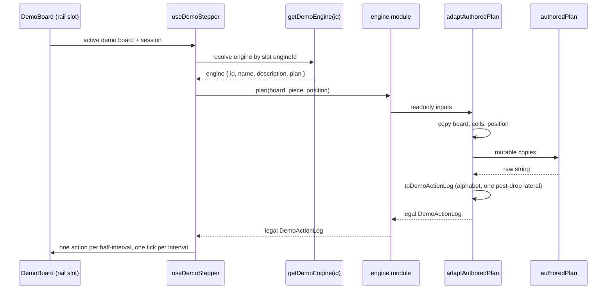

# Design — add-7-ai-engines

## Context

`packages/pentix-core/src/demo-engines/` holds one module per engine named `<engine-id>-demo-engine.ts`, each exporting `id`, `name`, `description`, and `plan(board, piece, position)`. `demo-engines/index.ts` is the only place an engine is added, and `DemoEngineRegistry` validates the module shape and lower-case kebab-case id before the browser rail turns every registered engine into one board (capped at `MAX_DEMO_BOARDS = 12`). `docs/demo-engine-task.md` asks an AI for one standalone `plan` function typed `(board: number[][], piece: { row: number; column: number }[][], position: { row: number; column: number }) => string`.

Seven such answers are kept and left as loose files in `c:\ai\temp`, with the producing model and its run metadata written into the file name. `GigaChat.ts` is deliberately not adopted. The bracketed reproduction note stays source metadata only — it is written into the engine description, not into the module file name.

| Source file in `c:\ai\temp` | Vendor | Version | Mode | Reproduction note (description only) |
| --- | --- | --- | --- | --- |
| `Claude Opus 5.5 Extra (40 min thingking).ts` | Claude Opus | 5.5 | Extra | 40 min thinking |
| `Claude Sonnet 5.5 Extra ((40 min thingking).ts` | Claude Sonnet | 5.5 | Extra | 40 min thinking |
| `DeepSeek v4 Flash 1107 Max (13 min thinking).ts` | DeepSeek Flash | v4 (build 1107) | Max | 13 min thinking |
| `DeepSeek v4 Pro Max (12 min thinking).ts` | DeepSeek Pro | v4 | Max | 12 min thinking |
| `GLM-5.3-Flash Extra (15 min thinking).ts` | GLM Flash | 5.3 | Extra | 15 min thinking |
| `MinMax-M3.1-Flash Extra (3-4 hours thinking, many credits has gone).ts` | MiniMax Flash | M3.1 | Extra | 3-4 hours thinking |
| `Qwen4 Max (Chat).ts` | Qwen | 4 | Max | Chat |

Constraints that shape the design:

- `DemoEngineId` must match `/^[a-z0-9]+(?:-[a-z0-9]+)*$/`, and the module file name must stay `<engine-id>-demo-engine.ts`.
- `pentix-core` builds with `strict`, `noUnusedLocals`, `noUnusedParameters`, and `erasableSyntaxOnly`; the authored code was written outside this build and may contain unused locals or an annotation the compiler rejects.
- The contract hands engines `readonly` inputs (`DemoBoard`, `DemoPiece`, `DemoPosition`), while the brief promises mutable `number[][]` and `{ row: number; column: number }[][]` to its author.
- The rail renders up to twelve cards of a fixed `--demo-slot-width`, so header and statistics are width-critical.
- The demo board currently renders the engine name, its description as a native tooltip, a `Game over` header marker, and three `Label value` pairs that wrap.

## Goals / Non-Goals

**Goals:**

- Make every AI-authored engine readable from its file name: vendor, version, variant, and mode.
- Register the seven adopted authored planners as first-class demo engines without touching browser-client code for registration, and keep the rail inside its capacity.
- Guarantee that a registered engine can never emit an illegal log, mutate the board, or crash a board, even when its authored body is imperfect.
- Make the classic Delphi 5 heuristic the engine the page opens on.
- Make each demo card fit its slot: name-only first header row with a hover/focus info panel, one-line `S`/`L`/`P` statistics at a larger font, and a board-level game-over overlay that reports the final score, lines, and pieces.
- Fix the authoring brief where the answers drifted: no cached/foreign context, an algorithm comment, and a drop before any side-step.

**Non-Goals:**

- Ranking engines by score, tuning weights, or adding a leaderboard.
- An engine picker in the UI; the rail stays registry-driven and ordered.
- Re-tuning the authored strategies inside their modules.
- Making the wrapper judge whether a trailing side-step was necessary; that policy belongs to the plan, and the authored files are re-requested with the fix-up request in D6.
- Persisting the selected engine, or changing server, storage, or replay code.
- Raising `MAX_DEMO_BOARDS` beyond its current `12` (nine engines fit).


## Decisions

### D1 — File-name grammar for AI-authored engines

An AI-authored engine file keeps the mandatory suffix and encodes the run in the id:

```
<vendor>-<version>[-<variant>]-<mode>-demo-engine.ts
```

- `<vendor>` — the model family as the author names it, kebab-cased (`claude-opus`, `claude-sonnet`, `deepseek`, `glm`, `minimax`, `qwen`).
- `<version>` — the version with dots written as dashes and the `v`/`M` prefix kept when the source name has it (`5-5`, `v4`, `5-3`, `m3-1`, `4`).
- `<variant>` — optional size/tier/build token (`flash`, `pro`, `flash-1107`), omitted when the name has none.
- `<mode>` — the reasoning mode named in the source (`extra`, `max`), omitted when the source names none (so a bare model keeps a bare id, as `delphi5` and `random` do).
- Every optional segment keeps the stated position, so a file name can be read left to right without guessing which token is the version.
- The bracketed reproduction note — thinking time, `Chat`, credit commentary — is deliberately **not** part of the id: it is run metadata, not engine identity, and it belongs in the engine's `description`.

Resulting catalog additions, appended after `delphi5` and `random` in this order:

| Module file | `id` | `name` |
| --- | --- | --- |
| `claude-opus-5-5-extra-demo-engine.ts` | `claude-opus-5-5-extra` | `Claude Opus 5.5 Extra` |
| `claude-sonnet-5-5-extra-demo-engine.ts` | `claude-sonnet-5-5-extra` | `Claude Sonnet 5.5 Extra` |
| `deepseek-v4-flash-1107-max-demo-engine.ts` | `deepseek-v4-flash-1107-max` | `DeepSeek v4 Flash 1107 Max` |
| `deepseek-v4-pro-max-demo-engine.ts` | `deepseek-v4-pro-max` | `DeepSeek v4 Pro Max` |
| `glm-5-3-flash-extra-demo-engine.ts` | `glm-5-3-flash-extra` | `GLM 5.3 Flash Extra` |
| `minimax-m3-1-flash-extra-demo-engine.ts` | `minimax-m3-1-flash-extra` | `MiniMax M3.1 Flash Extra` |
| `qwen-4-max-demo-engine.ts` | `qwen-4-max` | `Qwen 4 Max` |

`GigaChat` is excluded: it is the weakest of the eight answers, adds no strategy the other seven do not cover, and would only spend one of the rail's fixed slots.

Each `description` repeats the name in more detail and folds in the bracketed note, e.g. “Claude Opus 5.5 in Extra mode (40 min of thinking): a breadth-first search of every reachable placement …”, or “Qwen 4 Max (Chat): …”. The `name` stays short enough for a `0.66rem` card header; the `description` carries the prose.

*Alternatives considered:* keeping the source file names verbatim — rejected, because spaces, capitals, parentheses, and `typing`/`thingking` typos produce ids the registry rejects and make grep/sort unreliable; a numeric suffix (`engine-1` …) — rejected, because the file name would no longer identify the model; encoding the thinking time in the id (`…-40m`) — rejected by the maintainer because it is run metadata that differs on every reproduction and would make stable ids churn; keeping `GigaChat` for completeness — rejected because the rail has a fixed twelve-slot budget and the plan is the weakest of the set.

### D2 — One adapter turns an authored plan into a contract plan

The toolkit gains `adaptAuthoredPlan(plan: AuthoredPlan): DemoEngine['plan']`, with

```ts
export type AuthoredPlan = (
  board: number[][],
  piece: { row: number; column: number }[][],
  position: { row: number; column: number },
) => string
```

For every call the adapter:

1. deep-copies the readonly board rows and piece cells into fresh mutable arrays, and clones the position, so an authored body that mutates its arguments cannot touch the session snapshot;
2. runs the authored plan inside `try`/`catch`, returning `''` on a throw so one broken engine cannot stop a rail board;
3. normalizes the returned string with `toDemoActionLog`: keep `L`, `R`, `C`, `A`, `H`; drop every other character; after the first `H` keep at most one following `L` or `R` and drop the rest; return `''` for an empty or non-string result.

Each new module then has the same small shape: the authored function pasted verbatim as a local `authoredPlan`, the three metadata exports, and `export const plan = adaptAuthoredPlan(authoredPlan)`. The built-in `delphi5` and `random` engines do not use the adapter — they call the toolkit directly. Where the pasted body trips `noUnusedLocals`/`noUnusedParameters`, the local is removed or folded without changing the algorithm; no authored decision is re-tuned.

*Alternatives considered:* casting the readonly contract inputs to `number[][]` — rejected, because the first accidental in-place write would corrupt a live session board; hand-editing each function’s signature to the readonly types — rejected, because eight divergent edits obscure the authored answer and would need re-editing on every future run; trusting the authored output — rejected, because the brief’s tolerance (“other characters are ignored”) is the caller’s leniency, and the demo board must never receive a code outside its alphabet, a second drop, or a rotation after `H`.

Flow of one planned piece after the change:



### D3 — Catalog order, the default engine, and rail capacity

`builtInDemoEngines` keeps `delphi5` first (the registry default and slot 1) and `random` second, then appends the seven authored engines in D1’s order. The rail grows from two to nine slots, all inside `MAX_DEMO_BOARDS = 12`; `demoBoardEngineIds()` already slices to that capacity, so the rail needs no reducer change.

Separately, the browser client’s attract demo stops opening on `random`: `MAIN_DEMO_ENGINE_ID` becomes `delphi5`, so the page opens on the classic heuristic in both the main board and slot 1. The registry’s own default (`DEFAULT_DEMO_ENGINE_ID`) is already `delphi5`; this aligns the visible default with it. The state still carries the engine, so a swap, a player session, and a demo restart keep whatever engine the main board holds.

Anything that looked up a board by index now looks it up by engine id, because slot 2 is no longer the main default and the rail has nine entries.

*Alternatives considered:* inserting the authored engines before the built-ins — rejected, because `DEFAULT_DEMO_ENGINE_ID = 'delphi5'` and the documented slot-1/slot-2 mapping would silently change; letting the rail exceed its capacity — rejected, because the four-per-row wall is measured for twelve cards and the card mino sizes are computed from it; changing only the registry default and leaving the main board on `random` — rejected, because the registry default was already `delphi5`, so that would change nothing visible.

### D4 — The demo card keeps the same data, rearranged

`DemoBoard.tsx` changes shape but not inputs (the resolved engine and the session snapshot):

- **Header row 1** is the engine name plus an info icon: `<span className="demo-board__info" role="img" tabIndex={0} aria-label="About <name>">i</span>`. The icon owns a `.demo-board__about` panel (name in `<strong>`, description below) that CSS reveals on `:hover`, `:focus-visible`, and `:focus-within`. The panel is absolutely positioned inside the relatively positioned card, spans the card width, and overlays the statistics and the top of the board, so it never overflows the rail or the shell’s `overflow-x: clip`. The card’s own `title` (the swap hint) and the article `aria-label` stay.
- **Header row 2** becomes the single line `S: 123, L: 45, P: 67` at a slightly larger font than today (`0.56rem` → `0.66rem`, the same size as the name row). `DemoStat` takes the abbreviated label, carries the full word (`Score`, `Lines`, `Pieces`) as its `title` and in an accessible label, and the row is `flex-wrap: nowrap`, `white-space: nowrap`, tabular numerals, with a `,` separator rendered by CSS between stats. The values are unchanged (`score`, `clearedLines`, `blocks`), so nothing about the data flow moves.
- **Game over** leaves the header. `BoardView` is wrapped in `.demo-board__stage` (`position: relative`) and a `.overlay.overlay--mini` is drawn over the board, following the main board’s overlay pattern but without buttons: the final grid stays visible under the dimmed backdrop. The overlay shows the title `Game over` in a slightly larger font than the card statistics (`0.9rem` title, `0.7rem` values) plus the final `Score`, `Lines`, and `Pieces` values read from the same session snapshot, so a finished card reports how it ended, not just that it ended. The unused `.demo-board__status` rule is deleted.

*Alternatives considered:* a native `title` on the name for the description — rejected, because the tooltip is slow, unstyled, and cannot show the name and the description together as a block; letting the statistics wrap — rejected, because a wrapped row makes cards in one rail row different heights; moving `Game over` into a badge under the card — rejected, because it still competes with the board for vertical space and diverges from the main board’s state language; putting the final statistics under the overlay instead of inside it — rejected, because the board area is the only place in the card with room and the overlay already dims it.

### D5 — Tests move from counts and indices to ids

`tests/pentix-core.test.mjs` currently asserts the literal list `['delphi5', 'random']` in four places and the exact module-name list in one. Those assertions become “the first two are `delphi5` and `random`”, “the catalog contains the nine documented ids in order”, and “every module name matches `<engine-id>-demo-engine.ts`, and each module’s id equals its file prefix”. A loop plans a fixed board with every registered engine and asserts the log only contains `L`/`R`/`C`/`A`/`H`, has at most one code after `H`, and leaves the inputs untouched. A second fixture plans on an empty board — where every placement is drop-reachable — and asserts no engine ends with a post-drop lateral; it lands together with the re-authored plans from D6, because the delivered bodies still append `HR` there (measured: six of the seven do, only `deepseek-v4-pro-max` ends at `H`). `tests/pentix-web.test.mjs` stops destructuring `[delphi, random]` and stops asserting `sessionIds.size === 3`; it looks up `demo-slot-1` and the `random` slot by engine id, asserts the rail length equals `min(registered, MAX_DEMO_BOARDS)` (nine), and asserts a fresh state's `mainEngineId` is `delphi5`.

*Alternatives considered:* leaving the literal lists and updating them again next time — rejected, because the suite should express the contract (registry order + module naming), not a count that changes with every authoring run.

### D6 — The brief gains three rules, and the answers get a fix-up request

`docs/demo-engine-task.md` is the single source of truth for an authored plan, so the rules the answers drifted on are stated there rather than patched in the wrappers:

1. **A self-contained, pure answer.** The brief adds a rule that the author must answer from this document alone: no cached code, snippets, or context from another chat, no imports from another answer, and no reuse of a previous conversation’s implementation. The reply is the complete function, produced fresh for this request.
2. **A short algorithm comment before the function.** The answer format now asks for a brief comment block above `function plan` that says, in a few lines, how the plan works and why. The earlier “no explanation outside the code” line is narrowed to “no prose after the function”; a leading comment is required, not forbidden.
3. **Drop before side-step.** The last-tick section becomes a rule, not an allowance: when the chosen placement is reachable by a straight drop in its target column, the log MUST end at `H`. Exactly one `L` or `R` after `H` is allowed only when the placement is a pocket a straight drop cannot enter (a cell under an overhang), and the log still ends there, with no rotation or second drop. Both the worked pocket example and the self-check list are updated to say the side-step is a last resort.

The plan functions already produced do not follow rule 3 — nearly all of them append a lateral move after `H` even when the drop alone reaches the target, which the demo then plays as “land, then walk sideways”. A direct check on an empty `12 × 22` board shows the drift: only `deepseek-v4-pro-max` returns `"H"`, while the other six return `"RRRRHR"`. The wrapper cannot tell whether a side-step was necessary (the moved piece is genuinely a different placement, and stripping the code would place the piece one column away from the column the engine chose), so the fix is to re-request the plan from the model with the same brief plus this fix-up request:

```text
Your previous `plan` implementation always ends its action log with `H` followed by `L` or `R`.
That side-step is only for placements a straight drop cannot reach — a pocket under an overhang.
Please return the whole `function plan(...)` again with these changes only:

- If the placement you chose is reachable by a straight drop in the column where the piece lands,
  end the log at `H`. Do not append `L` or `R`, even if your search used a side-step internally to
  score that placement.
- Emit exactly one `L` or `R` after `H` only when the chosen placement is reachable solely by
  dropping one column beside it and side-stepping on the last tick; the log must then end with
  that one code, with no rotation or second drop after it.
- Keep the search, scoring, and edge-case handling unchanged; keep the short algorithm comment
  above the function; return the complete TypeScript function, with nothing after it.
```

*Alternatives considered:* making `adaptAuthoredPlan` strip a trailing lateral when the drop alone already fits the target column — rejected, because the adapter sees only the raw string and the inputs, cannot know which cells the author scored, and would silently change the engine’s chosen placement; documenting the rule only in the wrapper — rejected, because every future answer would keep the same drift.

## Risks / Trade-offs

- **A pasted plan may not compile under the strict build** (unused local, `any`, parameter property) → each module is compiled in place, and only the offending declaration is rewritten; the algorithm stays byte-for-byte otherwise, and the plan-output test catches behavioural drift.
- **The delivered plans still side-step unnecessarily** → the empty-board test fails loudly until each authored file is replaced with the version requested by D6’s fix-up request; the wrapper never hides the problem.
- **A pasted plan can be slow** (some enumerate every orientation, column, and a lookahead) → the board is `12 × 22` and a plan runs once per spawned piece on that board’s own half-interval timer, never per animation frame; the adapter’s `try`/`catch` covers throws but not an infinite loop, which is accepted as an authoring risk and would show as one stalled card, not a stalled page.
- **Nine cards make one rail row heavier** (nine engines are three-quarters of the wall) → the rail already reserves `4 × 3` slots and the card mino sizes are fixed by `--demo-slot-width`; no layout change is needed.
- **Long scores can still crowd `S`/`L`/`P`** → the row is nowrap with tabular numerals at `0.66rem` and clips instead of wrapping, keeping every card the same height; the full value stays readable in the main board’s HUD.
- **The larger statistics and overlay type could crowd a `6` px-mino card** → the statistics stay on one line and the overlay sits over the board, which is at least `6 × 22` rows tall, so five short lines fit even at the narrowest wall.
- **The hover panel can cover the board while open** → it is `pointer-events: none`, closes as soon as the pointer or focus leaves the icon, and never intercepts the card’s swap double-click.
- **Slot-2 and initial-engine assertions assume `random`** → D5’s lookup-by-id rewrite and the `MAIN_DEMO_ENGINE_ID` change are part of this change and precede the UI tasks so the suite stays green throughout.

## Migration Plan

Code-only, no persisted data and no schema change. Deploy by merging the change; the registry rebuilds the rail from the catalog at startup, so the new boards appear on the next page load. Rollback is `git revert` of the change commit: removing the seven catalog entries returns the rail to two boards, the `MAIN_DEMO_ENGINE_ID` constant returns to `random`, the brief reverts to its previous text, and the `DemoBoard.tsx`/`App.css` edits revert with the same commit. No cleanup or data repair is required because sessions are never persisted.


## Open Questions

- `1107` is kept verbatim as part of the DeepSeek Flash variant token (`flash-1107`) because the source file gives it no other meaning; if it turns out to be a date or a build number with a fixed pattern, the grammar’s `<variant>` slot already accepts it unchanged.
- Whether a later change should let the player pin an engine to the main board instead of only swapping a rail card is out of scope here and does not affect the naming grammar.
