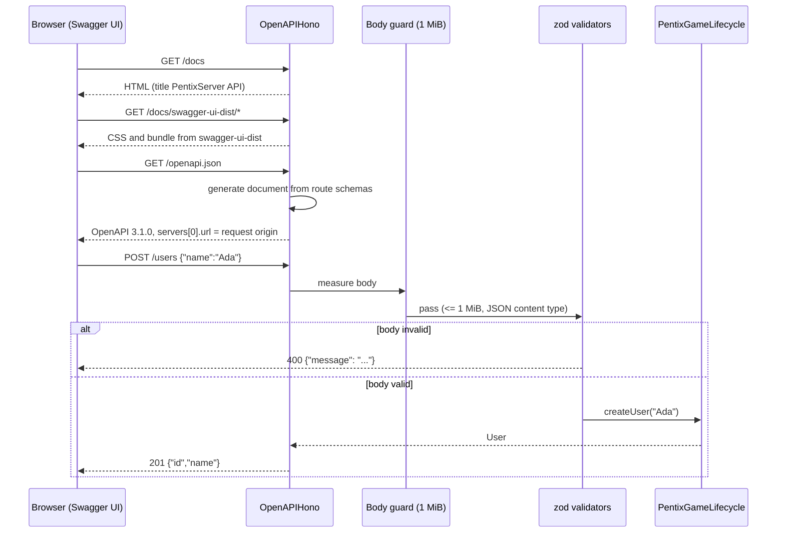

## Context

`apps/pentix-server/src/app.ts` builds a plain `Hono` app with twelve routes. Request bodies are read by `readJsonBody` (a 1 MiB cap plus `JSON.parse`), interpreted by the hand-written readers in `request.ts`, and responses are written by `writeJson` as `application/json; charset=utf-8`. Nothing describes the API, so `README.md` carries a prose copy of the contracts and drifts from the code, and no browser UI can exercise the endpoints.

Constraints that shape this design:

- Node 22, TypeScript 5.9 with `strict`, `noUnusedLocals`, `erasableSyntaxOnly`, and `module: NodeNext`; the server is compiled by `tsc` with no bundler, so runtime file paths resolve inside `node_modules`.
- Tests run through `node --test` over HTTP only (`tests/pentix-server.test.mjs`), against `apps/pentix-server/dist`, and assert exact status codes, the `{ message }` error shape, and the exact `application/json; charset=utf-8` response header.
- Dependencies are deliberately few: `hono`, `@hono/node-server`, `uuid`, `react`. `hono` is `4.13.16`, and `zod 4.3.6` is already in `node_modules` transitively.
- `GET /` must keep answering the `404` fallback (an existing test asserts it), so the console cannot live at `/`.

## Goals / Non-Goals

**Goals:**

- One declaration per endpoint that both validates the request and generates the OpenAPI document, so the document cannot drift from the handlers.
- A browser page at `GET /docs` — Swagger UI with Try it out — available whenever `npm run start:server` runs, with no CDN, no internet access, and no extra flag.
- A machine-readable `GET /openapi.json` (OpenAPI 3.1.0) that other tools and clients can consume.
- Zero change for valid clients: same paths, payloads, status codes, error envelope, and response `Content-Type`.
- Fail the build when a handler's real response stops matching the documented schema.

**Non-Goals:**

- Authentication or authorization for the API or the console: the API is unauthenticated today, and the console inherits that.
- Documentation for `pentix-core`, the browser app, or internal (non-HTTP) API seams.
- Code-generation clients, SDK publishing, or a versioned API lifecycle.
- Runtime response validation in production requests: response schemas are documentation plus test-time enforcement, never a per-request cost.
- Gating the console behind an environment flag. The docs wiring lives in one module, so a flag can be added later without touching the routes.

## Decisions

### 1. Schema-first routes through `@hono/zod-openapi`

`createPentixApp` returns an `OpenAPIHono` and registers each endpoint with `app.openapi(createRoute({...}), handler)`. The route's zod schemas validate the request and feed `app.doc('/openapi.json', ...)`.

Rejected alternatives:

- **A hand-written `openapi.json`/YAML next to the handlers.** It documents today's API and drifts tomorrow; nothing forces a handler change to touch the document. This is the maintenance tax the change exists to remove.
- **`hono-openapi` with `describeRoute`.** Keeps handlers unchanged, but adds a second declaration layer (descriptions separate from validators) and relies on a community package rather than the `honojs/middleware` packages that track Hono releases.
- **A NestJS/Fastify-style framework migration.** Far larger than the problem.

Consequence: the `request.ts` readers are absorbed into schemas, and handlers read `c.req.valid('param')` / `c.req.valid('json')`.

### 2. Self-host the Swagger UI assets

`@hono/swagger-ui`'s `swaggerUI({ baseUrl: '/docs', title: 'PentixServer API' })` emits `/docs/swagger-ui-dist/swagger-ui.css` and `/docs/swagger-ui-dist/swagger-ui-bundle.js`. A new `src/api/docs.ts` mounts `serveStatic` from `@hono/node-server/serve-static` at `/docs/swagger-ui-dist/*` with:

- `root` = the directory reported by `createRequire(import.meta.url)('swagger-ui-dist').getAbsoluteFSPath()` — the documented way for a Node host to locate the package's assets, so the served files always match the installed version, and
- `rewriteRequestPath` stripping the `/docs/swagger-ui-dist` prefix so the remaining file name resolves inside that directory.

A missing asset directory is a startup error naming `swagger-ui-dist`, not a silently blank page.

`GET /openapi.json` and `GET /docs` are registered as plain Hono routes rather than OpenAPI routes, so the document describes the twelve API operations and the console does not list itself. Their own contract is the `api-reference` spec, and `listPentixRouteKeys()` deliberately excludes them so the drift test compares like with like.

Rejected alternatives:

- **The CDN default (`cdn.jsdelivr.net`).** The only way to test the API would break offline, in restricted networks, and whenever the CDN reorganises — unacceptable for a tool that must work on a developer laptop.
- **Copying assets into `dist` at build time.** Adds a build step, duplicates ~1.8 MB per build, and lets copied files drift from the installed package.
- **A hand-built HTML/JS explorer.** Maximum control, but bespoke UI code with no upstream maintenance — the opposite of a long-lived choice.

The version served is therefore exactly the version in `package.json`; there is no second place to bump.

### 3. Keep the response envelope byte-identical

`writeJson` stays the single response helper, now implemented over the typed context API:

```ts
function writeJson<T>(c: Context, statusCode: ContentfulStatusCode, payload: T) {
  return c.json(payload, statusCode, {
    'content-type': 'application/json; charset=utf-8',
  })
}
```

`c.json` accepts a header override (verified against the installed `hono 4.13.16`), so the header stays `application/json; charset=utf-8`, the existing assertions keep passing, and handlers still return the typed response their route declares.

Rejected alternative: plain `c.json(payload, status)` — idiomatic, but it emits `application/json` and would change an observable header plus three existing assertions for no gain.

### 4. One validation policy, current messages preserved

- Zod schemas carry the current wording through explicit messages (for example `Demo run gameCount must be an integer from 1 to 256.`, `<label> must be a UUIDv7 value.`, `<label> direction must be one of: left, right.`).
- `new OpenAPIHono({ defaultHook })` turns a failed validation into `400` with `{ message }` taken from the first issue, before any handler runs, so a rejected request cannot mutate state.
- Path ids are validated by one shared UUIDv7 regex schema. Where an id arrives in an optional body field (`gameId`), the handler keeps `checkUuid` after normalising `null` and blank to "absent".
- Body rules per route: `POST /games` optional body (`required: false`) whose `name` is trimmed and defaults to `''`; `POST /game-sessions` required `userId` and optional `gameId`; `POST /users` required non-empty trimmed `name`; `/move` and `/rotate` required enum `direction`; `POST /demo-runs` optional body with `gameCount` an integer `1`–`256`; `/next-piece`, `/tick`, and `/drop` declare no body.
- `app.onError` maps both `HttpError` and Hono's `HTTPException` to `{ message }` with their status, so malformed JSON (`400 Malformed JSON in request body`) and the media-type gate (`415 Unsupported Media Type`) keep the envelope; unknown errors stay `500 { message: 'Internal server error.' }`.
- The 1 MiB cap moves to an `app.use('*', ...)` guard registered before the routes: it rejects a declared `Content-Length` over the cap and otherwise reads `c.req.text()` once to measure it. Hono caches the body per request, so the route validator's `c.req.json()` re-parses the cached text instead of reading the stream twice.

The only behaviour tightening is `415` for a body sent without a JSON content type, which `@hono/zod-openapi` enforces once a route declares a body schema. It replaces today's "parse whatever arrived as JSON" behaviour, is standard HTTP, and carries its own scenario in `pentix-server-bootstrap`.

### 5. Module layout

```text
apps/pentix-server/src/api/
  schemas.ts   zod schemas for ids, bodies, errors, and the User/Board/Game/Session/DemoRun snapshots
  routes.ts    buildPentixRoutes(lifecycle, demoRuns) -> readonly { route, handler }[]
  docs.ts      registerApiReference(app): /openapi.json, /docs, /docs/swagger-ui-dist/*
apps/pentix-server/src/app.ts   guard, routes, notFound, onError
```

`buildPentixRoutes` returns the route table, `createPentixApp` registers it, and `listPentixRouteKeys()` (derived from the same table) lets the test compare the document with the registered surface. Handlers stay in one table so a new endpoint is one entry, and its validation, documentation, and behaviour cannot be added separately.

Rejected alternative: a single `openapi.ts`. It would re-create the current coupling of every endpoint in one function and grow past 400 lines with schemas included.

Response schemas mirror the `pentix-core` snapshots field for field, using `.readonly()` for arrays and records that the core types declare readonly (`board.rows`, `availablePieceIds`, `pieceIds`, `standings`, `engines`), and are pinned with `satisfies z.ZodType<PentixGame>` and friends. That keeps the documented shape equal to the compiled snapshot type: a change in `pentix-core` breaks the server build before it can break the document.

### 6. Drift protection lives in the test suite

`tests/pentix-server.test.mjs` gains a block that imports the schemas from `apps/pentix-server/dist/api/schemas.js` and:

1. fetches `GET /openapi.json` and asserts `openapi === '3.1.0'`, `info.title`, the reported origin in `servers`, and that every path/method in `listPentixRouteKeys()` is documented (and nothing else is);
2. creates a user, a game, a session, and a demo run over HTTP and runs each response through its schema with `.parse()`, so a renamed or dropped field fails the suite;
3. asserts `GET /docs` is HTML titled `PentixServer API`, references `/openapi.json` and only same-origin assets, and that both asset URLs answer `200` with CSS and JavaScript content types;
4. asserts the documented `gameCount` bounds and the UUIDv7 param pattern appear in the document, proving the document comes from the schemas.

Runtime response validation is deliberately test-only: production requests pay nothing, and `.parse()` failures point at the field rather than at a 500.

### 7. Request flow



## Risks / Trade-offs

- **Response schema types fight the readonly core snapshots** → Declare arrays and records with `.readonly()` and pin each schema with `satisfies z.ZodType<CoreType>`; run `npm run build` (which type-checks the handlers against the declared responses) before touching the tests.
- **`415` surprises a client that posted JSON without a content type** → Documented in the spec, covered by a test, and limited to requests that actually send a body; `npm test` catches a regression in either direction.
- **Asset resolution depends on the installed package layout** → Resolve through `getAbsoluteFSPath()`, the package's documented entry for Node hosts, and fail startup with a message naming `swagger-ui-dist` when it is missing; a test requests both asset URLs.
- **`swagger-ui-dist` pulls `@scarf/scarf` for install-time analytics** → Accepted because it is the canonical Swagger UI distribution and the CDN alternative was rejected; if policy forbids it, `scarfSettings.enabled=false` in `package.json` disables the report without touching the assets.
- **The bundle is ~1.8 MB** → Served from disk by `serveStatic` with `Last-Modified` and no eager read, so startup cost and memory stay flat; only `/docs` visitors pay for it.
- **The document is generated per request** → Twelve routes generate in microseconds; caching would add invalidation logic for no measurable gain.
- **OpenAPI 3.1 support in third-party tooling** → Swagger UI 5.x handles 3.1; a consumer that still needs 3.0 can be served a 3.0 document later by switching the generator, without touching the schemas.

## Migration Plan

1. Add the four dependencies and install, updating `package-lock.json`.
2. Add `src/api/schemas.ts`, then `src/api/routes.ts` with the route table, then `src/api/docs.ts`.
3. Rewrite `app.ts` to build an `OpenAPIHono`, register the body guard, the route table, the docs module, `notFound`, and `onError`.
4. Delete the readers in `request.ts` that nothing uses any more; keep `isUuidV7` and `checkUuid`.
5. Add the new tests, keep the existing ones untouched, and run `npm run build`, `npm test`, and `npm run lint`.
6. Start the server, open `/docs`, and execute `POST /users` and `GET /users` from the browser as the manual acceptance check.
7. Update `README.md` and `docs/foundation.md`.

No data migration: storage schemas, session logs, and the lifecycle are untouched. Rollback is the proposal's rollback plan plus `npm install` to drop the added dependencies.

## Open Questions

- Should the console be disabled in a future production profile? Deferred: the API has no authentication today, and a flag can wrap `registerApiReference` without touching the route table.
- Should `GET /` redirect to `/docs`? No: an existing test and the `api-reference` spec require the `404` fallback at `/`, and a redirect would hide a mistyped API URL behind an HTML page.
