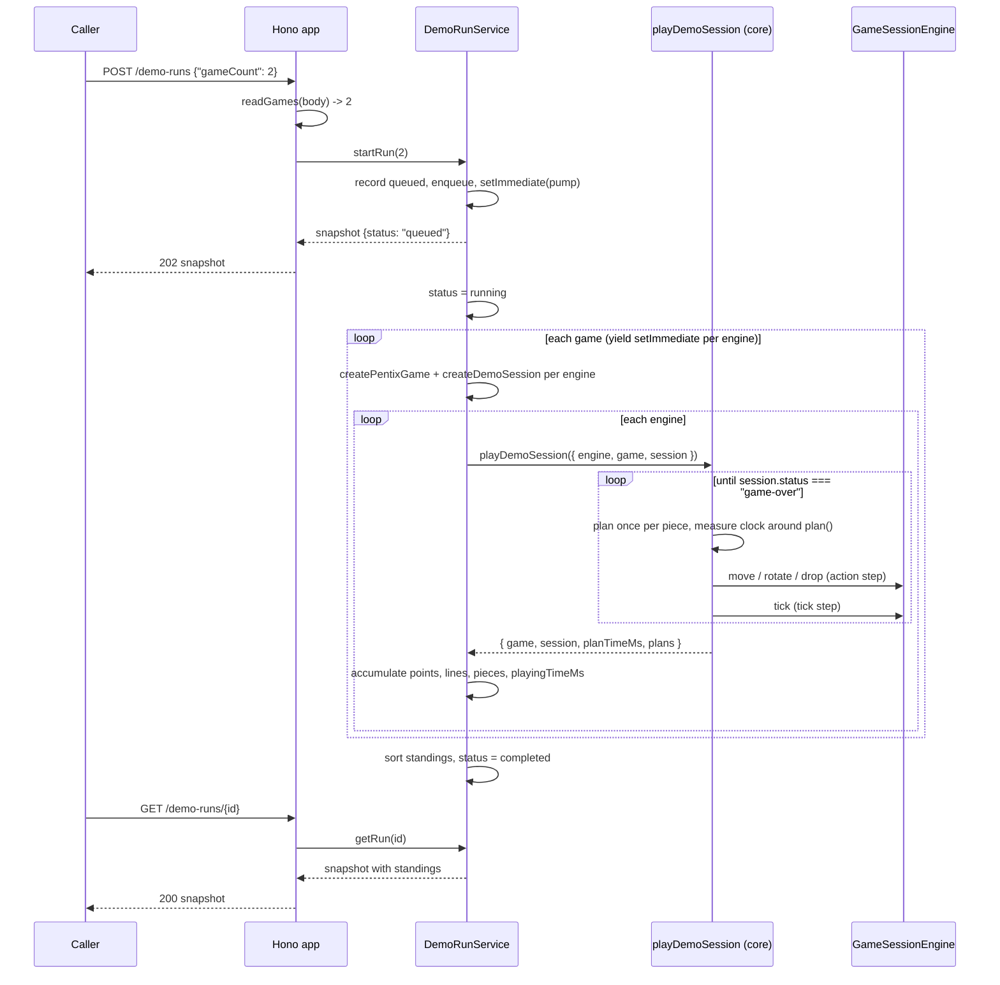

## Context

`packages/pentix-core` already has everything a headless demo needs: `createPentixGame`, `createPentixGameSession`, the stateless `GameSessionEngine`, the demo-engine registry with nine built-in engines, `createDemoEngineInput(session)`, and the `DemoActionLog` alphabet. `apps/pentix-server` owns a `PentixGameLifecycle` that creates games and sessions, persists them, and applies gameplay operations through the same engine. What is missing is the demo driver itself: today it lives in `apps/pentix-web` — `useDemoController`/`useDemoStepper` own the timers, `engine/demo.ts` owns plan caching and the slot alternation, and `gameReducer.ts` owns `withSeededDemoMino` and the `demoAction`/`demoTick` branches. None of that runs in Node.js, and none of it measures how long an engine spends planning.

Constraints that shape this design:

- The server is a single Node.js process with a synchronous domain core (`GameSessionEngine` returns new snapshots). There are no workers, no queues, and no new dependencies expected.
- Player and demo sessions must not diverge in rules: same engine operations, same seeded mino, same action/tick cadence. A second implementation of those rules in the server would be the main source of long-term drift.
- Retained users, games, and sessions are persisted through engine-agnostic repositories. Demo runs are a measurement tool, not player history, so they must not leak into those repositories or their SQLite schema.
- The client is not part of this change: `apps/pentix-web` keeps working exactly as it does today.

## Goals / Non-Goals

**Goals:**

- One shared, timer-free demo driver in `pentix-core` that reproduces the browser demo's rules deterministically and reports the time spent inside `plan`.
- A server-side batch that plays `1`–`256` demo games on demand, in the background, and ranks the registered engines from winner to loser with points, lines, pieces, and planning time.
- Built-in fairness: within one game, every engine plays the same piece sequence from one `PentixGame`.
- Minimal blast radius: additive core exports, two additive HTTP endpoints, no storage, contract, or client change.

**Non-Goals:**

- No UI, no browser client changes, no page that renders a run.
- No persistence and no history endpoints for runs: a run lives in server memory and is forgotten on restart.
- No per-game standings, average-per-game columns, or exported reports — the standings are one aggregate list.
- No worker threads, no concurrency between runs, no cancellation of a running batch.
- No change to `GameSessionEngine`, scoring, leveling, game-over detection, the engine contract, or the registry.
- No migration of the browser demo onto the shared driver in this change (see Open Questions).

## Decisions

### D1 — The demo driver belongs to `pentix-core`, not to the server

New module `packages/pentix-core/src/demo-play.ts` owns demo-session creation and playback. The browser client keeps its React hooks; the server imports the same rules instead of re-implementing them.

*Alternatives:* (a) re-implement the loop in `apps/pentix-server/src` — fastest to write, guaranteed drift and no test coverage shared with the browser rules; (b) drive the client reducer headlessly — the reducer is bound to `GameState` phases, settings, and React identity, far more than a batch needs; (c) extract only a "next action" helper and keep the loop in the server — leaves the tick/slot rules duplicated. Chosen: (d) a dedicated core module whose only inputs are a session, a game, and an engine.

### D2 — Headless playback keeps the order of operations and drops the clock

A browser demo runs one timer at half the gravity interval and alternates action and tick. Headless, only the order carries meaning, so the driver exposes a step function plus a loop: `createDemoPlayback` returns a state whose `slot` names the operation `advanceDemoPlayback` applies next, and `playDemoSession` keeps calling that advance until the session ends. The loop therefore executes the same sequence without sleeping:

- Plan once per spawned piece (`session.nextPieceIndex` changes when a piece locks), cached under the session id and piece index.
- Start with an action operation; then a tick; then an action again.
- A `H` action makes the next operation an action, not a tick, so a log's post-drop side-step precedes the locking tick; if the drop settled the piece instead, the next plan belongs to the new piece index and the old log's remaining codes are discarded with it.
- Once the log is exhausted, action operations apply nothing and ticks continue until the piece locks or the session ends.
- Actions and ticks go through `gameSessionEngine` (`move`, `rotate`, `drop`, `tick`) and keep the returned game, merging the longer piece list exactly like the client's `mergeGame`.

The level-derived interval (`getTickInterval`) is irrelevant here: it only spaces operations in real time. Playback therefore ignores it and never reads a timer.

*Alternatives:* a generator/async iterator per step — nicer to pause, no consumer needs it, and a synchronous loop keeps tests trivial. Chosen: synchronous loop returning the final game, session, plan count, and plan time.

### D3 — One `PentixGame` per game, one session per engine

A batch game creates one `PentixGame` through the server's `createId`/`selectPieceId` seams, then one session per registered engine from that game. Sessions share the piece list but keep their own board snapshot, statistics, level, and piece index. When a playback extends the sequence, the batch keeps the longer game for the next engine, mirroring the browser board set.

*Alternatives:* one independent game per engine — engines would face different piece sequences, so score differences would mix luck and skill; seeds per engine would require a seeded PRNG in core, which changes `createPentixGame`'s contract. Chosen: shared game, matching the shipped board-set semantics.

### D4 — A demo session is seeded and opens at the client demo's starting level

`createDemoSession({ id, userId, game, level, seedColumn? })` wraps `createPentixGameSession`, sets `statistics.level` to the demo's opening level, and seeds exactly one settled cell (`key` `1Line`) on row `height - 2` in a random or supplied column. That reproduces the client demo: the attract demo opens at the client's default starting level (`9`) and every demo session begins with one overhang.

The seed helper moves to core (`withSeededDemoMino`), and `apps/pentix-web/src/engine/gameReducer.ts` calls it instead of keeping its own copy, re-exporting it so existing imports and tests keep working. Behaviour is identical: one cell, random column, no score, no piece count.

*Alternatives:* an empty board on the server — results would not be comparable with the browser demo and the classic `delphi5` pocket behaviour would rarely be exercised; a `level` query parameter — the request only asks for a game count, and a parameter without a consumer is speculative. Chosen: fixed level `9`, exposed as a documented constant and as a service option for tests.

### D5 — Planning time is measured around `plan` only

`playDemoSession` receives `clock?: () => number` (default `performance.now()`, `Date.now()` fallback) and sums `clock()` deltas taken immediately before and after each `engine.plan(...)` call. Nothing else is timed: not `createDemoEngineInput`, not cloning, not engine operations, not ticks. The authored-plan adapter's normalisation runs inside `plan` and is therefore counted — it is part of the engine's work.

Totals are summed per engine across the run and rounded to three fractional milliseconds to keep JSON free of float noise.

*Alternatives:* wall-clock time of the whole playback — dominated by tick volume, not engine quality; `process.hrtime.bigint()` — nanoseconds are noise for millisecond budgets and the default clock must also exist outside Node.js. Chosen: a fractional-millisecond clock with an injectable seam for tests.

### D6 — Runs execute in the background, one at a time

`DemoRunService` (`apps/pentix-server/src/demo-runs.ts`) holds a FIFO of runs. `startRun(games)` creates the record (`queued`), enqueues it, kicks the pump through `setImmediate`, and returns the snapshot immediately, so the `202` leaves the process before the first engine plans. The pump marks one run `running`, plays its games by advancing the shared playback one step at a time and yields with `setImmediate` whenever a new piece is planned, so the event loop keeps serving HTTP, then sorts and marks it `completed`. An unexpected exception marks the run `failed` with the error message.

Running one batch at a time keeps plan timings comparable across runs and keeps memory predictable. `whenIdle()` exposes the queue drain for tests; `startPentixServer().close()` does not wait for an in-flight batch (no timers are held, so a closing process simply stops playing).

*Alternatives:* fully concurrent runs — plan timings inflate unpredictably; worker threads — new process-management surface, and the request does not need them; a synchronous request that returns the result — `256` games would hold one request open for a long time and contradicts "run demos in the background". Chosen: FIFO, one at a time, microtask-driven.

### D7 — Two additive endpoints, no persistence

- `POST /demo-runs` with an optional body `{ "gameCount": <integer> }`. Absent means `1`; a value that is not an integer in `1`–`256` is rejected with `400` and a message naming the bound. Success returns `202` with the run snapshot.
- `GET /demo-runs/{id}` returns `200` with the snapshot, or `404` for a malformed or unknown id.

```json
{
  "id": "018cc251-f400-7000-8000-000000000000",
  "status": "completed",
  "gameCount": 2,
  "completedGameCount": 2,
  "engines": ["delphi5", "random", "claude-opus-5-5-extra"],
  "standings": [
    {
      "engineId": "delphi5",
      "name": "Delphi 5",
      "points": 21450,
      "lines": 37,
      "pieces": 96,
      "playingTimeMs": 412.318
    }
  ]
}
```

`standings` is an empty array until the run completes; `error` appears only on `failed`. `engines` lists the registry's engine ids in registration order so a caller knows the field before results exist. Run ids come from the existing `createId` seam (UUIDv7 in production) and are validated with `checkUuid`.

Finished runs are kept in memory, bounded to the `32` most recent completions; older ones are dropped and their ids answer `404`.

*Alternatives:* a single synchronous endpoint returning the table — no status to poll but a long-held request and no progress signal; persisting runs through a repository — new tables and migrations for a measurement tool the client never reads; `/demos` — "demo" already means the attract mode, and a run is the batch resource.

### D8 — Ordering is total and deterministic

Standings sort by `points` descending, then `lines` descending, then `pieces` descending, then `playingTimeMs` ascending, then `engineId` ascending. Two engines can therefore never swap places between reads of the same completed run, and a shorter planning time is not mistaken for a better engine — it only breaks otherwise equal results.

### D9 — Engine failures do not take the batch down silently

Authored engines are already wrapped by `adaptAuthoredPlan`, which returns the empty log when the body throws, so a broken authored plan degrades to "let gravity finish the piece". Any other exception aborts the run and surfaces as `status: "failed"` with the message; no partial standings are published.

## Sequence



## Risks / Trade-offs

- [A `256`-game batch starves the event loop while an engine plans, because one `plan` call is synchronous] → The pump yields whenever a new piece is planned, runs are serialised, and the batch is documented as an offline-style operation; a game at level `9` tops out after a few hundred pieces and each game holds only ten small snapshots.
- [Plan timing depends on the machine and on JIT warm-up] → Every engine plays every game in the same process in the same order, so warm-up affects engines similarly; timing only breaks ties, ranking is by points.
- [The client keeps its own React driver, so two rule implementations exist] → The seed helper is already moved to core, the client's remaining loop is covered by `tests/pentix-web.test.mjs`, and migrating it onto `playDemoSession`'s step rules is recorded as a follow-up instead of a hidden change.
- [The shared piece sequence can make an engine look lucky or unlucky in a short run] → The `gameCount` parameter exists precisely to average that out; consumers run many games, and the run reports `completedGameCount` so partial results are visible.
- [An in-memory run can be lost on restart or evicted] → Documented as a measurement tool, not history; `404` after eviction and after restart is the expected contract.
- [`random` and the classic tie-break use `Math.random`] → Results are not reproducible across runs by design; the server context's `selectPieceId` seam and the service's engine-list seam keep tests deterministic without changing engine behaviour.

## Migration Plan

1. Add `packages/pentix-core/src/demo-play.ts`, export it from the barrel, and build with `npm run build:core`.
2. Point `apps/pentix-web/src/engine/gameReducer.ts` at the core seed helper; run `npm run test:web` to prove the demo behaviour is unchanged.
3. Add `apps/pentix-server/src/demo-runs.ts`, wire it in `server.ts`, and register the routes and the `gameCount` parser in `app.ts`/`request.ts`.
4. Extend `tests/pentix-core.test.mjs` and `tests/pentix-server.test.mjs`; run `npm run lint`, `npm test`, and a manual `POST`/`GET` pair against `npm run start:server`.
5. Update `README.md` (Server API and current scope) and `docs/foundation.md`.

Rollback: remove the new module, routes, parser, service wiring, and tests, and restore the reducer's local seed helper. Nothing is persisted, so no data action is required; player sessions, storage tables, and the browser client are unaffected throughout.

## Open Questions

- Should results be reported per game as well as aggregated? The current shape answers "which engine won the batch"; per-game detail can be added later without breaking the aggregate list.
- Should the opening level or the seeded-mino column be caller parameters? Both are fixed (`9`, random column) until a caller needs otherwise.
- Should the browser demo be migrated onto the shared playback rules so one module owns the cadence? Deferred to a separate change so this one cannot regress the UI.
- Should large batches move to worker threads? Deferred; the queue and the yield points are the seam where that would be added.

