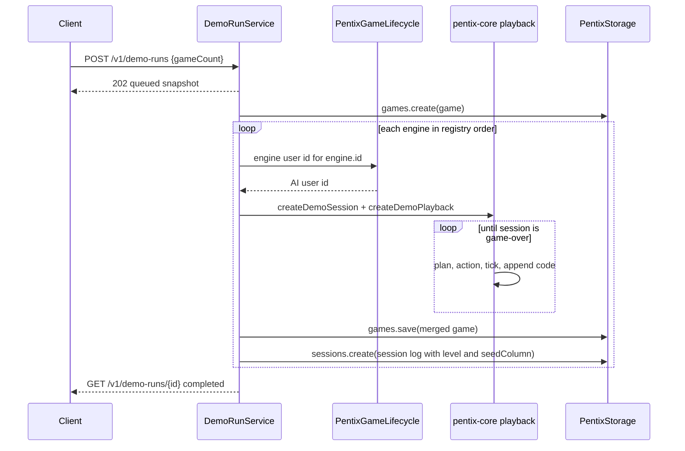
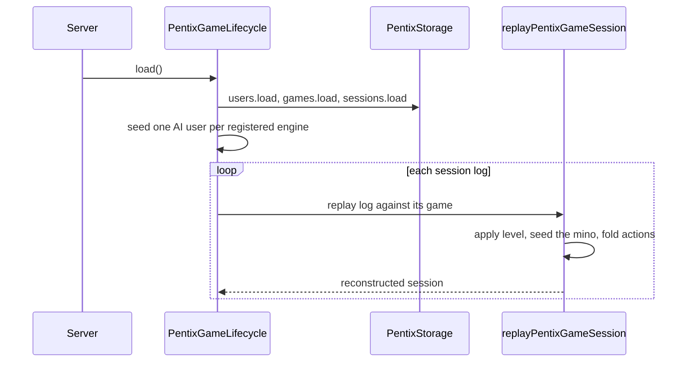

## Context

`PentixServer` has three repositories behind `PentixStorage`: users, games, and
sessions (`apps/pentix-server/src/storage/repositories.ts`). The SQLite
implementation creates the `users`, `games`, and `game_sessions` tables and the
in-memory implementation mirrors it. `PENTIX_DATA_FILE` selects the SQLite file,
and `apps/pentix-server/src/main.ts` defaults it to `data/pentix.db`. A human
session is durable because its `SessionActionLog` is written on every gameplay
request, and `PentixGameLifecycle.load()` rebuilds each session by replaying its
log against the parent game.

`DemoRunService` plays batches with the shared playback in `pentix-core`. It
creates one `PentixGame` and one seeded demo session per engine, plays each to
`game-over`, and keeps the run in a memory map. It attributes every session to
the constant `DEMO_RUN_USER_ID` (`'demo'`) and writes nothing. The playback
returns the final session but not the action log. No engine owns a `User` row,
and `User` has only `id` and `name`.

The browser client (`apps/pentix-web`) builds its own board set locally. It
calls no server endpoint, so the attract demo and its rail boards are outside
this design.

## Goals / Non-Goals

**Goals:**

- Give every registered demo engine one durable `User` row of type `ai`, stable
  across server restarts.
- Add the user type (`human` or `ai`) to `User`, the repositories, the database
  schema, and the API responses.
- Store one `PentixGame` and one session log per finished demo session, at the
  moment that session reaches `game-over`.
- Make a stored demo log replay to the state that live play reached, including
  the seeded opening mino and the demo starting level.
- Migrate an existing database file in place with additive changes.
- Use the existing storage setting and repositories. Add no dependency and no
  new environment variable.

**Non-Goals:**

- Persisting the browser attract demo or its rail boards. That needs a
  browser-to-server channel, which does not exist.
- A read endpoint for stored demo sessions, a UI, or a standings change.
- Persisting the run record, its status, or its standings across a restart.
- Storing per-action board snapshots, plan logs, or plan timings.
- A retention or pruning policy for demo rows, an admin deletion endpoint, or a
  backfill of past runs.
- Any gameplay, scoring, engine, or session-rule change.

## Decisions

### 1. `User` carries `type`, and an AI user carries `engineId`

`User` gains a required `type` of `'human'` or `'ai'` and an optional
`engineId`. `createUser({ id, name, type, engineId })` defaults `type` to
`'human'`, so every existing call site keeps working. AI seeding passes
`type: 'ai'` and the engine id.

Alternative: a separate `ai_users` table. Rejected, because the requirement is
one `users` row per engine, and the API list must show the type.

Alternative: infer the type from the name or from an engine registry lookup.
Rejected, because the stored row must answer the question without the registry.

### 2. AI users get UUIDv7 ids and a durable `engine_id` lookup key

`PentixGameLifecycle.load()` seeds the AI users after it loads the human users.
For each engine, it looks for a loaded user whose `engineId` matches the engine
id. When none exists, it creates one through `createUser` with
`id: this.createId()`, `name: engine.name`, `type: 'ai'`, and `engineId:
engine.id`, then writes it through `UserRepository.create`. A restart therefore
reuses the retained row and creates nothing twice.

Alternative: the engine id as the user id. Rejected, because `User` ids are
UUIDv7 values. `UserSchema` validates that format, and a malformed id in
`GET /v1/users/{id}` answers `400`.

Alternative: a deterministic UUIDv5 from the engine id. Rejected, because the
`users` schema and the path validator accept UUIDv7 only.

Alternative: seed lazily when a run starts. Rejected, because the lifecycle's
working map would lack the row while `createSession` validates a user id, and a
lazy seed adds a start-time race.

The engine list is the server context's `demoEngines`, which defaults to the
whole registry. The lifecycle therefore seeds exactly the engines that a run can
compete, including a stub list in a test.

### 3. Reuse `game_sessions` for demo logs, with optional `level` and `seedColumn`

A demo log is a `SessionActionLog` with two optional fields. `level` is the
session's opening level, which is `9` for a demo. `seedColumn` is the column of
the opening seed mino. `replayPentixGameSession` applies `level` and calls
`withSeededDemoMino` before it folds the recorded actions. A human log omits
both fields, and its replay is unchanged.

Alternative: a new `demo_game_sessions` table and repository. Rejected, because
it duplicates the log representation and the repository contract, and the task
names the existing session storage.

Alternative: store final statistics instead of a replayable log. Rejected,
because the repository's retained form of a session is its log, and a log
repairs, audits, and replays.

The demo `PentixGame` is written through `GameRepository` before its sessions,
because `load()` rejects a session whose `gameId` has no game. The merged game,

### 4. The demo playback records the log it applies

`DemoPlayback` gains the recorded pieces and the log metadata. Every advance
appends the code it applied through `GameSessionEngine`: `L`, `R`, `C`, `A`, `H`,
or `T`. The playback groups the code under the numeric id of the piece that was
active when the operation arrived. The lifecycle already uses that rule.
`playDemoSession` returns the log with the session and the plan totals.

Two cases need care. An action that the board blocks still appends its code,
because the log is a transcript of the plan. A code that the settling hard drop
discards never changes the placement, so the playback does not append it. Both
rules keep a replay equal to live play.

The playback captures the opening level from `session.statistics.level` and the
seed column from the single occupied cell on the row before last. A playback
that starts on a board without that exact opening shape records no seed column,
and its log replays without a seed.

Alternative: rebuild the log in `demo-runs.ts` from the codes it sends. Rejected,
because the playback alone knows which code was applied, which code was
discarded, and which tick ran.

### 5. Write each demo session once, when it reaches `game-over`

A run keeps one `PentixGame`, then plays the engines in registry order. After an
engine's playback finishes, the service saves the merged game when its piece list
grew, then creates one session log for that engine. A run of `n` games with `k`
engines therefore writes at most `n` games and `n × k` session logs.

Alternative: save on every tick or action. Rejected, because the request is one
record per finished session, and per-action writes would multiply the write
count without adding a fact.

Alternative: batch all sessions of a run at the end. Rejected, because a long
run would keep no record when it fails part-way, and the request says to store
each session when it finishes.

### 6. Additive column migration guarded by `PRAGMA table_info`

`SCHEMA_SQL` gains the four columns for a fresh file. `openDatabase` then reads
`PRAGMA table_info` for `users` and `game_sessions` and adds a missing column
with `ALTER TABLE ... ADD COLUMN`. `users.type` gets `NOT NULL DEFAULT 'human'`,
so every existing row becomes a human user. `users.engine_id`, `level`, and
`seed_column` are nullable. The migration is idempotent, because each statement
runs only when its column is absent.

Alternative: a schema-version table and ordered migration scripts. Rejected for
four nullable or defaulted columns, because it adds machinery that this change
does not need.

### 7. The user JSON exposes `type` and `engineId`, and only seeding creates AI users

`UserSchema` gains `type` as an enum of `human` and `ai` and `engineId` as an
optional kebab-case string. `CreateUserRequestSchema` is unchanged, and
`PentixGameLifecycle.createUser` always sets `type: 'human'`. A client therefore
cannot create an AI user or choose an engine binding.

`GET /v1/users` and `GET /v1/users/{id}` return the AI users. A client that wants
only human users filters on `type`, and the documentation states that rule.

### 8. The run record stays in memory, and only games and sessions are durable

`DemoRunService` keeps its map, retention bound, and one-at-a-time queue. It now
receives the storage bundle and a resolver that returns the AI user id for an
engine id. `DEMO_RUN_USER_ID` is removed, so every demo session is attributed to
the engine's user row.

## Sequence: one demo run game

## Sequence: startup with a retained demo log

## Risks / Trade-offs

- AI users appear in `GET /v1/users` and occupy names. A human who registers an
  engine name gets `409`. A client that expects only humans must filter on
  `type`. The API schema and the documentation state `type`, and the seeded set
  is one row per registered engine.
- An in-memory server creates a new UUIDv7 AI id per engine on every start.
  In-memory storage retains no session either, so no durable record references
  the old ids.
- A demo log enters the lifecycle working set at startup. A client that knows a
  demo session id could advance it through the gameplay endpoints. No endpoint
  lists session ids, and demo ids are UUIDv7 values.
- A failed write fails the run, and rows written before the failure stay. The
  run reports `failed` with the cause. The rows describe sessions that did
  finish, so the partial state is accurate.
- Unbounded growth: every run adds `n` games and `n × k` logs. This change adds
  no pruning. The risk is recorded as an open question, and the run retention
  bound still limits the in-memory records.
- `seedColumn` comes from the opening board shape. Only a fresh demo session has
  one occupied cell on the row before last. Any other opening board records no
  seed and replays without one.
- An old database file is migrated on first open. Each `ALTER TABLE` runs only
  when `PRAGMA table_info` shows the column missing, so a repeated start is safe.
- Demo writes lengthen a run and hold the one-at-a-time queue. The service
  yields between plans as before. The write count is one game save plus one
  session save per engine.

## Migration Plan

1. Build `packages/pentix-core` and `apps/pentix-server` together. The user type,
   the log fields, the playback result, and the storage columns ship as one unit.
2. Start `PentixServer` against the existing `PENTIX_DATA_FILE`. The four columns
   are added, existing users become `human`, and one AI user per registered
   engine is created.
3. Start one demo run and inspect the new game row and the session rows.
4. Restart the server and observe that `load()` replays the demo logs and that
   `GET /v1/users` still holds one AI row per engine.
5. Roll back with the steps in `proposal.md`. The added columns stay in place and
   are unread after a rollback, so no data repair is necessary.

## Open Questions

- Does demo-session storage need a retention bound or a deletion endpoint before
  long-running deployments accumulate rows?
- Should a later change expose the stored demo sessions through a read endpoint,
  and should it link them to a run id?
- Should the browser attract demo post its finished sessions once a
  browser-to-server channel exists?

with the longest piece list, is saved after each engine's playback.
