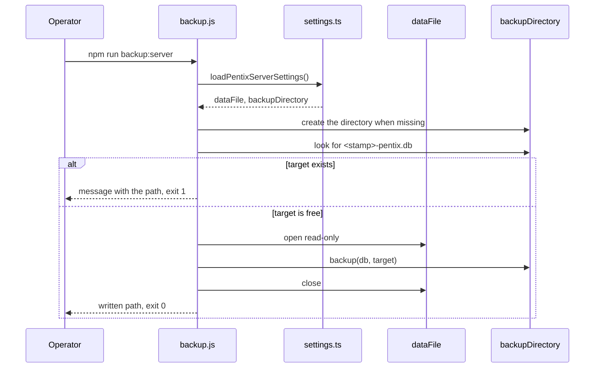

## Context

`apps/pentix-server/src/main.ts` resolves one path today:

```ts
const DEFAULT_DATA_FILE = path.resolve('data', 'pentix.db')
const dataFile = path.resolve(process.env.PENTIX_DATA_FILE ?? DEFAULT_DATA_FILE)
```

The path is relative to the process working directory. `npm run start:server` runs from the repository root, so the file lands in `data/pentix.db` inside the working copy. The folder sits beside generated output, and nothing backs it up.

`startPentixServer` keeps its host and port in `process.env.PENTIX_SERVER_HOST` and `PENTIX_SERVER_PORT`, and the option object takes precedence. The repository holds no settings file. `README.md` and `docs/foundation.md` name `PENTIX_DATA_FILE` as the only data-path setting.

`apps/pentix-server/src/storage/sqlite.ts` creates the parent directory of the data file, tests the file integrity, sets write-ahead logging, and creates the schema. The store therefore accepts any absolute path and creates `C:\db\pentix\` on the first start.

`node:sqlite` in the running Node.js version exports `backup(sourceDb, path, options)`. It copies a live database page by page, and it reads through a write-ahead log.

## Goals / Non-Goals

**Goals:**

- Keep the data file outside the working copy, at `C:\db\pentix\pentix.db`.
- Hold both storage paths in one committed app settings file that an operator can read and edit.
- Keep the existing environment variables working, and name the resolved paths at startup.
- Add one command that writes a consistent backup copy while the server runs.
- Name every backup file by its creation minute, so a name sort orders the files by time.
- Fail loudly on a bad settings file and on a refused backup, so no silent default hides a mistake.

**Non-Goals:**

- A backup schedule, a retention policy, and a restore command.
- A server endpoint that starts a backup.
- A change to the schema, the row shapes, the repositories, the API, or the in-memory store.
- A migration tool for the old data file.

## Decisions

### 1. One settings file at `apps/pentix-server/settings.json`

The file sits beside the application source and outside `src`, so the build copies nothing and `tsc` does not compile it.

```json
{
  "dataFile": "C:\\db\\pentix\\pentix.db",
  "backupDirectory": "C:\\db\\Backups\\pentix"
}
```

The keys are flat, because the file holds two paths and no nesting adds meaning.

Alternative: keep the values in `package.json`. Rejected, because an operator should not edit the manifest to move a data file.

Alternative: read `apps/pentix-server/settings.json` from the working directory. Rejected, because a start from another directory then finds no file.

### 2. Resolve the settings file from the module URL

`settings.ts` derives its default path from `import.meta.url`, two levels up. `dist/main.js` resolves to `apps/pentix-server/settings.json`, and `src/main.ts` resolves to the same file. The working directory never changes the answer.

`PENTIX_SERVER_SETTINGS_FILE` replaces that path. A relative value resolves against the working directory, because the operator typed it there.

### 3. Resolve each path against the settings folder

An absolute `dataFile` or `backupDirectory` value SHALL be used as written. A relative value resolves against the directory that holds the settings file, so `{"dataFile": "pentix.db"}` means `apps/pentix-server/pentix.db`.

Alternative: resolve relative paths against the working directory. Rejected, because the same settings file would then name two different files.

### 4. Environment variables override the file

Precedence, highest first:

1. `PENTIX_DATA_FILE` and `PENTIX_BACKUP_DIRECTORY`.
2. The `dataFile` and `backupDirectory` values in the settings file.
3. Nothing. The loader requires the settings file, so no built-in path sits below it.

`PENTIX_DATA_FILE` keeps its current meaning, so an existing start command still works. The two other variables name a path that an operator sets for one run.

### 5. A missing or invalid settings file fails startup

`loadPentixServerSettings()` throws a `SettingsError` when the file is missing, unreadable, not valid JSON, holds an unknown key, lacks a key, or holds an empty or non-string value. The message names the settings file and the offending key.

Alternative: fall back to `data/pentix.db` when the file is missing. Rejected, because the fallback recreates the problem that this change removes, and the operator never learns that the file is gone.

The module exports the resolved settings:

```ts
export interface PentixServerSettings {
  readonly settingsFile: string
  readonly dataFile: string
  readonly backupDirectory: string
}
```

### 6. Backup through `node:sqlite` `backup()` instead of a file copy

A byte copy of `pentix.db` misses the commits that write-ahead logging holds in `pentix.db-wal`. Copying three files in some order can catch a half-written transaction. `backup()` reads the database through SQLite, so the copy holds every committed page and no uncommitted page. It also runs while the server holds the file open.

The backup command opens the data file read-only, calls `backup(db, target)`, and closes the source handle. A failed copy removes the partial target file, so the backup directory holds complete backups only.

### 7. The file name is `<yyyyMMddHHmm>-pentix.db` in local time

The stamp is the local creation minute, as the operator's clock reads it. `toISOString()` is not used, because it reports UTC and the operator compares the name against the wall clock. A small formatter pads every field to two digits, so the name sorts by time.

The suffix `.db` follows the file name. It states that the file is a SQLite database. A restore copies it back as a data file unchanged.

### 8. The command refuses a second backup in the same minute

An existing `<stamp>-pentix.db` is never replaced. The command prints that path and exits `1`.

Alternatives: overwrite the file, or add a counter suffix such as `-2`. Overwriting destroys a good backup without a warning. A counter breaks the stated name format and hides how many backups a minute produced. A refused run costs one retry, and a scripted caller sees the failure.

### 9. The backup is a command, not an endpoint and not a timer

`npm run backup:server` builds the core and the server, then runs `apps/pentix-server/dist/backup.js`. The entry point reads the same settings as the server, so the operator configures one file.

Alternative: an HTTP endpoint. Rejected, because a backup writes a file on the server host, and the API carries no authentication.

Alternative: a timer inside the server. Rejected, because the schedule, the retention, and the failure reporting each need a decision that this change does not need.

### 10. The old data file moves by hand, once

The change adds no migration code. The operator stops the server, moves `data\pentix.db`, `data\pentix.db-wal`, and `data\pentix.db-shm` into `C:\db\pentix\`, and starts the server. A first start on an empty `C:\db\pentix\` also works, because the store creates the directory and the schema.

### 11. Startup output names the resolved paths

`main.ts` prints the settings file, the data file, and the backup directory beside the existing listen URL lines. An operator then sees which file the process locked, without reading the code or the environment.

### Backup flow



## Risks / Trade-offs

- A settings file that names a removable drive fails at startup →  The `SettingsError` names the file and the folder. The operator then edits one line.
- A relative path in the settings file resolves against a folder outside the working copy →  The startup line prints the absolute resolved path. A wrong answer is then visible at once.
- A large database backup needs free disk space →  The command names the target path. A failed write exits non-zero and leaves no partial file.
- Two backup runs in the same minute →  The second run exits `1` and leaves the first file intact. A scheduled caller then retries in the next minute.
- A backup file holds user names and game sessions in plaintext →  The backup directory stays a local folder. A copy to a share or a cloud folder needs its own protection. This change adds no encryption.
- A settings file committed with Windows paths does not suit another operating system →  `PENTIX_DATA_FILE` and `PENTIX_BACKUP_DIRECTORY` override both values. A Linux run then names its own paths without a file edit.
- A future key added to the settings file breaks an older server →  The loader rejects an unknown key on purpose, so a typo is caught. A new key ships with the code that reads it.

## Migration Plan

1. Stop the running `PentixServer`.
2. Move `data\pentix.db`, `data\pentix.db-wal`, and `data\pentix.db-shm` into `C:\db\pentix\` when the old files exist. The server creates the data folder and the backup folder when they are missing, so the move is the only manual file work.
3. Build and start the server. The startup lines must name the new data file.
4. Read `GET /v1/users` and verify that the retained users survived the move.
5. Run `npm run backup:server` and verify one `<stamp>-pentix.db` file in `C:\db\Backups\pentix`.
6. Roll back by stopping the server and starting it with `PENTIX_DATA_FILE` set to the old path, or by moving the file back after step 2.

## Open Questions

- Does the operator want a retention rule, such as keeping the newest `30` backups? The answer decides a later change.
- Does a restore command belong in this repository, or does the operator copy the file by hand? This change documents the copy.
