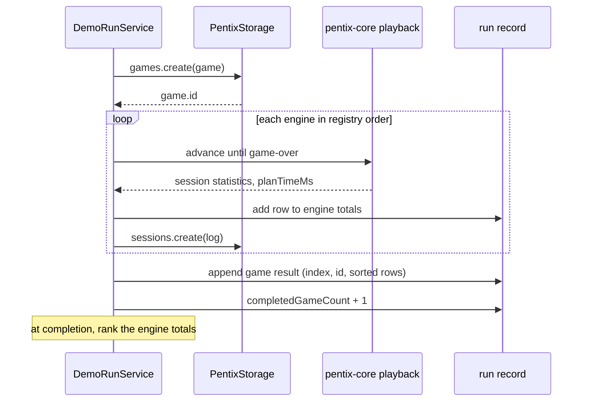

## Context

`DemoRunService` in `apps/pentix-server/src/demo-runs.ts` plays a batch of
`gameCount` games. Every game creates one `PentixGame` through
`storage.games.create`, then plays one seeded demo session per registered
engine. The service keeps `DemoRunTotals` per engine and adds each finished
session's `statistics.score`, `statistics.clearedLines`,
`statistics.blocks`, and `planTimeMs` to it. At the end it maps the totals to
`DemoRunStanding` lines, sorts them, and publishes them in `standings`.

The snapshot therefore holds one line per engine and no game attribution. It
lists `engines` as bare id strings, so the name and description of an engine
never reach a reader of the run. `DemoRunStanding`, `DemoRunSnapshot`,
`DemoRunStandingSchema`, and `DemoRunSnapshotSchema` mirror that shape, and the
schemas pass `satisfies z.ZodType<...>`, so a type and its schema move together.

The run already stores every game and every finished session log. The stored
game id exists, but no published line names it. A reader therefore cannot
connect a stored row to a score.

The browser client calls no demo-run endpoint, so no UI consumes the response.

## Goals / Non-Goals

**Goals:**

- Attribute every score, line count, piece count, and planning time to its game.
- Label every engine line with `engineId` and `name`, so a reader needs no
  registry lookup.
- Keep an engine line's sums apart from a game row's values by name.
- Name the durable game of each entry, so a reader reaches the stored game and
  its session logs.
- Report the planning cost of `1000` pieces, so games of different length
  compare fairly.
- Keep the rank order and the tie-break rules unchanged.

**Non-Goals:**

- A change to scoring, leveling, playback, plan-time measurement, or retention.
- A new endpoint, a stored result, a database column, or a migration.
- A browser UI for a run.
- An engine `description` on the result line.

## Decisions

### 1. The snapshot holds `engines` and `games`, and `standings` is removed

`DemoRunSnapshot` gains `engines: readonly DemoRunEngineStanding[]` and
`games: readonly DemoRunGameResult[]`, and it drops `standings`. The engine line
holds the run aggregate. The game entry holds that game's rows. A reader reads
the overall winner from `engines[0]` and one game's winner from
`games[i].standings[0]`.

Alternative: keep `standings` and add `games` beside it. Rejected, because it
publishes the same numbers twice, and a client must decide which copy is
authoritative.

Alternative: a separate results endpoint. Rejected, because a run is one
in-memory record, and a second path adds a lifecycle that the record already
holds.

### 2. An engine line carries `engineId` and `name`, and its sums take the `total` prefix

`DemoRunEngineStanding` copies the engine id and display name. Its three sums are
`totalPoints`, `totalLines`, and `totalPieces`. `playingTimeMs` and its rate keep
their names. A game row keeps `points`, `lines`, `pieces`, and `playingTimeMs`,
because it reports one game.

Alternative: keep `points`, `lines`, and `pieces` on both levels. Rejected,
because the same name at two levels invites a reader to compare a row with a
total.

Alternative: carry `description` on the line. Rejected, because the description
is long registry text, the name identifies the line, and the registry keeps the
description.

### 3. A game entry uses `index` and `id`

`DemoRunGameResult` carries `index` (zero-based position in the run), `id` (the
UUIDv7 of the stored `PentixGame`), and `standings`. The entry sits inside
`games`, so `gameIndex` and `gameId` would repeat the parent name.

Alternative: `gameIndex` and `gameId`. Rejected, because the entry sits inside
`games`, so the prefix repeats the parent name.

### 4. `games` grows after each game ends, and `engines` is always ranked

`playGame` returns a `DemoRunGameResult` once every engine of that game has
finished. `playRun` appends the result and publishes it in the same update that
raises `completedGameCount`, so `games.length` always equals
`completedGameCount`. Every entry is final when it appears, because all engines
of that game have ended.

`engines` holds one line per engine from the start. Before the first game ends,
each line carries `engineId`, `name`, zero sums, and zero time, so the sort falls
through to `engineId`. The same comparator ranks the lines at every read, so the
order always agrees with the totals. The chain is `totalPoints`, `totalLines`,
`totalPieces`, shorter `playingTimeMs`, then `engineId`.

Alternative: publish `games` only at completion. Rejected, because a batch of
`256` games gives no per-game progress for a long time, and each finished game
is already final.

Alternative: publish `games` while a game is in flight. Rejected, because the
engines of that game have not all finished, and a partial row would need a
second status field.

Alternative: registry order for `engines`. Rejected, because the request names
`engines` as the run statistics, and a reader expects the winner first.

### 5. The rate field sits on the engine line only, and it is `null` without pieces

`playingTimePer1000PiecesMs` follows the `<quantity><Unit>` spelling of
`playingTimeMs`. The value is `playingTimeMs × 1000 ÷ totalPieces`, rounded to
three decimals. A line whose `totalPieces` is `0` reports `null`. A game row does
not carry the field.

Alternative: report the rate on every game row too. Rejected, because a game row
already carries its time, and a per-game rate invites a comparison that the
per-game rounding makes noisy.

Alternative: report `0`. Rejected, because `0` claims a perfect rate for an
engine that placed nothing, and a client that sorts on the field ranks it first.

Alternative: omit the field. Rejected, because an optional field makes the
schema and every reader branch on presence.

### 6. Per-game values are rounded, and the engine total is their sum

Each game row's `playingTimeMs` is rounded to three decimals. The engine total
is the sum of the rounded game rows, rounded again to remove float noise. An
engine line therefore equals the sum of its rows. The rate comes from the
reported `playingTimeMs` and `totalPieces` of the engine line.

Alternative: round only the summed total, as now. Rejected, because the game
rows would not add up to the total, and a reader would see an unexplained gap
of up to `0.0005 × gameCount` milliseconds.

### 7. The types and the zod schemas move together

`DemoRunEngineStanding`, `DemoRunGameStanding`, `DemoRunGameResult`, and
`DemoRunSnapshot` live in `demo-runs.ts`. New zod schemas mirror the three new
objects. `totalPoints` and `points` are numbers, `totalLines`, `totalPieces`,
`lines`, and `pieces` are integers, `gameCount` and `completedGameCount` are
integers, `index` is a non-negative integer, and `id` is `UuidV7Schema`. Every
schema keeps its `satisfies z.ZodType<...>` clause.

### 8. One comparator serves both lists

A private `compareRank(a, b)` holds the chain: points descending, lines
descending, pieces descending, time ascending, engine id ascending. A game row
sorts through it directly. The engine sort maps `totalPoints`, `totalLines`, and
`totalPieces` into the same five fields, so the two lists cannot drift apart.

Alternative: two comparators with own chains. Rejected, because a later
tie-break change would need two edits, and one chain is the rule.

## Sequence: one game reaches the snapshot

## Risks / Trade-offs

- The response shape breaks for a client that reads `standings`, treats `engines`
  as strings, or reads `points` on an engine line. No shipped client reads a run,
  and the README states the new shape.
- A published game result grows the snapshot. The worst case is nine engines and
  `256` games, which is `2304` rows per retained run and about `74k` over the
  `32` retained runs. The bound stays constant.
- A client that charts a run must read `completedGameCount` to know how many
  entries `games` holds. The spec states that `games.length` equals that field.
- The rate is `null` for a piece-less line. A client that sorts on the rate must
  handle a gap. The glossary and the README state the rule.
- A reader can mistake a game row's `points` for the run rank. The fields keep
  their names, and the order of each list still decides its winner.
- The engine rate can differ from the mean of the game rates, because games have
  different piece counts. Both values come from the reported fields, so the
  difference is explainable.

## Migration Plan

1. Build `packages/pentix-core` and `apps/pentix-server` together. This change
   touches no shared-core file, so its build only rebuilds unchanged code.
2. Start `PentixServer` against the existing `PENTIX_DATA_FILE`. No column is
   added and no row is rewritten.
3. Start one `POST /v1/demo-runs` run of `2` games. The response must carry two
   `engines` lines and two `games` entries. Each game must name a stored game id,
   and each engine total must equal the sum of its game rows.
4. Roll back with the steps in `proposal.md`. The stored games and session logs
   stay as they are, so no data repair is necessary.

## Open Questions

- Should a later change store the run result, so a restart keeps a finished run?
- Should a client read the stored session logs of one game entry, or does the
  `id` reference serve that need through the existing session rows?
- Should the engine line carry the registry `description` after a change to that
  text, or the text that the run started with?
