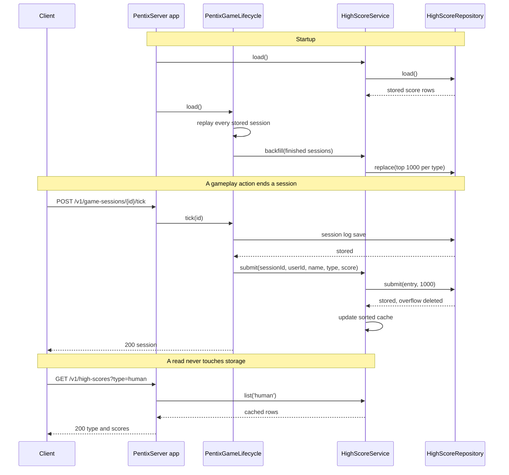

## Context

`apps/pentix-server` stores every user, game, and session through
`PentixStorage`, and `createSqliteStorage` keeps those rows in one SQLite file
under `game_sessions`, `games`, and `users`. A session is stored as a
`SessionActionLog`, and `PentixGameLifecycle.load()` replays every log through
`replayPentixGameSession`. The replayed session carries
`statistics.score`, and the log carries no timestamp.

Three facts shape this design:

- The score of a session exists only after a replay. SQLite cannot rank stored
  sessions by score without replaying their action logs, so a plain SQL view or
  an `ORDER BY score` query cannot answer the request.
- The server already holds every replayed session in memory after startup.
  Every completion passes through one of two code paths:
  `PentixGameLifecycle.persistAction` for gameplay endpoints and
  `DemoRunService.playGame` for a batch.
- The storage contract has one interface per entity, one SQLite
  implementation, and one in-memory implementation. Migrations add columns in
  place and are safe to repeat.

## Goals / Non-Goals

**Goals:**

- One durable table that holds the best 1000 finished sessions for `ai` users
  and the best 1000 for `human` users.
- One endpoint, `GET /v1/high-scores?type=ai|human`, that answers from memory
  and never reads the session table.
- One submission point per completion path, so a new session moves the table
  in the same request or run that stores its log.
- A deterministic order, so two servers with the same rows answer the same
  list.
- A repeated deployment that creates the table in an existing data file
  without a manual step.

**Non-Goals:**

- A browser screen for high scores. This change stops at the API.
- Live scores of an unfinished session. A session enters the table when it
  reaches `game-over`.
- Pagination, a rank field, a date-range filter, or a player filter. The
  filter is the user type, and one response holds one full table.
- A second data file, a separate cache process, or an external cache such as
  Redis.
- A history of every score. The table keeps the best 1000 rows per type and
  drops the rest.
- Backfill of sessions whose id is not a UUIDv7 value.

## Decisions

### 1. One persisted table plus an in-memory cache

`high_scores` is a real table, and `HighScoreService` loads it once at startup
into two sorted arrays. `GET /v1/high-scores` reads those arrays. A submission
writes the row through `HighScoreRepository` first, then updates the arrays.

Rejected alternatives:

- **Replay the sessions on each request.** It costs one replay per stored
  session per request and grows without bound.
- **A SQLite view.** A view cannot run `replayPentixGameSession`, so it cannot
  compute a score.
- **A `score` column on `game_sessions` only.** It still needs an index and an
  ordering query on every read, and it duplicates the cache that the server
  already holds. The dedicated table also keeps the user name and the
  achievement date next to the score.
- **An external cache.** It adds an operational dependency for a table of at
  most 2000 rows.

### 2. The row holds a name snapshot

Each row carries `session_id`, `user_id`, `name`, `user_type`, `score`, and
`achieved_at`. The name is copied from the user when the row is submitted.

This repository has no rename operation, so a stored name cannot drift from
its user. A snapshot keeps the read path free of a join and keeps one
`SELECT` sufficient for the cache load.

Rejected alternative: store `user_id` only and join `users` at load time. A
future rename would then rewrite the visible table, and the SQL read would
need a join for no present gain.
### 3. The table keeps 1000 rows per user type

`HighScoreRepository.submit(entry, tableLimit)` inserts or updates one row by
`session_id`. It then deletes the rows of that type beyond `tableLimit`. The
order is score descending, achievement date ascending, then session id
ascending. The SQLite implementation runs both statements in one transaction.

`HighScoreService` applies the same order and limit to its arrays. It keeps
`HIGH_SCORE_TABLE_SIZE = 1000` and passes that value to the repository, so the
storage layer owns no product constant.

Rejected alternatives:

- **Trim on read.** The table would grow without a bound, and each read would
  sort more rows than it returns.
- **A fixed `LIMIT 1000` on read with no delete.** The file would hold every
  finished session twice, once as a log and once as a score row.
- **A separate limit per query.** The proposal fixes one table per type, so
  the limit is one constant.

### 4. Only a finished session enters the table

`HighScoreService.submit` accepts one session id, user id, user name, user
type, and score. Both callers send it only when the session status changes to
`game-over`:

- `PentixGameLifecycle.persistAction` records the session once after it stores
  the log and the game.
- `PentixGameLifecycle.advanceSession` records the session when a next-piece
  request ends it.
- `DemoRunService.playGame` records each engine session after it stores the
  log.

A session that is still `active` has no final score, so it does not reserve a
row. This rule also stops a restart from ranking an unfinished human session.

Rejected alternative: submit on every successful save. It would rewrite a row
on each action, and an unfinished game could hold a slot in the table.

### 5. A submission failure fails its request or run

The lifecycle saves the session log first and then submits the score. A
repository error propagates, so the gameplay request answers `500`, and a demo
run reports `failed` with the storage message. The cache changes only after
the repository write succeeds, so an error never leaves a row that a restart
loses.

Rejected alternative: log the error and answer success. The table would then
silently miss a finished session, and a client would have no signal to retry.

### 6. An empty table is rebuilt from stored sessions at startup

`HighScoreService.load()` reads the table. When the table is empty,
`PentixGameLifecycle.load()` passes its replayed sessions to
`HighScoreService.backfill`, which keeps the finished sessions and submits the
best 1000 per type through `HighScoreRepository.replace`.

The achievement date of a backfilled row is the timestamp inside the session
id when that id is a UUIDv7 value. A session whose id is not a UUIDv7 value is
skipped, because the store has no other date for it. This date is the session
creation time, so it is an approximation of the end time. A row written after
this change carries the exact end time.

Rejected alternatives:

- **No backfill.** An upgraded database would show an empty table until 1000
  new games end, even though the store holds the scores.
- **Backfill on every start.** It would rewrite rows and restore entries that
  the limit dropped.
- **Add an `ended_at` column to `game_sessions`.** It would change the core
  `SessionActionLog` type and the replay contract for a value that only this
  table needs. The table stores its own date instead.


### 7. The endpoint requires the user-type filter

`GET /v1/high-scores` accepts one required query parameter, `type`, with the
value `ai` or `human`. Any other value or a missing value answers
`400 Bad Request` with the message
`High score type must be one of: ai, human.` The response is
`{ "type": "human", "scores": [{ "name": "Ada", "score": 1200, "achievedAt": "2026-11-28T10:15:00.000Z" }] }`.

The filter is required because one response then holds one full table. The
client calls the endpoint twice when it shows both tables.

Rejected alternatives:

- **No filter and both lists in one response.** It doubles the payload and
  makes the shape conditional on the presence of a filter.
- **Two routes, `/high-scores/ai` and `/high-scores/human`.** It splits one
  list operation into two route entries for no gain.
- **A silent default of `human`.** A caller that forgets the filter would
  read the wrong table without a signal.

### 8. The order is score, date, then session id

Both the table and the cache order rows by `score` descending, then
`achievedAt` ascending, then `sessionId` ascending. The earlier achievement
wins a tie, and the session id makes the order total.

Rejected alternatives:

- **Score only.** Equal scores would return in insertion order, which can
  differ after a backfill or a restart.
- **Latest achievement first.** It would reward a later equal score, and the
  order would depend on clock resolution.

### 9. The clock is a server-context seam

`PentixServerContext` gains `highScoreClock?: () => Date`. The default is the
real clock. A test sets it to a fixed clock and asserts exact dates.

Rejected alternative: read `Date.now()` inside the service. It would make the
endpoint test depend on wall-clock time.

### 10. Storage exposes three operations

```ts
export interface HighScoreRepository {
  load(): Promise<HighScoreCollection>
  submit(entry: HighScoreEntry, tableLimit: number): Promise<void>
  replace(entries: readonly HighScoreEntry[], tableLimit: number): Promise<void>
}
```

`submit` serves one finished session. `replace` serves the backfill and writes
the final table in one transaction. The in-memory implementation keeps a map
and applies the same order and limit.

Rejected alternative: one `save` that accepts a collection. A single
submission would then rewrite up to 2000 rows on every game over.
## Risks / Trade-offs

- **The cache and the table can differ after an external write** → One process
  owns the store. It is the only writer of the data file. A second writer was
  already unsupported.
- **A failed submission leaves the table short one session** → The failure
  fails the request or run, so the client knows. A later start does not write
  the row again when the table is not empty. The risk is accepted for the
  simpler write path.
- **A backfilled date is the session start, not the end** → The design records
  the approximation in the spec. New rows carry the exact end time.
- **A backfill of a large store writes 2000 rows at startup** → It runs once
  and only while the table is empty. `replace` writes the table in one
  transaction.
- **The name snapshot can go stale if a rename operation appears later** → No
  rename operation exists. A future rename must update the table then.
- **The response can reach 1000 entries** → The payload stays below roughly 80
  KB, and the client asks for one type at a time.
- **A zero-point finished session can hold a row** → The rule is the best 1000
  finished sessions. A zero-point row enters only while the table has room.
  This keeps the contract simple and testable.

## Migration Plan

1. Add `HighScoreEntry`, `HighScoreCollection`, and `HighScoreRepository` to
   `storage/entities.ts` and `storage/repositories.ts`. Add
   `highScores: HighScoreRepository` to `PentixStorage`.
2. Add the `high_scores` table and its index to `SCHEMA_SQL` in
   `storage/sqlite.ts`. `CREATE TABLE IF NOT EXISTS` and
   `CREATE INDEX IF NOT EXISTS` add them to an existing file. Export the
   repository types from `storage/index.ts`.
3. Add the in-memory repository to `storage/memory.ts`.
4. Add `apps/pentix-server/src/high-scores.ts` with
   `HIGH_SCORE_TABLE_SIZE`, the cache, `load`, `backfill`, `submit`, `list`,
   and the UUIDv7 timestamp helper.
5. Wire `PentixServerContext.highScoreClock`, create the service in
   `createPentixServer`, load it before the lifecycle, and pass it to
   `PentixGameLifecycle` and `DemoRunService`. Record a finished session in
   `persistAction`, `advanceSession`, and `playGame`.
6. Add `HighScoreQuerySchema`, `HighScoreEntrySchema`, and
   `HighScoreListSchema` to `api/schemas.ts`. Add the route to
   `api/routes.ts`, and register it after the demo-run routes. Pass the
   service through `createPentixApp`.
7. Add the tests in `tests/pentix-server.test.mjs`, following the existing
   in-memory and SQLite fixtures.
8. Run `npm run build`, `npm test`, and `npm run lint`. Run
   `python .cline/skills/asd-ste100/scripts/ste-lint.py` on every changed spec
   and document.
9. Update `README.md`, `docs/foundation.md`, and `GLOSSARY.md`.

Rollback stops the server, starts the previous build, and optionally drops the
table. No existing row or column changes, so rollback needs no data
conversion.

## Open Questions

- Should a later change add pagination when the table grows past 1000 rows per
  type? The current table is bounded, so the endpoint returns the full list.
- Should a later change store an end timestamp with each session log, so the
  backfill can use the exact end date? The current backfill uses the session
  start time from the UUIDv7 id.
- Should a future rename operation rewrite the high-score name snapshot? No
  rename operation exists today.


